<table>
<colgroup>
<col style="width: 24%" />
<col style="width: 21%" />
<col style="width: 22%" />
<col style="width: 31%" />
</colgroup>
<thead>
<tr>
<th colspan="4" style="text-align: right;"></th>
</tr>
</thead>
<tbody>
<tr>
<td colspan="4" style="text-align: center;">
<strong>中国广核新能源控股有限公司</strong>

<blockquote>

CGN NEW ENERGY HOLDINGS CO. LTD

</blockquote></td>
</tr>
<tr>
<td colspan="4" style="text-align: center;">
项目管理文档

PROJECT MANAGEMENT DOCUMENT
</td>
</tr>
<tr>
<td colspan="4" style="text-align: center;">
<strong>电力交易辅助决策系统项目</strong>

<strong>需求规格说明书</strong>
</td>
</tr>
<tr>
<td colspan="2" style="text-align: center;">文件编码：</td>
<td colspan="2" style="text-align: left;">版次：V2.1</td>
</tr>
<tr>
<td style="text-align: left;">正文页数：</td>
<td colspan="3" style="text-align: left;">附录页数：</td>
</tr>
<tr>
<td colspan="4" style="text-align: left;"></td>
</tr>
<tr>
<td style="text-align: center;"></td>
<td style="text-align: center;">姓名</td>
<td style="text-align: center;">日期</td>
<td style="text-align: center;">批准</td>
</tr>
<tr>
<td style="text-align: center;">编写</td>
<td style="text-align: center;">王嘉辉、郝承</td>
<td style="text-align: center;">2026年10月09日</td>
<td rowspan="3" style="text-align: center;">王子健</td>
</tr>
<tr>
<td style="text-align: center;">审核</td>
<td style="text-align: center;">王子健</td>
<td style="text-align: center;">2026年10月09日</td>
</tr>
<tr>
<td style="text-align: center;">审定</td>
<td style="text-align: center;">王子健</td>
<td style="text-align: center;">2026年10月09日</td>
</tr>
<tr>
<td style="text-align: center;"></td>
<td style="text-align: center;"></td>
<td style="text-align: center;"></td>
<td rowspan="2" style="text-align: center;"></td>
</tr>
<tr>
<td style="text-align: center;"></td>
<td style="text-align: center;"></td>
<td style="text-align: center;"></td>
</tr>
<tr>
<td style="text-align: center;"></td>
<td style="text-align: center;"></td>
<td style="text-align: center;"></td>
<td style="text-align: left;">日期：2026年10月09日</td>
</tr>
<tr>
<td style="text-align: left;">下次升版时间</td>
<td colspan="3" style="text-align: center;"></td>
</tr>
<tr>
<td colspan="3" style="text-align: left;">分发：</td>
<td style="text-align: left;">原件存：</td>
</tr>
<tr>
<td colspan="4" style="text-align: center;">
<strong><u>此文件产权属中国广核新能源控股有限公司所有，未经事先书面许可，不得以任何方式外传。</u></strong>

This document is the property of CGN NEW ENERGY HOLDINGS CO., LTD （CGNNE）no part of this document may be distributed without its prior written permission
</td>
</tr>
</tbody>
</table>

<table style="width:100%;">
<colgroup>
<col style="width: 6%" />
<col style="width: 11%" />
<col style="width: 51%" />
<col style="width: 17%" />
<col style="width: 14%" />
</colgroup>
<thead>
<tr>
<th colspan="5" style="text-align: center;">文 件 修 改 跟 踪 页</th>
</tr>
</thead>
<tbody>
<tr>
<td style="text-align: center;">版次</td>
<td style="text-align: center;">作 者</td>
<td style="text-align: center;">文 件 修 改 原 因</td>
<td style="text-align: center;">开始施行日期</td>
<td style="text-align: center;">修 改 页</td>
</tr>
<tr>
<td style="text-align: center;">V1.0</td>
<td style="text-align: center;">郝承、王嘉辉</td>
<td style="text-align: center;">完成完整版文档编写并核对</td>
<td style="text-align: center;">2026/05/06</td>
<td style="text-align: center;"></td>
</tr>
<tr>
<td style="text-align: center;">V2.0</td>
<td style="text-align: center;">王嘉辉</td>
<td style="text-align: center;">完善概述内容</td>
<td style="text-align: center;">2026/05/08</td>
<td style="text-align: center;"></td>
</tr>
<tr>
<td style="text-align: center;">V2.1</td>
<td style="text-align: center;">王嘉辉</td>
<td style="text-align: center;">完善内容，调整样式</td>
<td style="text-align: center;">2026/10/09</td>
<td style="text-align: center;"></td>
</tr>
<tr>
<td style="text-align: center;"></td>
<td style="text-align: center;"></td>
<td style="text-align: center;"></td>
<td style="text-align: center;"></td>
<td style="text-align: center;"></td>
</tr>
<tr>
<td style="text-align: center;"></td>
<td style="text-align: center;"></td>
<td style="text-align: center;"></td>
<td style="text-align: center;"></td>
<td style="text-align: center;"></td>
</tr>
<tr>
<td style="text-align: center;"></td>
<td style="text-align: center;"></td>
<td style="text-align: center;"></td>
<td style="text-align: center;"></td>
<td style="text-align: center;"></td>
</tr>
<tr>
<td style="text-align: center;"></td>
<td style="text-align: center;"></td>
<td style="text-align: center;"></td>
<td style="text-align: center;"></td>
<td style="text-align: center;"></td>
</tr>
<tr>
<td style="text-align: center;"></td>
<td style="text-align: center;"></td>
<td style="text-align: center;"></td>
<td style="text-align: center;"></td>
<td style="text-align: center;"></td>
</tr>
<tr>
<td style="text-align: center;"></td>
<td style="text-align: center;"></td>
<td style="text-align: center;"></td>
<td style="text-align: center;"></td>
<td style="text-align: center;"></td>
</tr>
<tr>
<td style="text-align: center;"></td>
<td style="text-align: center;"></td>
<td style="text-align: center;"></td>
<td style="text-align: center;"></td>
<td style="text-align: center;"></td>
</tr>
<tr>
<td style="text-align: center;"></td>
<td style="text-align: center;"></td>
<td style="text-align: center;"></td>
<td style="text-align: center;"></td>
<td style="text-align: center;"></td>
</tr>
<tr>
<td style="text-align: center;"></td>
<td style="text-align: center;"></td>
<td style="text-align: center;"></td>
<td style="text-align: center;"></td>
<td style="text-align: center;"></td>
</tr>
<tr>
<td style="text-align: center;"></td>
<td style="text-align: center;"></td>
<td style="text-align: center;"></td>
<td style="text-align: center;"></td>
<td style="text-align: center;"></td>
</tr>
<tr>
<td style="text-align: center;"></td>
<td style="text-align: center;"></td>
<td style="text-align: center;"></td>
<td style="text-align: center;"></td>
<td style="text-align: center;"></td>
</tr>
</tbody>
</table>

目录

[1 引言 [4](#引言)](#引言)

[1.1 目的 [4](#目的)](#目的)

[1.2 术语定义与缩略词 [4](#术语定义与缩略词)](#术语定义与缩略词)

[1.3 参考文档 [4](#参考文档)](#参考文档)

[1.4 文档编写规约 [4](#文档编写规约)](#文档编写规约)

[2 系统概述 [4](#系统概述)](#系统概述)

[2.1 系统背景、目的 [4](#系统背景目的)](#系统背景目的)

[2.2 界定系统范围 [6](#界定系统范围)](#界定系统范围)

[2.3 假设和依赖 [7](#假设和依赖)](#假设和依赖)

[2.4 开发语言与环境 [8](#开发语言与环境)](#开发语言与环境)

[3 需求分析 [9](#需求分析)](#需求分析)

[3.1 总体业务概述 [9](#总体业务概述)](#总体业务概述)

[3.1.1 业务流程图 [10](#业务流程图)](#业务流程图)

[3.1.2 流程说明 [10](#流程说明)](#流程说明)

[3.2 系统模块划分 [11](#系统模块划分)](#系统模块划分)

[3.2.1 系统模块划分框图 [11](#系统模块划分框图)](#系统模块划分框图)

[3.2.2 模块间接口分析 [11](#模块间接口分析)](#模块间接口分析)

[3.3 用户角色分析 [12](#用户角色分析)](#用户角色分析)

[3.4 功能性需求 [13](#功能性需求)](#功能性需求)

[3.4.1 电力交易辅助决策平台 [13](#电力交易辅助决策平台)](#电力交易辅助决策平台)

[3.4.2 概述 [13](#概述)](#概述)

[3.4.3 业务事件 [13](#业务事件)](#业务事件)

[3.4.4 报表 [220](#报表)](#报表)

[4 接口分析与定义 [220](#接口分析与定义)](#接口分析与定义)

[5 补充规约 [220](#补充规约)](#补充规约)

[5.1 系统验收准则 [220](#系统验收准则)](#系统验收准则)

[5.2 设计约束 [221](#设计约束)](#设计约束)

[5.3 质量属性 [221](#质量属性)](#质量属性)

[5.4 其它需求 [221](#其它需求)](#其它需求)

[6 遗留问题 [222](#遗留问题)](#遗留问题)

[7 信息安全需求表 [222](#信息安全需求表)](#信息安全需求表)

# 引言

## 目的

本文档为电力交易辅助决策系统需求规格说明书，详细描述系统功能的业务背景、用户需求及系统功能要求，作为系统设计、开发、测试和验收的依据。本文档面向系统分析师、开发工程师、测试工程师及项目管理人员。

## 术语定义与缩略词

不涉及

## 参考文档

不涉及

## 文档编写规约

| 名称 | 约定 | 说明 |
|----|----|----|
| 按钮 | 【】 | 确定按钮，可简化为【确定】 |
| 文件或文件夹 | 《》 | 双击TEST.ASPX文件，可简化为：双击《TEST.ASPX》 |
| 菜单项 | 〖〗 | 点击文件菜单，可简化为：点击〖文件〗 |
| 左键单击 | 单击 | 点击确定按钮，可简化为：单击【确定】 |
| 右键单击 | 右击 | 选中Document文件夹，按下鼠标右键，可简化为：右击《Document》 |
| 左键双击 | 双击 | 双击鼠标左键打开A文件，可简化为：双击《A》 |
| 连续选择菜单及子菜单 | → | 选择〖沟通平台〗→〖收藏夹管理〗→〖个人收藏夹〗 |
| 窗体 | ‘’ | 弹出‘新增收藏夹’窗口 |
| 窗体中的项 | \<\> | 窗体中“收藏夹地址”，可简化为：窗体中\<收藏夹地址\> |
| 输入信息 | 下划线 | 在\<收藏夹地址\>中输入“ADMIN”，可简化为：在\<收藏夹地址\>中输入<u>ADMIN</u> |
| 提示信息 | 用斜体显示 | 如：弹出‘确认删除’窗口，提示**是否确定删除？** |

# 系统概述

## 系统背景、目的

> 随着我国电力市场化改革的持续深化，中共中央、国务院《关于进一步深化电力体制改革的若干意见》（中发〔2015〕9号）及《关于加快建设全国统一电力市场体系的指导意见》等政策相继落地，我国已逐步构建起“中长期+现货”协同的现代电力市场体系。截至2025年，全国超20个省份已完成电力现货市场的正式运行或连续试运行，新能源市场化定价全面落地，延续多年的固定电价时代正式终结；新能源参与现货交易的电量占比已提升至41%，电力市场已进入高波动、快响应、多主体博弈的竞争新阶段。 在此背景下，传统依赖人工经验的交易模式已难以适配市场的新特征，核心痛点日益凸显：
>
> 1.效率瓶颈凸显：现货市场交易频率持续加密、市场数据规模呈指数级增长，传统人工数据整理、核对的模式效率低下，交易决策响应滞后，无法及时捕捉转瞬即逝的市场价格波动机会。
>
> 2.决策精度不足：市场价格的强波动性、新能源出力的不确定性，导致传统经验式的预测与决策误差较大，叠加严格的偏差考核规则，企业频繁面临高额的考核罚款，经营风险居高不下。
>
> 3.市场衔接不畅：中长期与现货市场“两张皮”问题突出，价格信号传导失效，企业难以有效平衡中长期保底收益与现货套利机会，资产配置效率低下。
>
> 4.规则适配困难：各省市场规则差异较大，跨省跨区交易存在制度性壁垒，传统分散式的管理模式无法支撑企业快速适配多市场的交易要求，制约了业务的拓展。 为破解上述痛点，响应国家加快建设智能化、数字化交易支撑系统的要求，企业亟需建设一套覆盖交易全流程的电力交易辅助决策平台，通过大数据、人工智能等技术，赋能交易决策的数字化、智能化转型，以应对市场化改革带来的全新挑战。
>
> 本项目建设电力交易辅助决策平台，旨在通过数字化与智能化技术，解决传统交易模式的核心痛点，为发电企业、售电公司等市场主体提供全流程、一体化的交易决策支撑，具体建设目的如下：
>
> 1.提效减负，释放人力价值：通过自动化的数据采集、清洗与处理能力，替代传统人工的数据整理、账单核对等重复性工作，将交易员从繁琐的事务性工作中解放出来，聚焦于核心策略决策，大幅提升交易业务的整体处理效率。
>
> 2.智能决策，最大化经营收益：依托AI机器学习与大数据分析技术，实现高精度的电价预测、负荷预测、新能源出力预测，辅助交易员制定科学的交易策略，优化报价方案，精准捕捉跨时段、跨节点的市场套利机会，有效降低购电成本、提升发电收益，帮助企业在市场化竞争中最大化经营效益。
>
> 3.风险管控，保障经营稳定：通过实时的仓位监控、负荷偏差预警、考核成本动态测算，帮助企业提前识别交易风险，动态调整交易策略，有效降低偏差考核损失，平衡中长期保底收益与现货套利风险，保障企业经营的稳定性。
>
> 4.闭环迭代，持续优化能力：打造覆盖“市场情报-交易决策-执行申报-结算复盘”的全流程闭环管理体系，通过事后的策略复盘与模型迭代，持续优化交易决策模型，实现策略的持续进化，形成“决策-执行-优化”的良性循环。 5.数字转型，筑牢核心竞争力：推动企业电力交易业务从“经验驱动”向“数据驱动、算法驱动”转型，全面提升企业应对复杂市场环境的能力，适配新型电力系统的发展要求，筑牢企业在电力市场化改革中的核心竞争能力，保障企业在新能源市场化时代的可持续发展。

## 界定系统范围

明确项目建设边界，规避后续需求蔓延风险，本项目从用户、业务、功能、数据、部署五个维度明确系统覆盖范围，同时清晰界定非建设范围，具体如下：

用户范围 本系统为企业内部专属业务支撑系统，服务对象仅覆盖企业内部参与发电交易的全岗位人员，不对外提供公共服务，具体包括：

1.  发电业务侧：发电交易员、电厂运营人员、发电业务管理层，支撑发电侧现货、中长期交易的全流程决策；

2.  系统管理侧：系统管理员、数据管理员，负责系统的权限配置、数据维护与日常运维管理。

本系统覆盖发电企业参与电力市场交易的全流程辅助决策业务，具体覆盖的业务边界如下：

1.  交易品种：覆盖中长期交易（年度、季度、月度、周度交易）、省内现货交易（日前市场、实时市场），同时支撑辅助服务交易的成本测算与决策分析；

2.  业务流程：完整覆盖市场情报采集→交易策略制定→申报数据生成→出清结果跟踪→结算数据核对→事后策略复盘的交易全流程，实现发电交易业务的闭环管理；

3.  主体适配：支撑发电侧市场主体的差异化业务需求，适配发电企业的交易场景与决策逻辑。

本系统的功能范围覆盖前期梳理的发电侧全量业务功能模块，具体包括：

1.  智慧发电模块：覆盖市场情报分析、交易决策支撑、出清结算管理、复盘配置管理四大类功能，支撑发电企业的交易全流程需求；

2.  数据支撑模块：覆盖外部数据采集管理、数据清洗与标准化治理功能，为上层业务提供高质量的基础数据支撑；

3.  平台基础模块：覆盖用户权限管理、操作日志审计、系统测试支撑等基础能力，保障系统的安全、稳定运行。

本系统处理与存储的数据范围包括：

1.  内部私有数据：企业内部的机组参数、发电出力数据、交易合约数据、结算数据、历史交易策略数据等企业私有业务数据；

2.  外部公共数据：气象数据、电力交易中心披露的市场供需数据、出清结果数据、节点电价数据、政策规则数据等外部公开数据；

3.  系统衍生数据：基于内外部数据生成的电价预测数据、新能源出力预测数据、策略分析数据、复盘评估数据等系统加工后的衍生数据。

本系统部署于企业内部私有云环境，支撑企业内部多部门、多岗位的协同访问；同时支持多省份市场规则的配置化适配，可支撑企业在不同省份的发电交易业务开展。

为明确建设边界，以下内容不属于本项目的建设范围：

1.  电力交易中心官方交易申报系统的开发与改造，本系统仅提供申报数据的生成与对接能力，不改造官方平台的原有功能；

2.  电厂SIS系统等底层硬件与采集系统的改造，本系统仅对接已有系统的标准化数据接口；

3.  财务系统的记账、开票、资金支付等财务核心功能，本系统仅提供结算数据的对接与导出能力；

4.  跨省跨区交易的官方通道对接与资质办理，本系统仅提供跨省交易的决策分析支撑；

5.  面向外部客户的公开服务平台，本系统为企业内部业务系统，不对外提供公开服务。

## 假设和依赖

假设：

1.  规则稳定假设：假设项目建设及运维周期内，企业参与的各省份电力市场规则（含出清规则、偏差考核规则、申报格式要求等）不会发生颠覆性的重大变更，仅存在局部的微调，且预留了规则配置的适配周期。

2.  数据可用性假设：假设项目所需的外部公共数据（气象数据、交易中心披露的市场数据等）可稳定获取，且数据格式、更新频率保持稳定，不会出现数据源中断或格式大幅调整的情况。

3.  内部系统假设：假设企业内部已有的电厂SIS系统、合约管理系统等，可提供标准化的数据接口，且接口的可用性、稳定性满足系统对接要求，内部数据的质量符合业务分析的基础要求。

4.  用户配合假设：假设企业的关键业务人员（发电交易员、电厂运维人员、系统管理员等）可全程参与项目的需求调研、功能测试与验收工作，可在约定时间内完成需求确认、测试反馈与机组参数、考核标准等业务配置信息的提供。

5.  环境适配假设：假设企业提供的私有云部署环境，可满足系统的硬件资源（CPU、内存、存储）、网络资源（可访问外部数据接口、内部业务系统接口）要求，且网络策略不会限制系统的正常数据交互。

6.  模型适配假设：假设用于电价、出力预测的AI模型，基于现有历史数据训练后的精度可达到业务预期，且市场的波动规律未发生超出模型适配范围的极端变化。

> 依赖：

1.  外部数据依赖： - 依赖第三方气象服务商提供的高精度气象数据接口，为新能源出力预测、市场供需分析提供基础输入数据； - 依赖电力交易中心提供的市场数据披露渠道（公开披露页面/官方接口），稳定获取市场供需、出清结果、节点电价等外部市场数据。

2.  内部系统依赖： - 依赖企业内部电厂SIS系统提供机组运行状态、发电出力等实时/历史数据，支撑机组状态监控与出力预测； - 依赖企业内部的合约管理、财务等系统提供标准化数据接口，实现业务数据的互通与对接，保障数据的一致性。

3.  基础设施依赖： - 依赖企业提供的私有云基础设施，满足系统部署所需的服务器、存储、网络资源，保障系统的运行环境； - 依赖企业的网络策略开放必要的访问权限，保障系统可正常访问外部数据接口与内部业务系统接口。

4.  业务人员依赖： - 依赖企业的发电交易业务专家，提供业务规则、机组参数、考核标准等核心业务配置信息，支撑系统的初始化配置； - 依赖企业的测试与验收人员，配合完成系统的功能测试、UAT用户验收测试，保障系统功能符合实际业务需求。

5.  合规资质依赖： - 依赖企业具备参与电力市场交易的合法资质，保障系统生成的申报数据可正常用于官方交易平台的申报与使用。

## 开发语言与环境

前端：Vue.js 3.x + TypeScript，使用 Ant Design Vue 组件库，支持树状结构、弹窗交互等复杂UI场景。

后端：Spring Boot 2.7.x + MyBatis-Plus，提供 RESTful API 接口，集成PDF识别引擎。

数据库：MySQL 8.0，存储结算单填报数据及结算科目数据。

部署：Docker 容器化部署，Nginx 反向代理，PDF识别引擎独立部署。

PDF识别：集成第三方OCR引擎及自定义规则解析模块，支持电费结算单模板匹配。

# 需求分析

## 总体业务概述

本系统是面向发电企业的电力交易全流程智能辅助决策业务系统，旨在破解电力市场化改革下，发电企业面临的交易决策依赖经验、市场响应滞后、经营风险高企的核心痛点，通过大数据、人工智能等数字化技术，整合企业内部业务数据与外部市场数据，为发电企业参与中长期、现货等全品类电力交易，提供覆盖全流程的一体化、智能化决策支撑。

本系统的总体业务围绕发电交易的全生命周期，构建了“数据采集-情报分析-智能决策-执行支撑-结算复盘”的闭环业务体系：

> 数据整合业务：系统自动完成外部气象数据、交易中心市场披露数据的稳定采集，同时对接内部电厂SIS系统、合约管理系统的业务数据，通过标准化的数据清洗、校验、指标化治理，打破数据孤岛，为上层业务提供高质量、统一的基础数据支撑，解决传统人工数据整理效率低、数据分散的痛点。
>
> 市场情报业务：基于整合后的内外部数据，系统自动完成市场供需、价格走势、气象影响的多维度分析，为交易员提供直观的市场情报看板，帮助交易员快速掌握市场整体态势，提前预判价格波动与供需变化，解决传统模式下市场信息分散、人工研判效率低的问题。
>
> 智能决策业务：依托AI机器学习模型，系统实现高精度的现货电价预测、新能源出力预测，辅助交易员完成合约全生命周期管理、交易仓位动态调控、报价策略优化，自动识别跨时段套利机会，动态测算偏差考核成本，为交易决策提供科学的数据支撑，解决传统经验决策精度不足、风险难管控的问题。
>
> 交易执行业务：系统根据决策结果自动生成符合官方要求的标准化交易申报数据，辅助交易员完成现货、中长期交易的申报，同时实时跟踪市场出清结果，帮助交易员快速掌握中标情况，及时调整后续交易日的报价策略，解决传统人工申报效率低、市场响应慢的问题。
>
> 复盘优化业务：在交易完成后，系统自动完成结算数据的核对与异常预警，同时对历史交易策略的执行效果进行回溯复盘，评估策略的收益贡献与风险表现，持续优化预测模型与决策参数，形成“决策-执行-优化”的良性循环，解决传统复盘效率低、策略迭代慢的问题。 本业务同时适配火电、新能源等不同类型发电主体的差异化需求，支持多省份电力市场规则的配置化适配，可支撑企业在不同省份的交易业务开展。通过该业务的落地，可推动发电企业的交易业务从传统的“经验驱动”转向“数据驱动、算法驱动”，大幅提升交易业务的整体处理效率，有效降低偏差考核风险，最大化发电资产的经营收益，助力企业在新能源市场化的全新竞争环境下，筑牢核心竞争力，实现稳健可持续的发展。

### 业务流程图

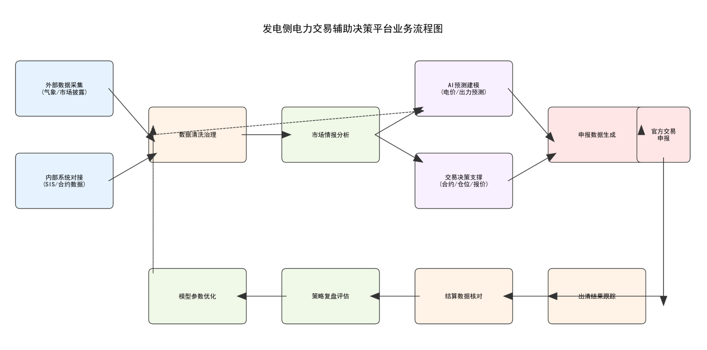

### 流程说明

> 本系统的业务流程围绕发电交易的全生命周期，构建了完整的闭环流转体系，各阶段的业务逻辑说明如下：

1.  数据采集阶段：系统并行完成两类基础数据的接入，解决传统模式下数据分散的痛点：

\- 外部数据：自动采集第三方高精度气象数据、电力交易中心的市场披露数据，为市场分析与预测提供外部输入；

\- 内部数据：对接企业内部的电厂SIS系统、合约管理系统，获取机组运行、发电出力、交易合约等内部业务数据。

2.  数据治理阶段：对采集到的多源异构数据进行统一的清洗、校验、去重与标准化处理，消除脏数据、统一数据格式，打破数据孤岛，为上层业务提供高质量、统一的基础数据底座。

3.  市场情报阶段：基于治理后的基础数据，系统自动完成市场供需、价格走势、气象影响的多维度分析，生成直观的市场情报看板，帮助交易员快速掌握市场整体态势，提前预判价格波动，解决传统人工研判效率低的问题。

4.  智能决策阶段：基于基础数据与情报分析结果，系统完成两类核心决策支撑，解决传统经验决策精度不足的问题： - AI预测：通过机器学习模型完成高精度的现货电价预测、新能源出力预测； - 策略制定：辅助交易员完成合约全生命周期管理、交易仓位动态调控、报价策略优化，自动识别套利机会、动态测算偏差考核风险，输出最优的交易决策方案。

5.  交易执行阶段：根据决策方案，系统自动生成符合官方要求的标准化交易申报数据，辅助交易员完成在官方交易平台的申报；申报完成后，系统实时跟踪市场出清结果，帮助交易员快速掌握中标情况，为后续交易日的策略调整提供依据，解决传统人工申报效率低、响应慢的问题。

6.  结算复盘阶：完成交易后的闭环优化，解决传统复盘效率低、策略迭代慢的问题：

\- 结算核对：自动完成结算数据的核对与异常预警，替代人工完成繁琐的结算校验工作；

\- 策略复盘：对历史交易策略的执行效果进行回溯评估，分析策略的收益与风险表现；

\- 模型优化：基于复盘结果，优化预测模型与决策参数，优化后的模型将反哺下一轮的交易决策，形成“决策-执行-优化”的完整业务闭环，实现策略的持续迭代进化。

## 系统模块划分

### 系统模块划分框图

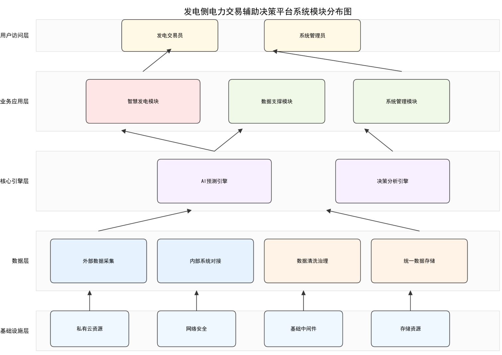

### 模块间接口分析

无

## 用户角色分析

统一设置角色权限管理，支持自定义设置角色与权限：

| **角色名称** | **角色定位** | **适用人员** |
|:---|:---|:---|
| 超级管理员 | 系统最高权限持有者，负责全局配置与租户管理 | 企业 IT 负责人、系统部署负责人 |
| 系统管理员 | 负责系统的日常运维与权限配置 | 企业内部系统运维人员 |
| 交易主管 | 交易团队的管理者，负责团队业务的统筹与审核 | 发电交易团队负责人 |
| 普通交易员 | 一线业务执行者，负责日常交易操作 | 一线发电交易员 |
| 运营运维人员 | 负责数据维护、报表运营的支撑人员 | 企业数据运营人员 |

系统采用三级权限控制体系，实现从功能到数据的全维度精细化管控，保障业务数据的安全与隔离：

1、功能权限：

菜单级权限：控制用户可见的系统菜单，比如普通交易员无法看到系统管理类的菜单，仅能访问业务相关的功能；

按钮级权限：控制页面内的操作按钮，比如普通交易员仅能查看结算数据，无法修改结算规则，仅授权的主管角色可执行修改操作。

2、数据权限：

支持按机组、按区域、按交易类型进行数据隔离，比如负责新能源机组的交易员，仅能查看新能源机组的交易数据，无法访问火电机组的敏感业务数据；

支持按用户维度的数据隔离，不同交易员仅能查看自己创建的交易策略，无法查看其他交易员的报价方案，保障核心交易策略的保密性。

3、操作权限：

针对敏感操作，比如提交大额交易申报、修改系统核心参数、删除历史业务数据，提供单独的操作权限，仅授权角色可执行，避免误操作；

支持操作的审批流配置，比如超过阈值的交易申报，需要交易主管审批后才能生效，通过权限配置实现业务流程的管控。

## 功能性需求

### 电力交易辅助决策平台

### 概述

发电侧电力交易辅助决策平台是面向发电企业打造的全流程智能化交易辅助系统，针对电力市场化改革下发电企业面临的人工交易效率低、决策精度不足、风险管控能力弱的痛点，围绕发电交易的全生命周期，构建了从数据接入、智能分析、决策支撑到执行复盘的完整闭环能力，助力发电企业实现交易业务的数字化、智能化转型。

###  业务事件

####  业务事件1 市场信息披露

<table style="width:84%;">
<colgroup>
<col style="width: 12%" />
<col style="width: 17%" />
<col style="width: 53%" />
</colgroup>
<thead>
<tr>
<th colspan="3" style="text-align: left;"><strong>界面逻辑说明</strong></th>
</tr>
</thead>
<tbody>
<tr>
<td style="text-align: left;"><strong>动作名称</strong></td>
<td style="text-align: left;"><strong>操作类型</strong></td>
<td style="text-align: left;"><strong>逻辑说明</strong></td>
</tr>
<tr>
<td colspan="3" style="text-align: left;">
<strong>市场信息披露</strong>

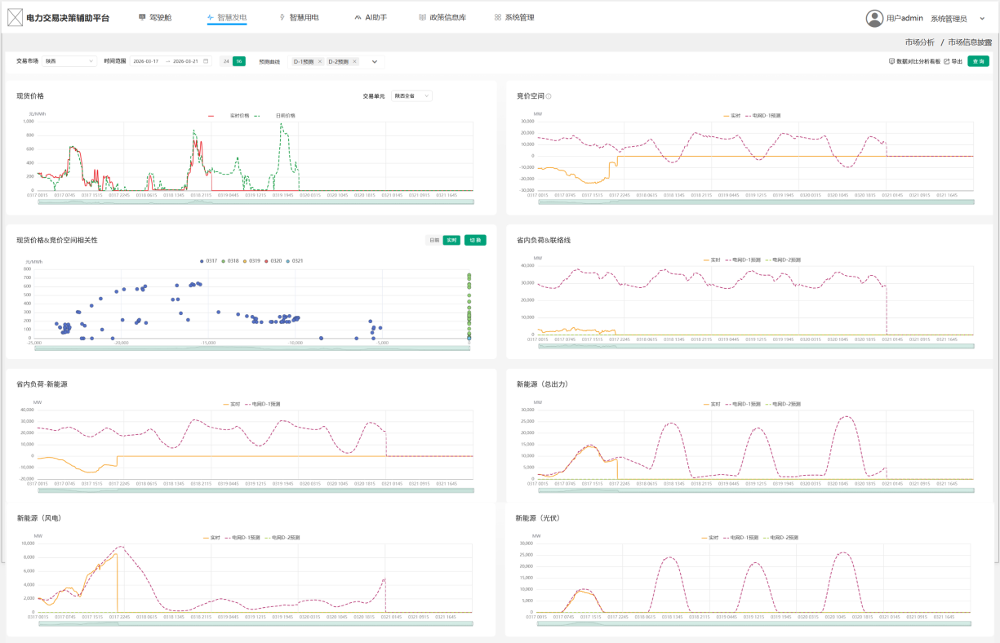

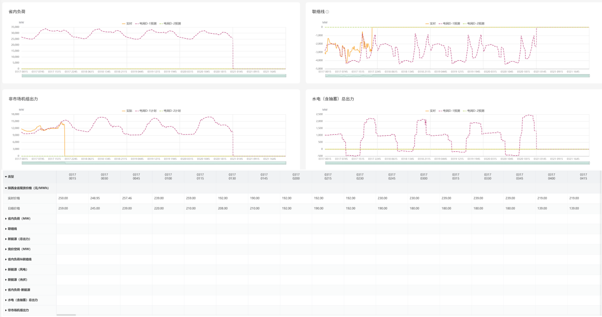
</td>
</tr>
<tr>
<td style="text-align: left;">交易市场</td>
<td style="text-align: left;">选择下拉框</td>
<td style="text-align: left;">
(1) 下拉框内容包含省且支持输入搜索

(2) 单选

(3) 用户具备某省交易单元权限，方可筛选出对应省份
</td>
</tr>
<tr>
<td style="text-align: left;">时间范围</td>
<td style="text-align: left;">选择时间控件</td>
<td style="text-align: left;">
(1) 时间周期最多选择 31 天

(2) 以日为最小单位选择连续多日时段，该时段选择对页面全部数据生 效；

(3) 默认为 D-2 至 D+2 日;
</td>
</tr>
<tr>
<td style="text-align: left;"><mark>颗粒度选择</mark></td>
<td style="text-align: left;"><mark>选择按钮</mark></td>
<td style="text-align: left;">
<mark>(1) 选择加载显示 96 点数据还是 24 点数据，默认为“96”；</mark>

<mark>(2) 所有数据 96-&gt;24 聚合采用均值逻辑；24-&gt;96 拆分采用复制逻辑；</mark>
</td>
</tr>
<tr>
<td style="text-align: left;">预测曲线</td>
<td style="text-align: left;">下拉多选</td>
<td style="text-align: left;">(1) 选择后控制下方图表中数据展示预测曲线，码值为D-1预测、D-2预测、D-3预测、D-4预测、D-5预测、D-6预测、D-7预测，默认选择D-1预测，D-2预测和D-3预测；</td>
</tr>
<tr>
<td style="text-align: left;">查询</td>
<td style="text-align: left;">单击按钮</td>
<td style="text-align: left;">(1) 根据时段选择和颗粒度选择查询并刷新所有图表；</td>
</tr>
<tr>
<td style="text-align: left;">数据对比分析看板</td>
<td style="text-align: left;">单击按钮</td>
<td style="text-align: left;">(1) 点击弹出长周期数据面板，浮窗方式</td>
</tr>
<tr>
<td style="text-align: left;">导出</td>
<td style="text-align: left;">单击按钮</td>
<td style="text-align: left;">
(1) 点击导出详细数据，excel 格式

(2) 内容同最下方详细数据表
</td>
</tr>
<tr>
<td style="text-align: left;">交易单元选择 (现货价格图表操作)</td>
<td style="text-align: left;">选择下拉框</td>
<td style="text-align: left;">
(1) 下拉框内容包含场站且支持输入搜索

(2) 单选

(3) “现货价格 ”与“现货价格&amp;竞价空间相关性 ”两张图数据生效

(4) 默认为陕西全省
</td>
</tr>
<tr>
<td style="text-align: left;">图表</td>
<td style="text-align: left;"></td>
<td style="text-align: left;">
(1) 图表中所有图例同步显示，“现货价格&amp;竞价空间相关性 ”除外

(2) 图表下方统一有缩放横条，拖拽后可缩放所选时间轴，且所有图表缩放同步，“现货价格&amp;竞价空间相关性 ”除外

(3) 图例鼠标获取焦点后，会高亮，点击可隐藏/显示，来回切换，所有 表格切换同步，”现货价格”与“现货价格&amp;竞价空间相关性 ”除外
</td>
</tr>
<tr>
<td style="text-align: left;">
日期选择

(<strong>现货价格&amp;竞价空间相关性图表操作</strong>)
</td>
<td style="text-align: left;">单击</td>
<td style="text-align: left;">
(1) 默认选择全部日期（同当前效果），也可逐天选择查看（日期范围 在当前全局选定的日期范围内）。

(2) 点击播放按钮后支持自动轮播，点击暂停停止，默认为暂停
</td>
</tr>
<tr>
<td colspan="2" style="text-align: left;"><strong>其他说明</strong></td>
<td style="text-align: left;"></td>
</tr>
</tbody>
</table>

**界面数据说明：**

<table style="width:84%;">
<colgroup>
<col style="width: 11%" />
<col style="width: 0%" />
<col style="width: 16%" />
<col style="width: 0%" />
<col style="width: 54%" />
</colgroup>
<thead>
<tr>
<th colspan="2" style="text-align: left;"><strong>数据名称</strong></th>
<th colspan="3" style="text-align: left;">市场供需数据</th>
</tr>
</thead>
<tbody>
<tr>
<td colspan="2" style="text-align: left;"><strong>编号</strong></td>
<td colspan="2" style="text-align: left;"><strong>内容</strong></td>
<td style="text-align: left;"><strong>说明或约束</strong></td>
</tr>
<tr>
<td colspan="2" style="text-align: left;">1.</td>
<td colspan="2" style="text-align: left;">现货价格</td>
<td style="text-align: left;">
（1）加载查看现货的日前和实时出清价格，单位 元/MWh

（2）如数据缺失则缺失点不展示，部分数据缺失不影响时轴

（3）数据来源：日前价格取爬虫的日前价格，实时价格取爬虫的实时价格
</td>
</tr>
<tr>
<td colspan="2" style="text-align: left;">2.</td>
<td colspan="2" style="text-align: left;">竞价空间</td>
<td style="text-align: left;"><ol type="1">
<li>
展示实时数据与电网预测数据，单位 MW
</li>
<li>
右上角角标展示计算公式“本图形计算逻辑为：省内负荷 &amp; 联络线 - 新能源 - 非市场机组出力 - 水电竞价空间”，展示曲线名称为“D-1预测、D-2预测、D-3预测、D-4预测、D-5预测、D-6预测、D-7预测”
</li>
<li>
竞价空间计算逻辑为：实时曲线=省内负荷实时+联络线实时-新能源（总出力）实时-非市场机组出力实时-水电实时；D-n预测曲线=省内负荷预测D-n+联络线预测D-n-新能源（总出力）预测D-n-非市场机组出力预测D-n-水电预测D-n
</li>
</ol>

</td>
</tr>
<tr>
<td style="text-align: left;">3.</td>
<td colspan="2" style="text-align: left;">省内负荷&amp;联络线</td>
<td colspan="2" style="text-align: left;">
（1）展示实时数据与电网预测数据,单位 MW

（2）数据来源公式为：

省内负荷&amp;联络线=省内负荷+联络线绝对值

实时曲线用实时数据相加，预测曲线用预测数据相加，展示曲线名称为“D-1预测、D-2预测、D-3预测、D-4预测、D-5预测、D-6预测、D-7预测”
</td>
</tr>
<tr>
<td style="text-align: left;">4.</td>
<td colspan="2" style="text-align: left;">省内负荷-新能源</td>
<td colspan="2" style="text-align: left;">
（1）展示实时数据与电网预测数据,单位 MW

（2）数据来源公式为：省内负荷-新能源

实时曲线用实时数据相减，预测曲线用预测数据相减，展示曲线名称为“D-1预测、D-2预测、D-3预测、D-4预测、D-5预测、D-6预测、D-7预测”
</td>
</tr>
<tr>
<td style="text-align: left;">5.</td>
<td colspan="2" style="text-align: left;">新能源（总出力）</td>
<td colspan="2" style="text-align: left;">
（1）展示实时数据与多源预测数据，单位 MW

（2）预测数据包括电网D-1预测、电网D-2预测、电网D-3预测、电网D-4预测、电网D-5预测、电网D-6预测、电网D-7预测或拟合D-1预测、拟合D-2预测、拟合D-3预测、拟合D-4预测、拟合D-5预测、拟合D-6预测、拟合D-7预测

（3）实际数据和预测数据取爬虫，预测数据爬虫有时取爬虫，没有时需算法拟合，取爬虫数据时预测数据名称为电网D-n预测，取算法数据时预测数据名称为拟合D-n预测
</td>
</tr>
<tr>
<td style="text-align: left;">6.</td>
<td colspan="2" style="text-align: left;">新能源（风电）</td>
<td colspan="2" style="text-align: left;">
（1）展示实时数据与多源预测数据，单位 MW

2）预测数据包括电网D-1预测、电网D-2预测、电网D-3预测、电网D-4预测、电网D-5预测、电网D-6预测、电网D-7预测或拟合D-1预测、拟合D-2预测、拟合D-3预测、拟合D-4预测、拟合D-5预测、拟合D-6预测、拟合D-7预测

（3）实际数据和预测数据取爬虫，预测数据爬虫有时取爬虫，没有时需算法拟合，取爬虫数据时预测数据名称为电网D-n预测，取算法数据时预测数据名称为拟合D-n预测
</td>
</tr>
<tr>
<td style="text-align: left;">7.</td>
<td colspan="2" style="text-align: left;">新能源（光伏）</td>
<td colspan="2" style="text-align: left;">
（1）展示实时数据与多源预测数据，单位 MW

2）预测数据包括电网D-1预测、电网D-2预测、电网D-3预测、电网D-4预测、电网D-5预测、电网D-6预测、电网D-7预测或拟合D-1预测、拟合D-2预测、拟合D-3预测、拟合D-4预测、拟合D-5预测、拟合D-6预测、拟合D-7预测

（3）实际数据和预测数据取爬虫，预测数据爬虫有时取爬虫，没有时需算法拟合，取爬虫数据时预测数据名称为电网D-n预测，取算法数据时预测数据名称为拟合D-n预测
</td>
</tr>
<tr>
<td style="text-align: left;">8.</td>
<td colspan="2" style="text-align: left;">省内负荷</td>
<td colspan="2" style="text-align: left;">
（1）展示实时数据与电网预测数据，单位 MW

2）预测数据包括电网D-1预测、电网D-2预测、电网D-3预测、电网D-4预测、电网D-5预测、电网D-6预测、电网D-7预测或拟合D-1预测、拟合D-2预测、拟合D-3预测、拟合D-4预测、拟合D-5预测、拟合D-6预测、拟合D-7预测

（3）实际数据和预测数据取爬虫，预测数据爬虫有时取爬虫，没有时需算法拟合，取爬虫数据时预测数据名称为电网D-n预测，取算法数据时预测数据名称为拟合D-n预测
</td>
</tr>
<tr>
<td style="text-align: left;">7.</td>
<td colspan="2" style="text-align: left;">联络线</td>
<td colspan="2" style="text-align: left;">
（1）展示实时数据与电网预测数据，单位 MW

2）预测数据包括电网D-1预测、电网D-2预测、电网D-3预测、电网D-4预测、电网D-5预测、电网D-6预测、电网D-7预测或拟合D-1预测、拟合D-2预测、拟合D-3预测、拟合D-4预测、拟合D-5预测、拟合D-6预测、拟合D-7预测

（3）实际数据和预测数据取爬虫，预测数据爬虫有时取爬虫，没有时需算法拟合，取爬虫数据时预测数据名称为电网D-n预测，取算法数据时预测数据名称为拟合D-n预测

提示文案：本平台联络线正负号代表输送方向，负值代表卖出，正值代表买入。
</td>
</tr>
<tr>
<td style="text-align: left;">8.</td>
<td colspan="2" style="text-align: left;">非市场机组出力</td>
<td colspan="2" style="text-align: left;">
（1）展示实时数据与多源预测数据，单位 MW

2）预测数据包括电网D-1预测、电网D-2预测、电网D-3预测、电网D-4预测、电网D-5预测、电网D-6预测、电网D-7预测或拟合D-1预测、拟合D-2预测、拟合D-3预测、拟合D-4预测、拟合D-5预测、拟合D-6预测、拟合D-7预测

（3）实际数据和预测数据取爬虫，预测数据爬虫有时取爬虫，没有时需算法拟合，取爬虫数据时预测数据名称为电网D-n预测，取算法数据时预测数据名称为拟合D-n预测
</td>
</tr>
<tr>
<td style="text-align: left;">9.</td>
<td colspan="2" style="text-align: left;">水电（含抽蓄）总出力</td>
<td colspan="2" style="text-align: left;">
（1）展示实时数据与多源预测数据，单位 MW

2）预测数据包括电网D-1预测、电网D-2预测、电网D-3预测、电网D-4预测、电网D-5预测、电网D-6预测、电网D-7预测或拟合D-1预测、拟合D-2预测、拟合D-3预测、拟合D-4预测、拟合D-5预测、拟合D-6预测、拟合D-7预测

（3）实际数据和预测数据取爬虫，预测数据爬虫有时取爬虫，没有时需算法拟合，取爬虫数据时预测数据名称为电网D-n预测，取算法数据时预测数据名称为拟合D-n预测
</td>
</tr>
<tr>
<td style="text-align: left;">10.</td>
<td colspan="2" style="text-align: left;">现货价格&amp;竞价空间相关性</td>
<td colspan="2" style="text-align: left;">
(1) 实时价格与竞价空间相关性：以时点的 ”省内现货&amp;联络线-新能源实时值“为 x 值，以同时点对应的“所选交易单元实时出清价格” 为 y 值形成的【实时价格与竞价空间相关性】散点图

(2) 日前价格与竞价空间相关性：以时点的 ”省内现货&amp;联络线-新能源 电网 D-1 预测“为 x 值，以同时点对应的“所选交易单元日前出清价格”为 y 值形成的【日前价格与竞价空间相关性】散点图

(3) 由于所加载日期范围和时间颗粒度不同，散点数量也会有差异，单组 图散点数量为加载天数 n*颗粒度个，如加载 7 月 12 到 14，颗粒度选择 96， 则日前和实时相关性图应各有 3*96 个点
</td>
</tr>
<tr>
<td style="text-align: left;">11.</td>
<td colspan="2" style="text-align: left;">数据详情表</td>
<td colspan="2" style="text-align: left;">展示除了“现货价格&amp;竞价空间相关性”的其他图表在所选时间开始时间至结束时间的实时数据和预测数据</td>
</tr>
<tr>
<td colspan="3" style="text-align: left;"><strong>其他特殊说明</strong></td>
<td colspan="2" style="text-align: left;">(1) 电价小数点保留两位，电量小数点保留三位</td>
</tr>
</tbody>
</table>

<table style="width:84%;">
<colgroup>
<col style="width: 12%" />
<col style="width: 17%" />
<col style="width: 53%" />
</colgroup>
<thead>
<tr>
<th colspan="3" style="text-align: left;"><strong>界面逻辑说明</strong></th>
</tr>
</thead>
<tbody>
<tr>
<td style="text-align: left;"><strong>动作名称</strong></td>
<td style="text-align: left;"><strong>操作类型</strong></td>
<td style="text-align: left;"><strong>逻辑说明</strong></td>
</tr>
<tr>
<td colspan="3" style="text-align: left;">
<strong>数据对比看板分析-数据对比分析</strong>

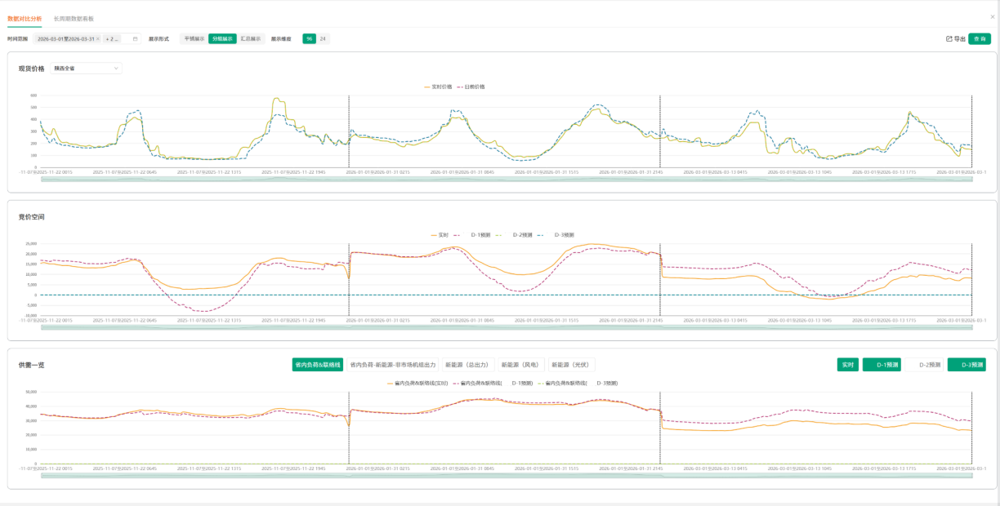
</td>
</tr>
<tr>
<td style="text-align: left;">时间范围</td>
<td style="text-align: left;">选择时间控件</td>
<td style="text-align: left;">
(1) 时间周期最多选择 31 天

(2) 以日为最小单位选择连续多日时段，该时段选择对页面全部数据生效；

(3) 默认与市场供需数据所选的时间范围保持一致；

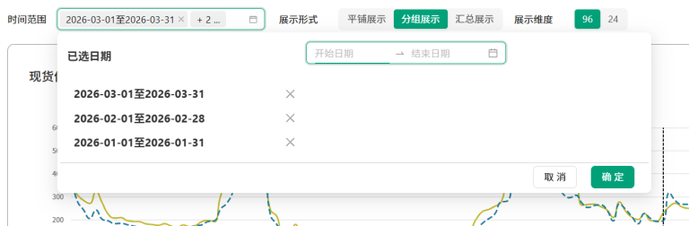
</td>
</tr>
<tr>
<td style="text-align: left;">展示形式</td>
<td style="text-align: left;">切换按钮</td>
<td style="text-align: left;">
(1) 默认为平铺展示

(2) 支持在平铺展示、分组展示、汇总展示中切换，切换后点击【查询】按所选形式展示图表数据；

(3) 平铺展示：根据所选时间范围按每日96时点或24时点连续平铺展示所有数据；

(4) 分组展示：根据所选时间范围分组按每日96时点或24时点展示时间范围内汇总的各时点数据；

(5) 汇总展示：汇总所选时间范围按24时点或96时点对每个时点进行汇总数据展示；
</td>
</tr>
<tr>
<td style="text-align: left;">展示维度</td>
<td style="text-align: left;">选择按钮</td>
<td style="text-align: left;">
(1) 选择加载显示 96 点数据还是 24 点数据，默认为“96”；

(2) 所有数据 96-&gt;24 聚合采用均值逻辑；24-&gt;96 拆分采用复制逻辑；
</td>
</tr>
<tr>
<td style="text-align: left;">交易单元选择（现货价格）</td>
<td style="text-align: left;">下拉选择</td>
<td style="text-align: left;">默认与市场供需数据中现货价格所选的交易单元一致，支持下拉单选，选择后刷新现货价格图表</td>
</tr>
<tr>
<td style="text-align: left;">查询</td>
<td style="text-align: left;">单击按钮</td>
<td style="text-align: left;">(1) 根据时段选择、展示形式、展示维度选择查询并刷新所有图表；</td>
</tr>
<tr>
<td style="text-align: left;">导出</td>
<td style="text-align: left;">单击按钮</td>
<td style="text-align: left;">
按查询结果以Excel形式导出数据

</td>
</tr>
<tr>
<td style="text-align: left;">现货价格</td>
<td style="text-align: left;">图表</td>
<td style="text-align: left;">按折线图展示实时价格、日前价格；</td>
</tr>
<tr>
<td style="text-align: left;">竞价空间</td>
<td style="text-align: left;">图表</td>
<td style="text-align: left;">按折线图展示竞价空间实时、D-1预测、D-2预测、D-3预测数据；</td>
</tr>
<tr>
<td style="text-align: left;">供需一览</td>
<td style="text-align: left;">图表</td>
<td style="text-align: left;">按折线图展示，可多选省内负荷&amp;联络线、省内负荷-新能源-非市场机组出力、新能源（总出力）、新能源（风电）、新能源（光伏），分别展示实时、D-1预测、D-2预测、D-3预测数据；</td>
</tr>
</tbody>
</table>

<table style="width:84%;">
<colgroup>
<col style="width: 12%" />
<col style="width: 17%" />
<col style="width: 53%" />
</colgroup>
<thead>
<tr>
<th colspan="3" style="text-align: left;"><strong>界面逻辑说明</strong></th>
</tr>
</thead>
<tbody>
<tr>
<td style="text-align: left;"><strong>动作名称</strong></td>
<td style="text-align: left;"><strong>操作类型</strong></td>
<td style="text-align: left;"><strong>逻辑说明</strong></td>
</tr>
<tr>
<td colspan="3" style="text-align: left;">
<strong>数据对比看板分析-长周期数据看板</strong>

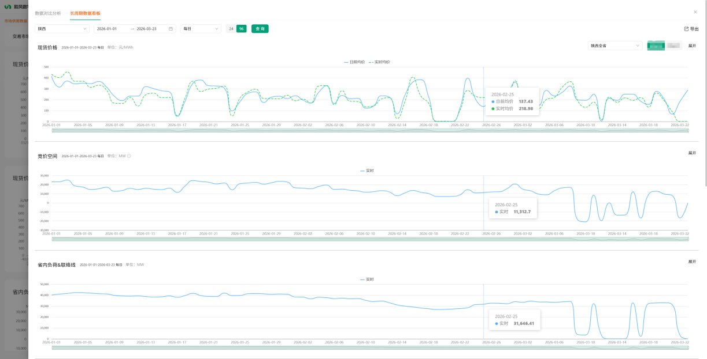

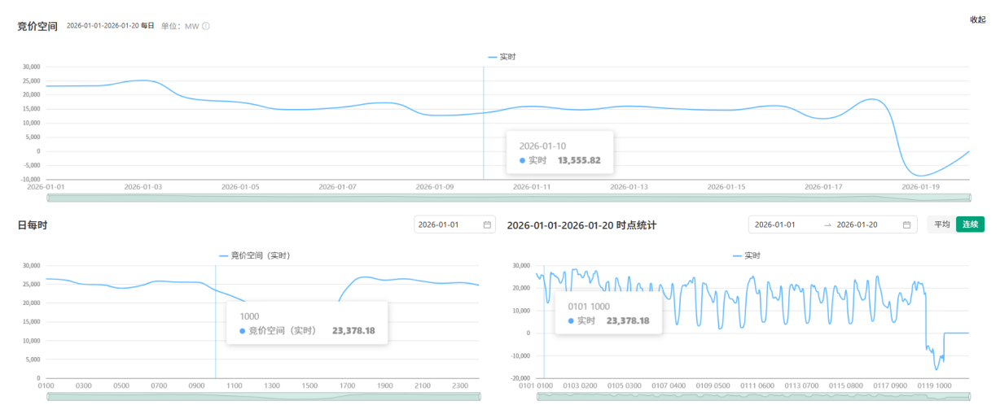

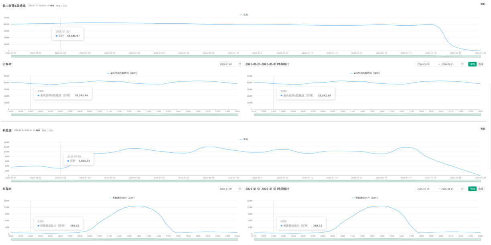

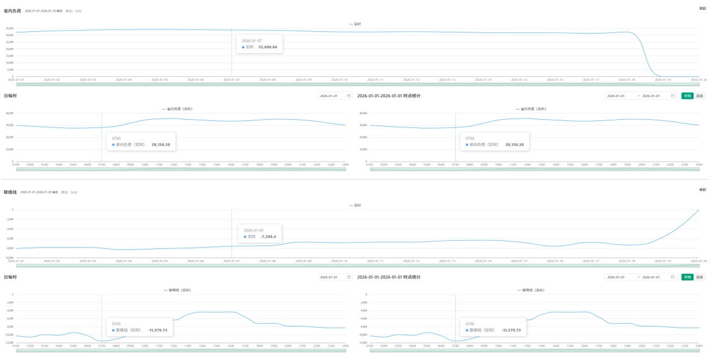
</td>
</tr>
<tr>
<td style="text-align: left;">交易市场</td>
<td style="text-align: left;">下拉选择框</td>
<td style="text-align: left;">
(1) 默认与市场供需数据选择的交易市场一致

(2) 下拉展示有权限的交易市场可单选
</td>
</tr>
<tr>
<td style="text-align: left;">时间范围</td>
<td style="text-align: left;">日期选择器</td>
<td style="text-align: left;"><ol type="1">
<li>
日期选择可选择连续的日期，所选截止日期不能超过当前日期；
</li>
</ol>

(2) 默认与市场供需数据所选的时间范围保持一致；
</td>
</tr>
<tr>
<td style="text-align: left;">周期维度</td>
<td style="text-align: left;">下拉选择框</td>
<td style="text-align: left;">默认为每日，可选择每日、每周、每月，选择后查询图表根据所选维度展示所选日期日或周或月的数据</td>
</tr>
<tr>
<td style="text-align: left;">展示维度</td>
<td style="text-align: left;">选择按钮</td>
<td style="text-align: left;">
(1) 选择加载显示 96 点数据还是 24 点数据，默认为“96”；

(2) 所有数据 96-&gt;24 聚合采用均值逻辑；24-&gt;96 拆分采用复制逻辑；
</td>
</tr>
<tr>
<td style="text-align: left;">交易单元选择（现货价格）</td>
<td style="text-align: left;">下拉选择</td>
<td style="text-align: left;">默认与市场供需数据中现货价格所选的交易单元一致，支持下拉单选，选择后刷新现货价格图表</td>
</tr>
<tr>
<td style="text-align: left;">查询</td>
<td style="text-align: left;">单击按钮</td>
<td style="text-align: left;">(1) 根据时段选择、展示形式、展示维度选择查询并刷新所有图表；</td>
</tr>
<tr>
<td style="text-align: left;">导出</td>
<td style="text-align: left;">单击按钮</td>
<td style="text-align: left;">按查询结果以Excel形式导出数据</td>
</tr>
<tr>
<td style="text-align: left;">现货价格</td>
<td style="text-align: left;">图表</td>
<td style="text-align: left;">
按折线图展示日前均价、实时均价数据；

点击展开后可选择具体日期展示当日的时点数据折线图和时间段内的时点数据折线图，可切换平均或连续
</td>
</tr>
<tr>
<td style="text-align: left;">竞价空间</td>
<td style="text-align: left;">图表</td>
<td style="text-align: left;">
折线图展示竞价空间实时数据；

点击展开可查询竞价空间实时数据所选日期的时点数和所选连续日期的时点数，可切换平均或连续，平均即为展示所选时间范围，每个时点的平均值；连续即为所选时间范围每日每个时点值；
</td>
</tr>
<tr>
<td style="text-align: left;">省内负荷&amp;联络线</td>
<td style="text-align: left;">图表</td>
<td style="text-align: left;">
折线图展示省内负荷&amp;联络线实时数据；

点击展开可查询省内负荷&amp;联络线实时数据所选日期的时点数和所选连续日期的时点数，可切换平均或连续
</td>
</tr>
<tr>
<td style="text-align: left;">新能源</td>
<td style="text-align: left;">图表</td>
<td style="text-align: left;">
折线图展示新能源实时数据；

点击展开可查询新能源实时数据所选日期的时点数和所选连续日期的时点数，可切换平均或连续
</td>
</tr>
<tr>
<td style="text-align: left;">省内负荷</td>
<td style="text-align: left;">图表</td>
<td style="text-align: left;">
折线图展示省内负荷实时数据；

点击展开可查询省内负荷实时数据所选日期的时点数和所选连续日期的时点数，可切换平均或连续
</td>
</tr>
<tr>
<td style="text-align: left;">联络线</td>
<td style="text-align: left;">图表</td>
<td style="text-align: left;">
折线图展示联络线实时数据；

点击展开可查询联络线实时数据所选日期的时点数和所选连续日期的时点数，可切换平均或连续
</td>
</tr>
</tbody>
</table>

####  业务事件2 节点价格对比

<table style="width:84%;">
<colgroup>
<col style="width: 12%" />
<col style="width: 17%" />
<col style="width: 53%" />
</colgroup>
<thead>
<tr>
<th colspan="3" style="text-align: left;"><strong>界面逻辑说明</strong></th>
</tr>
</thead>
<tbody>
<tr>
<td style="text-align: left;"><strong>动作名称</strong></td>
<td style="text-align: left;"><strong>操作类型</strong></td>
<td style="text-align: left;"><strong>逻辑说明</strong></td>
</tr>
<tr>
<td colspan="3" style="text-align: left;">
路径：智慧发电-市场分析-节点价格对比

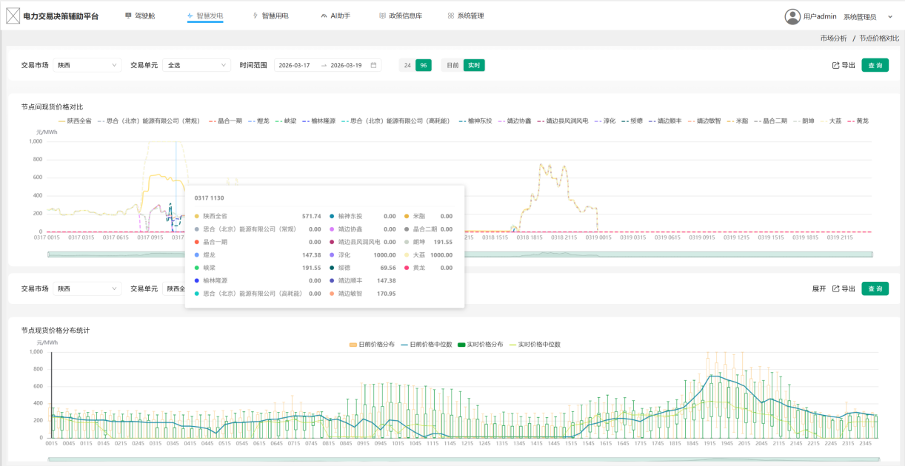

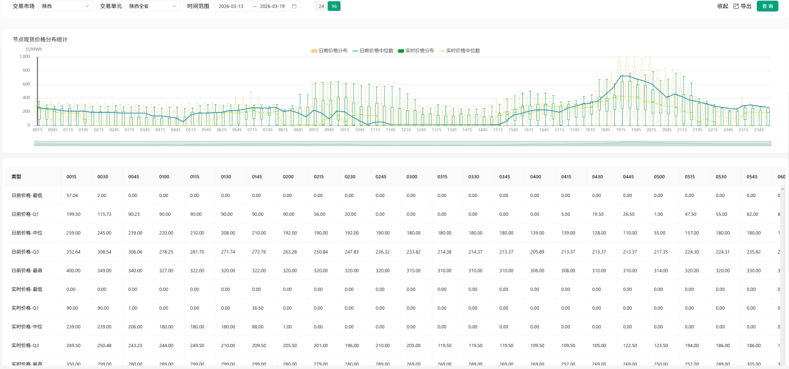
</td>
</tr>
<tr>
<td style="text-align: left;">交易市场</td>
<td style="text-align: left;">选择下拉框</td>
<td style="text-align: left;">
(1) 下拉框内容包含省且支持输入搜索

(2) 单选

(3) 用户具备某省交易单元权限，方可筛选出对应省份；
</td>
</tr>
<tr>
<td style="text-align: left;">交易单元</td>
<td style="text-align: left;">选择下拉框</td>
<td style="text-align: left;">
(1) 下拉框内容包含省且支持输入搜索

(2) 多选，默认全部

(3) 联动展示所所选交易市场的交易单元
</td>
</tr>
<tr>
<td style="text-align: left;">时间范围</td>
<td style="text-align: left;">选择时间控件</td>
<td style="text-align: left;"><ol type="1">
<li>
以日为最小单位选择连续多日时段
</li>
</ol>

(2) 默认为 D-3 至 D-1 日;

(3) 不可选择 D 日之后的日期
</td>
</tr>
<tr>
<td style="text-align: left;">颗粒度选择</td>
<td style="text-align: left;">选择按钮</td>
<td style="text-align: left;">
(1) 选择加载显示 96 点数据还是 24 点数据，默认为“96”；

(2) 所有数据 96-&gt;24 聚合采用均值逻辑；24-&gt;96 拆分采用复制逻辑；
</td>
</tr>
<tr>
<td style="text-align: left;">查询</td>
<td style="text-align: left;">单击按钮</td>
<td style="text-align: left;">(1) 根据时段选择和颗粒度选择查询并刷新；</td>
</tr>
<tr>
<td style="text-align: left;">导出</td>
<td style="text-align: left;">单击按钮</td>
<td style="text-align: left;">(1) 按查询数据将查询结果以Excel表形式导出；</td>
</tr>
<tr>
<td style="text-align: left;">日前/实时切换</td>
<td style="text-align: left;">单击按钮</td>
<td style="text-align: left;">
(1) 点击日前切换到日前价格，点击实时切换到实时价格

(2) 默认实时

(3) 切换后即时刷新图
</td>
</tr>
<tr>
<td style="text-align: left;">图表</td>
<td style="text-align: left;"></td>
<td style="text-align: left;">
(1) 图表下方有缩放横条，可拖拉

(2) 图例鼠标获取焦点后，会高亮，点击可隐藏/显示，来回切换

(3) 鼠标移上展示数据详情浮框，多日间采用竖线间隔
</td>
</tr>
<tr>
<td style="text-align: left;"><strong>动作名称</strong></td>
<td style="text-align: left;"><strong>操作类型</strong></td>
<td style="text-align: left;"><strong>逻辑说明</strong></td>
</tr>
<tr>
<td colspan="3" style="text-align: left;">
<strong>节点现货价格分布统计</strong>

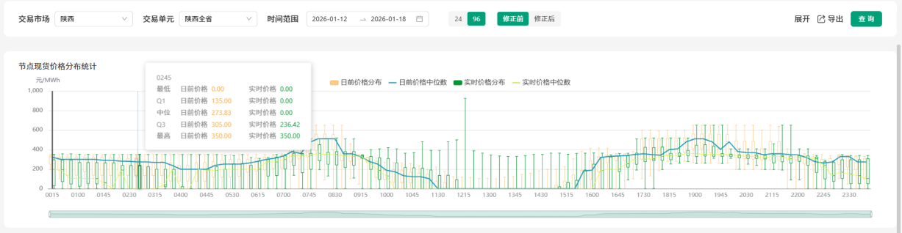
</td>
</tr>
<tr>
<td style="text-align: left;">交易市场</td>
<td style="text-align: left;">选择下拉框</td>
<td style="text-align: left;">
(1) 下拉框内容包含省且支持输入搜索

(2) 单选

(3) 用户具备某省交易单元权限，方可筛选出对应省份
</td>
</tr>
<tr>
<td style="text-align: left;">场站选择</td>
<td style="text-align: left;">选择下拉框</td>
<td style="text-align: left;">
(1) 在所选交易市场下，在用户有数据权限的交易单元范围内，选择需要比对的单元，且支持输入搜索

(2) 支持单选

(3) 默认展示所选交易市场全省
</td>
</tr>
<tr>
<td style="text-align: left;">时间范围</td>
<td style="text-align: left;">选择时间控件</td>
<td style="text-align: left;"><ol type="1">
<li>
以日为最小单位选择连续多日时段
</li>
</ol>

(2) 默认为 D-7至 D-1日;

(3) 不可选择D日之后的日期
</td>
</tr>
<tr>
<td style="text-align: left;">颗粒度选择</td>
<td style="text-align: left;">选择按钮</td>
<td style="text-align: left;">
(1) 选择加载显示 96 点数据还是 24 点数据，默认为“96”；

(2) 所有数据 96-&gt;24 聚合采用均值逻辑；24-&gt;96 拆分采用复制逻辑；
</td>
</tr>
<tr>
<td style="text-align: left;">查询</td>
<td style="text-align: left;">单击按钮</td>
<td style="text-align: left;">(1) 根据时段选择和颗粒度选择查询并刷新；</td>
</tr>
<tr>
<td style="text-align: left;">图表</td>
<td style="text-align: left;"></td>
<td style="text-align: left;">(1) 图例鼠标获取焦点后，会高亮，点击可隐藏/显示，来回切换</td>
</tr>
<tr>
<td style="text-align: left;">导出</td>
<td style="text-align: left;">单机按钮</td>
<td style="text-align: left;">(1) 点击导出数据详情表 excel</td>
</tr>
<tr>
<td style="text-align: left;">展开/收起</td>
<td style="text-align: left;">单机按钮</td>
<td style="text-align: left;"><ol type="1">
<li>
点击后显示/隐藏数据详情表
</li>
</ol>

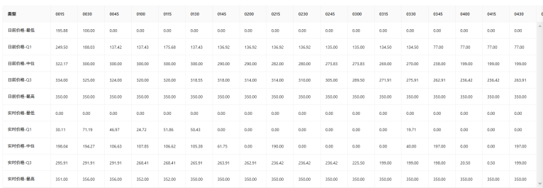
</td>
</tr>
<tr>
<td colspan="2" style="text-align: left;"><strong>其他说明</strong></td>
<td style="text-align: left;"></td>
</tr>
</tbody>
</table>

**界面数据说明：**

<table style="width:84%;">
<colgroup>
<col style="width: 11%" />
<col style="width: 16%" />
<col style="width: 54%" />
</colgroup>
<thead>
<tr>
<th style="text-align: left;"><strong>数据名称</strong></th>
<th colspan="2" style="text-align: left;">节点价格对比</th>
</tr>
</thead>
<tbody>
<tr>
<td style="text-align: left;"><strong>编号</strong></td>
<td style="text-align: left;"><strong>内容</strong></td>
<td style="text-align: left;"><strong>说明或约束</strong></td>
</tr>
<tr>
<td style="text-align: left;">1.</td>
<td style="text-align: left;">节点间现货价格对比</td>
<td style="text-align: left;">
（1）加载查看多场站现货的日前和实时出清价格,单位 元/MWh

（2）如数据缺失则缺失点不展示，部分数据缺失不影响时轴
</td>
</tr>
<tr>
<td style="text-align: left;">2.</td>
<td style="text-align: left;">节点现货价格分布统计</td>
<td style="text-align: left;">
（1）展示单场站现货实时价格数据与日前价格数据分布,单位元/MWh

（2）数据字段分为：最低、Q1 、中位、Q3 、最高

（3）将日期范围内数据平均到一天 96/24 个时点，每个时间排序得出最低、Q1 、中位、Q3 、最高的值，Q1 为 25%位置值，Q3 为 75%位置值

（4）详细数据表中横列为平铺一天 96/24 个时点，纵列为日前价格与实时价格的最低、Q1 、中位、Q3 、最高值
</td>
</tr>
<tr>
<td colspan="2" style="text-align: left;"><strong>其他特殊说明</strong></td>
<td style="text-align: left;">电价小数点保留两位，电量小数点保留三位</td>
</tr>
</tbody>
</table>

####  业务事件3 市场出清概况

<table style="width:84%;">
<colgroup>
<col style="width: 12%" />
<col style="width: 17%" />
<col style="width: 53%" />
</colgroup>
<thead>
<tr>
<th colspan="3" style="text-align: left;"><strong>界面逻辑说明</strong></th>
</tr>
</thead>
<tbody>
<tr>
<td style="text-align: left;"><strong>动作名称</strong></td>
<td style="text-align: left;"><strong>操作类型</strong></td>
<td style="text-align: left;"><strong>逻辑说明</strong></td>
</tr>
<tr>
<td colspan="3" style="text-align: left;"><strong>路径：智慧发电-市场分析-市场出清概况</strong>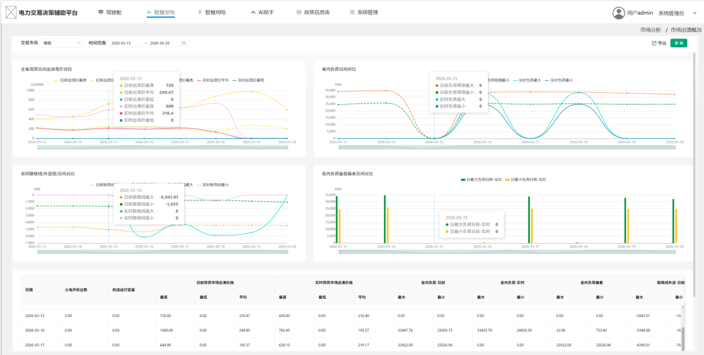</td>
</tr>
<tr>
<td style="text-align: left;">交易市场选择</td>
<td style="text-align: left;">选择下拉框</td>
<td style="text-align: left;">
(1) 用户具备某省交易单元权限，方可筛选出对应省份

(2) 下拉框内容包含省且支持输入搜索

(3) 单选
</td>
</tr>
<tr>
<td style="text-align: left;">时间选择</td>
<td style="text-align: left;">选择时间控件</td>
<td style="text-align: left;">
(1) 以日为最小单位选择连续多日时段

(2) 默认为 D-6 至 D 日;

(3) 不可选择 D 日之后的日期
</td>
</tr>
<tr>
<td style="text-align: left;">查询</td>
<td style="text-align: left;">单击按钮</td>
<td style="text-align: left;">(1) 根据时段选择和颗粒度选择查询并刷新；</td>
</tr>
<tr>
<td style="text-align: left;">导出</td>
<td style="text-align: left;">单击按钮</td>
<td style="text-align: left;">(1) 点击导出详细数据 excel</td>
</tr>
<tr>
<td style="text-align: left;">图表</td>
<td style="text-align: left;"></td>
<td style="text-align: left;">(1) 图例鼠标获取焦点后，会高亮，点击可隐藏/显示，来回切换</td>
</tr>
<tr>
<td colspan="2" style="text-align: left;"><strong>其他说明</strong></td>
<td style="text-align: left;"></td>
</tr>
</tbody>
</table>

**界面数据说明：**

<table style="width:84%;">
<colgroup>
<col style="width: 11%" />
<col style="width: 16%" />
<col style="width: 54%" />
</colgroup>
<thead>
<tr>
<th style="text-align: left;"><strong>数据名称</strong></th>
<th colspan="2" style="text-align: left;">市场出清概况</th>
</tr>
</thead>
<tbody>
<tr>
<td style="text-align: left;"><strong>编号</strong></td>
<td style="text-align: left;"><strong>内容</strong></td>
<td style="text-align: left;"><strong>说明或约束</strong></td>
</tr>
<tr>
<td style="text-align: left;">1.</td>
<td style="text-align: left;">全省现货日间出清电价对比</td>
<td style="text-align: left;">
（1）展示所选日期范围内每日的日前出清价最高/最低/平均值,单位元 /MWh

（2）展示所选日期范围内每日的实时出清价最高/最低/平均值,单位 元 /MWh
</td>
</tr>
<tr>
<td style="text-align: left;">2.</td>
<td style="text-align: left;">省内负荷日间对比</td>
<td style="text-align: left;">
（1）展示所选日期范围内每日的日前负荷预测最高/最低,单位 MW，日前负荷取所在日前预测的D+1日数据

（2）展示所选日期范围内每日的实时负荷预测最高/最低，单位 MW
</td>
</tr>
<tr>
<td style="text-align: left;">3.</td>
<td style="text-align: left;">省间联络线（外送值）日间对比</td>
<td style="text-align: left;">
（1）展示所选日期范围内每日的日前联络线值最高/最低，单位 MW，日前联络线取所在日前预测的D+1日数据

（2）展示所选日期范围内每日的实时联络线值最高/最低，单位 MW
</td>
</tr>
<tr>
<td style="text-align: left;">4.</td>
<td style="text-align: left;">省内负荷最值偏差日间对比</td>
<td style="text-align: left;">
（1）展示所选日期范围内每日的日最大负荷“实时-日前 ”，单位 MW

（2）展示所选日期范围内每日的日最小负荷 “实时-日前”，单位 MW
</td>
</tr>
<tr>
<td style="text-align: left;">5.</td>
<td style="text-align: left;">数据详情表</td>
<td style="text-align: left;">
（1）日前现货市场出清价格最高、最低、平均

（2）实时现货市场出清价格最高、最低、平均

（3）省内负荷-日前最大、最小

（4）省内负荷-实时最大、最小

（5）省内负荷偏差最大负荷偏差、最小负荷偏差

（6）联络线外送-日前最大、最小

（7）联络线外送-实时最大、最小

（8）合计：求平均值
</td>
</tr>
<tr>
<td colspan="2" style="text-align: left;"><strong>其他特殊说明</strong></td>
<td style="text-align: left;">电价小数点保留两位，电量小数点保留三位</td>
</tr>
</tbody>
</table>

####  业务事件4 现货供需分析

<table style="width:84%;">
<colgroup>
<col style="width: 12%" />
<col style="width: 17%" />
<col style="width: 53%" />
</colgroup>
<thead>
<tr>
<th colspan="3" style="text-align: left;"><strong>界面逻辑说明</strong></th>
</tr>
</thead>
<tbody>
<tr>
<td style="text-align: left;"><strong>动作名称</strong></td>
<td style="text-align: left;"><strong>操作类型</strong></td>
<td style="text-align: left;"><strong>逻辑说明</strong></td>
</tr>
<tr>
<td colspan="3" style="text-align: left;">
<strong>路径：智慧发电-市场分析-现货供需分析</strong>

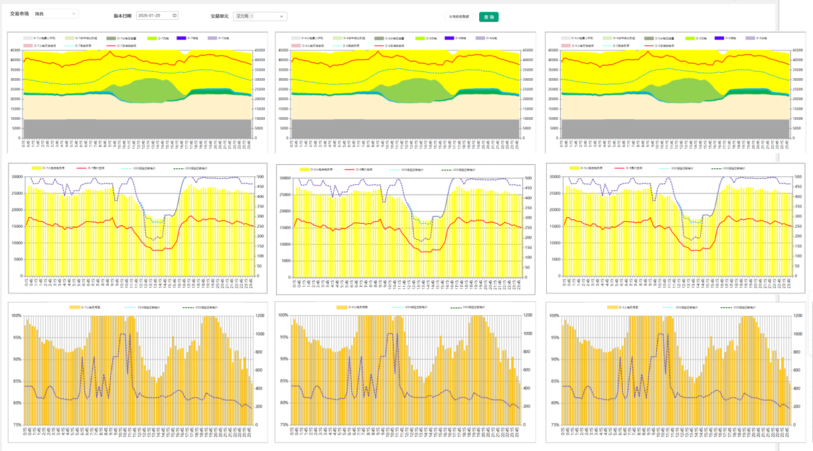

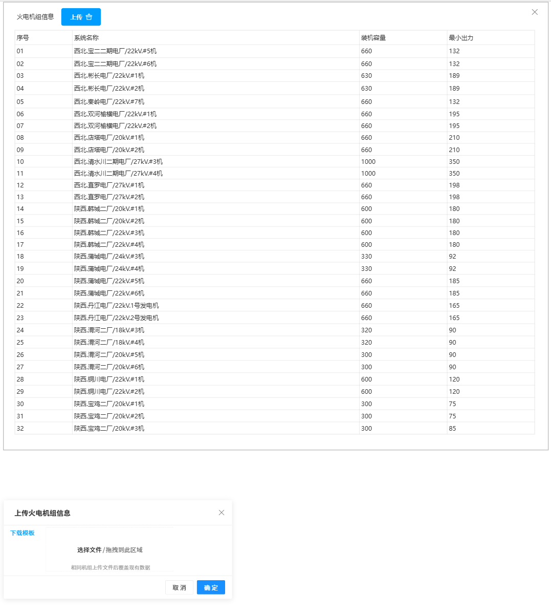
</td>
</tr>
<tr>
<td style="text-align: left;">交易市场</td>
<td style="text-align: left;">选择下拉框</td>
<td style="text-align: left;">
(1) 用户具备某省交易单元权限，方可筛选出对应省份

(2) 下拉框内容包含省且支持输入搜索

(3) 单选
</td>
</tr>
<tr>
<td style="text-align: left;">版本日期</td>
<td style="text-align: left;">日期选择控件</td>
<td style="text-align: left;">
(1) 展开日历选择单日

(2) 默认为当前日;
</td>
</tr>
<tr>
<td style="text-align: left;">交易单元</td>
<td style="text-align: left;">下拉多选框</td>
<td style="text-align: left;">
(1) 联动交易市场展示有权限的交易单元

(2) 默认为第一个交易单元，可多选，交易单元选择后查询刷新右侧图表数据，选择多个交易单元则展示多条曲线
</td>
</tr>
<tr>
<td style="text-align: left;">查询</td>
<td style="text-align: left;">单击按钮</td>
<td style="text-align: left;">(1) 根据筛选条件查询并刷新；</td>
</tr>
<tr>
<td style="text-align: left;">火电机组数据</td>
<td style="text-align: left;">单击按钮</td>
<td style="text-align: left;"><ol type="1">
<li>
点击后右侧弹出栏展示导入的火电机组数据，如果未导入则展示空表头；
</li>
<li>
点击【上传】后在弹窗中可【下载模板】或选择文件上传，将所选文件拖入目标区域也可完成上传，上传后点击【确认】将上传的数据入库，每个省份对应一份数据，导入数据的省份与所选省份保持一致；
</li>
<li>
每次上传的文件如果有相同机组名称，则新数据覆盖上一次导入的数据，如果没有已导入的机组则新增一条该机组的数据，同一个导入文件中不允许存在相同的系统名称；
</li>
<li>
上传模版
</li>
</ol></td>
</tr>
<tr>
<td style="text-align: left;">图表</td>
<td style="text-align: left;"></td>
<td style="text-align: left;"><ol type="1">
<li>
图例鼠标获取焦点后，会高亮，点击图例可隐藏/显示，来回切换
</li>
<li>
选择版本日期后，刷新页面图表，各指标数据来源见下表，图表竖向展示同一预测版本的数据，横向按D-7预测、D-6预测、D-5预测、D-4预测、D-3预测、D-2预测、D-1预测、日前出清、实时出清、D日数据展示，展示所选日期当日96时点不同版本的预测数据或出清数据；
</li>
</ol></td>
</tr>
<tr>
<td colspan="2" style="text-align: left;"><strong>其他说明</strong></td>
<td style="text-align: left;"></td>
</tr>
</tbody>
</table>

**界面数据说明：**

<table style="width:84%;">
<colgroup>
<col style="width: 11%" />
<col style="width: 16%" />
<col style="width: 54%" />
</colgroup>
<thead>
<tr>
<th style="text-align: left;"><strong>数据名称</strong></th>
<th colspan="2" style="text-align: left;">市场出清概况</th>
</tr>
</thead>
<tbody>
<tr>
<td style="text-align: left;"><strong>编号</strong></td>
<td style="text-align: left;"><strong>内容</strong></td>
<td style="text-align: left;"><strong>说明或约束</strong></td>
</tr>
<tr>
<td style="text-align: left;">1.</td>
<td style="text-align: left;">火电最小开机</td>
<td style="text-align: left;">
（1）∑（机组最小出力*0或机组最小出力*1），相同机组名称进行匹配，如果有匹配不上的按0处理

（2）预测目标日机组为关机状态则为0，预测目标日机组为开机状态则为1

（3）机组状态取爬虫最新日期的数据，D-n日预测均取最新日期数据，机组最小出力取导入数据，导入数据为空则按0计算

以柱状图展示，横坐标时点，纵坐标出力（MW）
</td>
</tr>
<tr>
<td style="text-align: left;">2.</td>
<td style="text-align: left;">非市场化机组</td>
<td style="text-align: left;">
取爬虫，非市场化机组预测数据或取算法预测值；

以柱状图展示，横坐标时点，纵坐标出力（MW）
</td>
</tr>
<tr>
<td style="text-align: left;">3.</td>
<td style="text-align: left;">水电及抽蓄</td>
<td style="text-align: left;">
取爬虫，水电（含抽蓄）预测数据或取算法预测值；

以柱状图展示，横坐标时点，纵坐标出力（MW）
</td>
</tr>
<tr>
<td style="text-align: left;">4.</td>
<td style="text-align: left;">风电预测</td>
<td style="text-align: left;">
取爬虫，新能源（风电）预测数据或取算法预测值；

以柱状图展示，横坐标时点，纵坐标出力（MW）
</td>
</tr>
<tr>
<td style="text-align: left;">5.</td>
<td style="text-align: left;">光电预测</td>
<td style="text-align: left;">
取爬虫，新能源（光电）预测数据或取算法预测值；

以柱状图展示，横坐标时点，纵坐标出力（MW）
</td>
</tr>
<tr>
<td style="text-align: left;">6.</td>
<td style="text-align: left;">核电预测</td>
<td style="text-align: left;">
取爬虫核电预测数据（陕西没有按0展示）；

以柱状图展示，横坐标时点，纵坐标出力（MW）
</td>
</tr>
<tr>
<td style="text-align: left;">7.</td>
<td style="text-align: left;">火电可发空间</td>
<td style="text-align: left;"><ol type="1">
<li>
火电总开机容量-火电最小开机
</li>
<li>
火电总开机容量=∑（机组容量*0或机组容量*1），相同机组名称进行匹配，如果有匹配不上的按0处理
</li>
<li>
预测目标日机组为关机状态则为0，预测目标日机组为开机状态则为1
</li>
<li>
机组状态取爬虫最新日期的数据，D-n日预测均取最新日期数据，机组容量取导入的装机容量，导入数据为空则按0计算
</li>
<li>
以柱状图展示，横坐标时点，纵坐标出力（MW）
</li>
</ol></td>
</tr>
<tr>
<td style="text-align: left;">8.</td>
<td style="text-align: left;">系统负荷</td>
<td style="text-align: left;">
取爬虫，系统负荷预测值或取算法预测值；

以折线图展示，横坐标时点，纵坐标出力（MW）
</td>
</tr>
<tr>
<td style="text-align: left;">9.</td>
<td style="text-align: left;">总消纳空间</td>
<td style="text-align: left;"><ol type="1">
<li>
计算逻辑：系统负荷-联络线计划
</li>
<li>
联络线计划取爬虫联络线预测数据
</li>
<li>
以折线图展示，横坐标时点，纵坐标出力（MW）
</li>
</ol></td>
</tr>
<tr>
<td style="text-align: left;">10.</td>
<td style="text-align: left;">火电发电负荷</td>
<td style="text-align: left;"><ol type="1">
<li>
计算逻辑：火电最小开机+竞价空间
</li>
<li>
以柱状图展示，横坐标时点，纵坐标出力（MW）
</li>
</ol></td>
</tr>
<tr>
<td style="text-align: left;">11.</td>
<td style="text-align: left;">竞价空间</td>
<td style="text-align: left;">
计算逻辑：总消纳空间-火电可发空间-非市场化机组-水电及抽蓄-风电预测-光电预测；

以折线图展示，横坐标时点，纵坐标出力（MW）
</td>
</tr>
<tr>
<td style="text-align: left;">12.</td>
<td style="text-align: left;">日前价格</td>
<td style="text-align: left;">日前价格曲线展示虚线，选择交易单元后不同交易单用不同颜色的虚线展示日前价格，数据取爬虫，横坐标时点，纵坐标价格；</td>
</tr>
<tr>
<td style="text-align: left;">13.</td>
<td style="text-align: left;">火电负荷率</td>
<td style="text-align: left;">计算逻辑：火电发电负荷/（火电最小开机+火电可发空间），结果保留为百分数，保留最多两位小数，以柱状图展示，横坐标时点，纵坐标百分比；</td>
</tr>
<tr>
<td style="text-align: left;">14.</td>
<td style="text-align: left;">版本说明</td>
<td style="text-align: left;">
所选版本日期所对应的D-5日数据为，D-5日对所选日期的预测数据，例如所选日期为3月25日，则D-5日对应的各项指标值就需取3月20日预测的3月25日值，D-4、D-3、D-2、D-1概念同理；D日值取爬虫的实际值；

其中日前出清数据和实时出清数据取爬虫表对应的D日各机组出力日前出清和实时出清，目前陕西无该数据，各项值按0展示即可。
</td>
</tr>
</tbody>
</table>

####  业务事件5 省间现货披露

（一）省间现货出清信息

<table style="width:84%;">
<colgroup>
<col style="width: 12%" />
<col style="width: 17%" />
<col style="width: 53%" />
</colgroup>
<thead>
<tr>
<th colspan="3" style="text-align: left;"><strong>界面逻辑说明</strong></th>
</tr>
</thead>
<tbody>
<tr>
<td style="text-align: left;"><strong>动作名称</strong></td>
<td style="text-align: left;"><strong>操作类型</strong></td>
<td style="text-align: left;"><strong>逻辑说明</strong></td>
</tr>
<tr>
<td colspan="3" style="text-align: left;">
<strong>省间现货出清信息</strong>

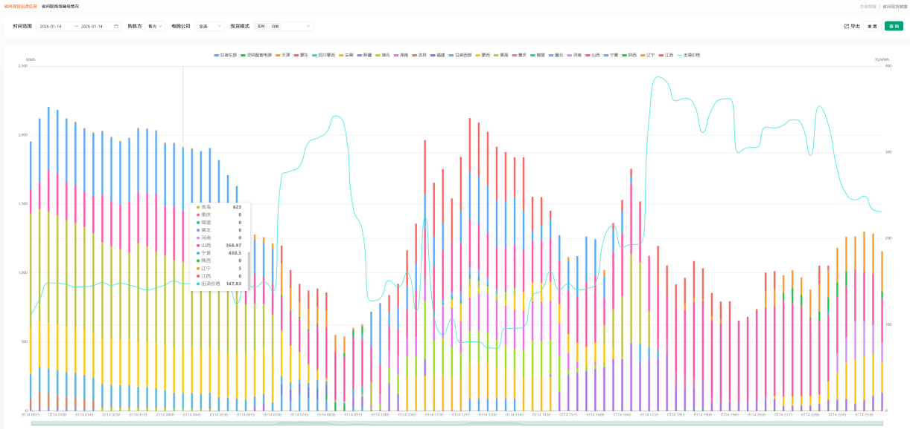

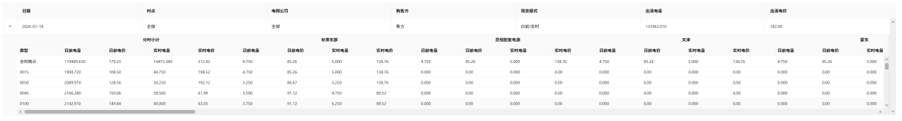
</td>
</tr>
<tr>
<td style="text-align: left;">时间选择</td>
<td style="text-align: left;">选择时间控件</td>
<td style="text-align: left;">
(1) 以日为最小单位选择 1 日；

(2) 默认为 D-1 日;

(3) 不可选择 D 日之后的日期
</td>
</tr>
<tr>
<td style="text-align: left;">购售方选择</td>
<td style="text-align: left;">下拉选择</td>
<td style="text-align: left;">
(1) 下拉选择包含：购方、售方；

(2) 下级级联跟随购方售方选择变化

(3) 单选
</td>
</tr>
<tr>
<td style="text-align: left;">电网公司选择</td>
<td style="text-align: left;">下拉选择</td>
<td style="text-align: left;">
(1) 跟随购售方选择变化

(2) 购方：全部、上海、北京、吉林、四川主网、天津、安徽、河北、浙江、湖北、蒙东、西藏、黑龙江

(3) 售方：全部、甘肃东部、灵绍配套电源、天津、蒙东、四川攀西、安徽、新疆、湖北、湖南、吉林、福建、甘肃西部、蒙西、青海、重庆、锡盟、翼北、河南、山西、宁夏、陕西、辽宁、江西

(4) 多选
</td>
</tr>
<tr>
<td style="text-align: left;">日前、实时选择</td>
<td style="text-align: left;">下拉选择</td>
<td style="text-align: left;">
(1) 包含：全部、 日前、实时

(2) 多选
</td>
</tr>
<tr>
<td style="text-align: left;">查询</td>
<td style="text-align: left;">单击按钮</td>
<td style="text-align: left;">(1) 根据选择查询并刷新所有图表；</td>
</tr>
<tr>
<td style="text-align: left;">重置</td>
<td style="text-align: left;">单击按钮</td>
<td style="text-align: left;">(1) 重置搜索项为默认值刷新</td>
</tr>
<tr>
<td style="text-align: left;">导出</td>
<td style="text-align: left;">单击按钮</td>
<td style="text-align: left;">(1) 将查询的结果表按Excel格式导出，导出内容与查询结果保持一致</td>
</tr>
<tr>
<td colspan="2" style="text-align: left;"><strong>其他说明</strong></td>
<td style="text-align: left;"></td>
</tr>
</tbody>
</table>

**界面数据说明：**

<table style="width:84%;">
<colgroup>
<col style="width: 11%" />
<col style="width: 16%" />
<col style="width: 54%" />
</colgroup>
<thead>
<tr>
<th style="text-align: left;"><strong>数据名称</strong></th>
<th colspan="2" style="text-align: left;">省间现货出清信息</th>
</tr>
</thead>
<tbody>
<tr>
<td style="text-align: left;"><strong>编号</strong></td>
<td style="text-align: left;"><strong>内容</strong></td>
<td style="text-align: left;"><strong>说明或约束</strong></td>
</tr>
<tr>
<td style="text-align: left;">1.</td>
<td style="text-align: left;">数据图</td>
<td style="text-align: left;">
（1）出清电量为柱图堆叠展示

（2）出清电价为折线展示

（3）横坐标为 96 时点，纵坐标为电量与电价分两侧显示

（4）如果为多个电网公司则出清电价为加权平均值

（5）如果选择日前与实时，则出清电量为日前实时加和值，出清电价为加权平均值
</td>
</tr>
<tr>
<td style="text-align: left;">2.</td>
<td style="text-align: left;">数据表</td>
<td style="text-align: left;">
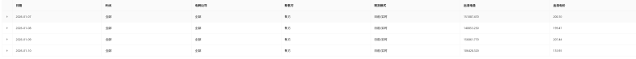

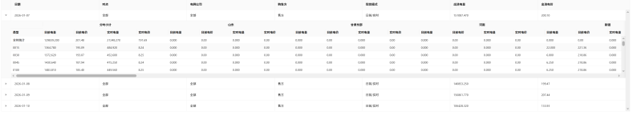

<ol type="1">
<li>
汇总表格
</li>
</ol>
<ul>
<li>
按所选日期汇总展示每日的出清电量和出清电价
</li>
<li>
点击展开图表可查看各省份时点数据
</li>
<li>
出清电量为加和值，出清电价为加权平均
</li>
</ul>
<ol start="2" type="1">
<li>
时点表格
</li>
</ol>
<ul>
<li>
展示96时点各省份出清电价和出清电量数据
</li>
<li>
小计汇总出清电量为加和值，汇总出清电价为加权平均值
</li>
<li>
展示的字段与查询条件保持一致
</li>
</ul></td>
</tr>
<tr>
<td colspan="2" style="text-align: left;"><strong>其他特殊说明</strong></td>
<td style="text-align: left;">(1) 电价小数点保留两位，电量小数点保留三位</td>
</tr>
</tbody>
</table>

（二）省间联络线输电情况

<table style="width:84%;">
<colgroup>
<col style="width: 12%" />
<col style="width: 17%" />
<col style="width: 53%" />
</colgroup>
<thead>
<tr>
<th colspan="3" style="text-align: left;"><strong>界面逻辑说明</strong></th>
</tr>
</thead>
<tbody>
<tr>
<td style="text-align: left;"><strong>动作名称</strong></td>
<td style="text-align: left;"><strong>操作类型</strong></td>
<td style="text-align: left;"><strong>逻辑说明</strong></td>
</tr>
<tr>
<td colspan="3" style="text-align: left;">
<strong>省间联络线输电情况</strong>

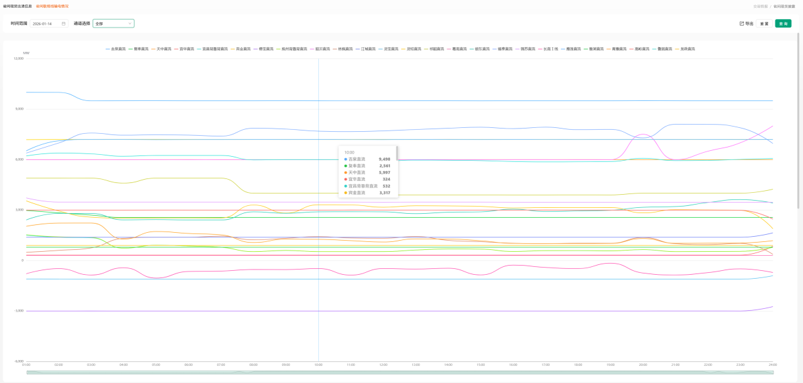
</td>
</tr>
<tr>
<td style="text-align: left;">时间选择</td>
<td style="text-align: left;">选择时间控件</td>
<td style="text-align: left;">
(1) 以日为最小单位选择 1 日；

(2) 默认为 D-1 日;

(3) 不可选择 D 日之后的日期
</td>
</tr>
<tr>
<td style="text-align: left;">通道选择</td>
<td style="text-align: left;">下拉选择</td>
<td style="text-align: left;">
(1) 下拉选择包含：全部、吉泉直流、复奉直流、天中直流、宜华直流、宜昌背靠背直流、宾金直流、德宝直流、施州背靠背直流、昭沂直流、林枫直流、江城直流、灵宝直流、灵绍直流、祁韶直流、葛南直流、银东直流、锡泰直流、锦苏直流、长南Ⅰ线、雁淮直流、雅湖直流、青豫直流、高岭直流、鲁固直流、龙政直流

(2) 多选
</td>
</tr>
<tr>
<td style="text-align: left;">查询</td>
<td style="text-align: left;">单击按钮</td>
<td style="text-align: left;">(1) 根据选择查询并刷新所有图表；</td>
</tr>
<tr>
<td style="text-align: left;">重置</td>
<td style="text-align: left;">单击按钮</td>
<td style="text-align: left;">(1) 重置搜索项为默认值刷新</td>
</tr>
<tr>
<td style="text-align: left;">导出</td>
<td style="text-align: left;">单击按钮</td>
<td style="text-align: left;">(1) 将查询的结果表按Excel格式导出，导出内容与查询结果保持一致</td>
</tr>
<tr>
<td colspan="2" style="text-align: left;"><strong>其他说明</strong></td>
<td style="text-align: left;"></td>
</tr>
</tbody>
</table>

**界面数据说明：**

<table style="width:84%;">
<colgroup>
<col style="width: 11%" />
<col style="width: 16%" />
<col style="width: 54%" />
</colgroup>
<thead>
<tr>
<th style="text-align: left;"><strong>数据名称</strong></th>
<th colspan="2" style="text-align: left;">重要通道实际输电情况</th>
</tr>
</thead>
<tbody>
<tr>
<td style="text-align: left;"><strong>编号</strong></td>
<td style="text-align: left;"><strong>内容</strong></td>
<td style="text-align: left;"><strong>说明或约束</strong></td>
</tr>
<tr>
<td style="text-align: left;">3.</td>
<td style="text-align: left;">数据图</td>
<td style="text-align: left;">
（1）折线展示

（2）横坐标为 96 时点，纵坐标为电力负荷
</td>
</tr>
<tr>
<td style="text-align: left;">4.</td>
<td style="text-align: left;">数据表</td>
<td style="text-align: left;">
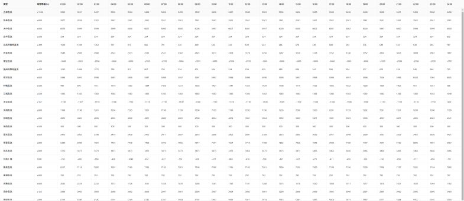

（1）横轴为电压等级、时点

（2）纵轴为通道名称
</td>
</tr>
<tr>
<td colspan="2" style="text-align: left;"><strong>其他特殊说明</strong></td>
<td style="text-align: left;"></td>
</tr>
</tbody>
</table>

####  业务事件6 交易公告

<table style="width:84%;">
<colgroup>
<col style="width: 12%" />
<col style="width: 17%" />
<col style="width: 53%" />
</colgroup>
<thead>
<tr>
<th colspan="3" style="text-align: left;"><strong>界面逻辑说明</strong></th>
</tr>
</thead>
<tbody>
<tr>
<td style="text-align: left;"><strong>动作名称</strong></td>
<td style="text-align: left;"><strong>操作类型</strong></td>
<td style="text-align: left;"><strong>逻辑说明</strong></td>
</tr>
<tr>
<td colspan="3" style="text-align: left;">
<strong>交易公告（路径：智慧发电-市场分析-交易公告）</strong>

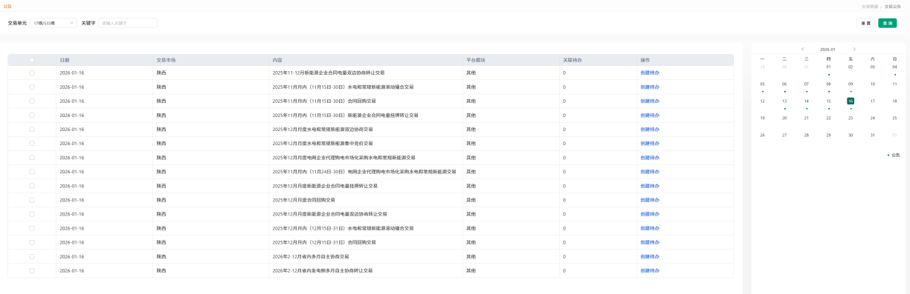
</td>
</tr>
<tr>
<td style="text-align: left;">交易单元</td>
<td style="text-align: left;">穿梭框选择</td>
<td style="text-align: left;">树状结构展示交易市场-交易单元，点击选择交易单元，可多选，默认展示全部有权限的交易单元</td>
</tr>
<tr>
<td style="text-align: left;">关键字</td>
<td style="text-align: left;">输入框</td>
<td style="text-align: left;">输入关键字可模糊搜索</td>
</tr>
<tr>
<td style="text-align: left;">查询</td>
<td style="text-align: left;">单击按钮</td>
<td style="text-align: left;">根据选择项查询数据</td>
</tr>
<tr>
<td style="text-align: left;">重置</td>
<td style="text-align: left;">单击按钮</td>
<td style="text-align: left;">点击后重置查询条件并刷新页面展示默认数据</td>
</tr>
<tr>
<td style="text-align: left;">列表</td>
<td style="text-align: left;">查询结果列表</td>
<td style="text-align: left;">
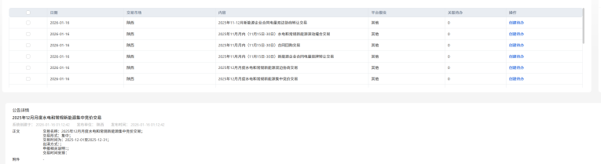

<ol type="1">
<li>
日期：展示数据日期；
</li>
<li>
交易市场：展示该数据所属交易市场；
</li>
<li>
内容：交易市场公布的交易公告名称（数据源于爬虫）；
</li>
<li>
平台模块：电力交易机构、通知公告、其他；
</li>
<li>
关联待办：已创建并关联的待办数；
</li>
</ol></td>
</tr>
<tr>
<td style="text-align: left;">详情</td>
<td style="text-align: left;">列表按钮</td>
<td style="text-align: left;">点击公告内容文字，可展开当前公告详情，默认展示标题、系统创建时间、发布单位、发布时间、正文和附件，如果数据没有则展示空</td>
</tr>
<tr>
<td style="text-align: left;">创建待办</td>
<td style="text-align: left;">列表按钮</td>
<td style="text-align: left;">

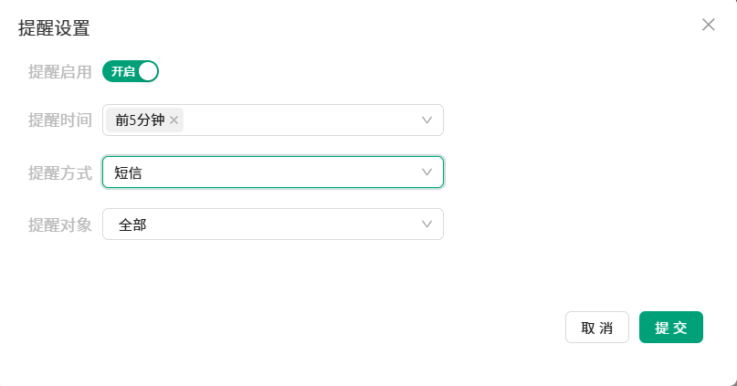

<ol type="1">
<li>
点击创建待办可对所选择的公告内容创建待办，默认待办内容为公告内容，可修改；
</li>
<li>
待办日期默认为公告发布日期，可修改；
</li>
<li>
待办时间可在时间选择器选择时分秒的时间段，开始时间需早于结束时间；
</li>
<li>
交易单元默认为全部，可多选有权限的交易单元；
</li>
<li>
点击提醒设置后打开提醒设置的弹窗，默认为开启状态；
</li>
<li>
提醒时间多选，准时、前5分钟、前10分钟、前15分钟...前24小时；
</li>
</ol>

<ol start="7" type="1">
<li>
提醒方式可选择短信或短信+电话提醒，单选；
</li>
<li>
提醒对象可选择操作人当前组织下的人员进行提醒。
</li>
</ol></td>
</tr>
<tr>
<td style="text-align: left;">日历</td>
<td style="text-align: left;">日期选择组件</td>
<td style="text-align: left;">
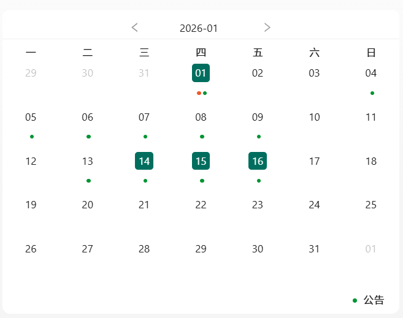

<ol type="1">
<li>
默认展示当前月当前日，标注有公告的日期，可点击多选选中日期；
</li>
<li>
列表根据所选日期展示交易公告列表数据；
</li>
<li>
点击已选择的日期可取消选中状态，取消选中后列表数据更新，展示其他已选日期的数据。
</li>
</ol></td>
</tr>
<tr>
<td colspan="2" style="text-align: left;"><strong>其他说明</strong></td>
<td style="text-align: left;"></td>
</tr>
</tbody>
</table>

####  业务事件7 交易日历

1.交易日历从日、周、月三个维度展示序列待办及日历。

2.交易日历角色分为管理员和交易员。平台的角色管理员会将待办序列分发给负责自己所管的交易市场交易员。如：角色管理员将公司下所属部门（技术部）的交易市场如：山西、安徽、甘肃分发给交易员，那么交易员角色在日历中就只能看到山西、安徽、甘肃这三个市场下的序列待办。

3.交易员在自己创建日历时，在选择关联人员时，也只能选择所属公司下技术部的平级人员进行关联创建日历进行提醒。

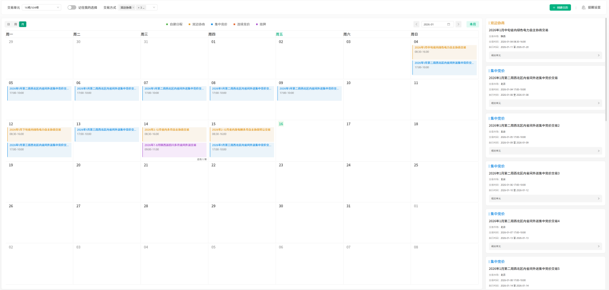

功能介绍：

1.  交易市场：角色为交易员时默认展示全部，角色为管理员时默认为第一个交易市场可点击进行切换。交易员所拥有的交易市场需要跟平台角色管理员分配的保持一致。

2.  交易单元：默认展示全部，可点击进行切换。 所有角色都有，但是交易员所拥有的交易单元需要跟管理员分配的保持一致。

3.  自动提醒：只有管理员角色有按钮权限，交易员角色没有此功能。点击按钮后展示自动提醒框，提供搜索框。根据人员名称进行查询搜索。

4.  左侧为日历待办表，右侧上边小闹钟为提醒设置，下方展示序列的明细。

5.  需要将交易市场按照颜色划分，左侧日历表上不同颜色代表不同交易市场的交易类型。

6.  序列按照交易市场进行归类，如交易市场下方有多条序列，按照不同颜色标识并列展示。

7.  右侧序列默认全部收起状态按钮为查看，点击后展开相关单元详情，按钮变为收起。当点开一个序列时没有点击收起按钮，再次点击下一个序列时需要将上一个序列收起。

8.  自动提醒列表：有权限的交易市场，可进行批量或单一设置，接收提醒的方式（默认开启平台提醒+短信提醒）、提醒时间（默认前10分钟提醒）、编辑权限（默认全有）、自动提醒（默认全部开启）。

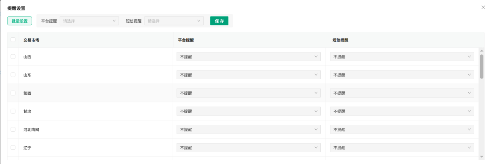

9.  点击日历中创建的日历，鼠标悬浮给一个删除和编辑的按钮 。

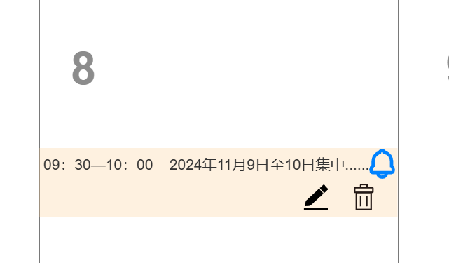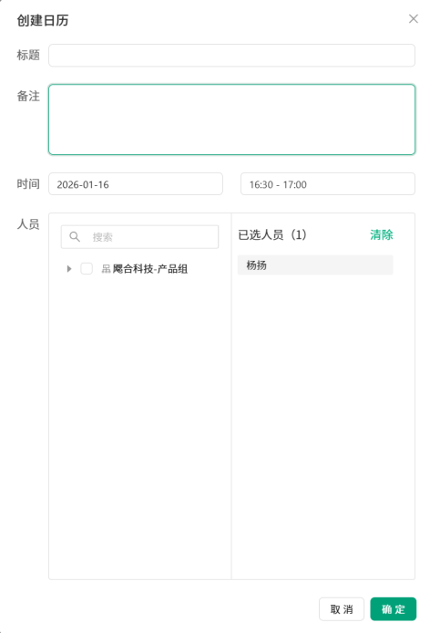

10. 周/日历表：日历默认固定展示周日历。可点击左上角日/月进行切换图表。左侧为各序列待办，和创建的日历。

11. 序列和创建的日历要展示内容名称和待办开始时间结束时间，序列展示颜色按照七大区域进行区分。日历待办按照一个颜色和小icon进行展示提醒。

12. 一个时间段内可以有多条待办，也可以跨日展示待办如下图黄色条。

13. 右侧为这一周所有的序列待办和创建的待办日历（默认收起详情）。点击查看进行展示详情（点击展开按钮后，按钮变为收起）。

14. 左侧日历表内点击已有的待办，右侧进行定位此条待办并展开详情。

15. 点击当前时点后的空白时间段可直接创建日历，显示创建日历框进行填写名称、备注、选择人员（可不选）、开始时间抓取刚才点击的空白时间段的一小时（如 点击的14：00-15：00的空白框，则自动获取当前的开始日期xx号，开始时间14：00，结束日期到当日xx号，结束时间15：00）。

16. 日/日历表：右侧内容框默认展开，按钮为收起；点击右上角的日期选择器可选择其他日期，点击【今天】可返回展示当前日数据。

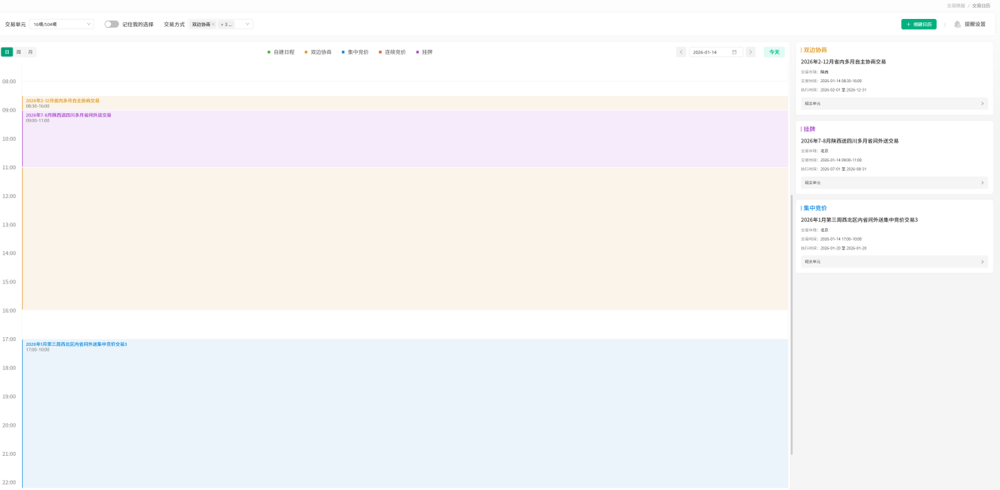

17. 周/日历表：右侧内容详情默认收起；点击右上角的日期选择器可选择其他周，点击【本周】可返回展示当前周数据。

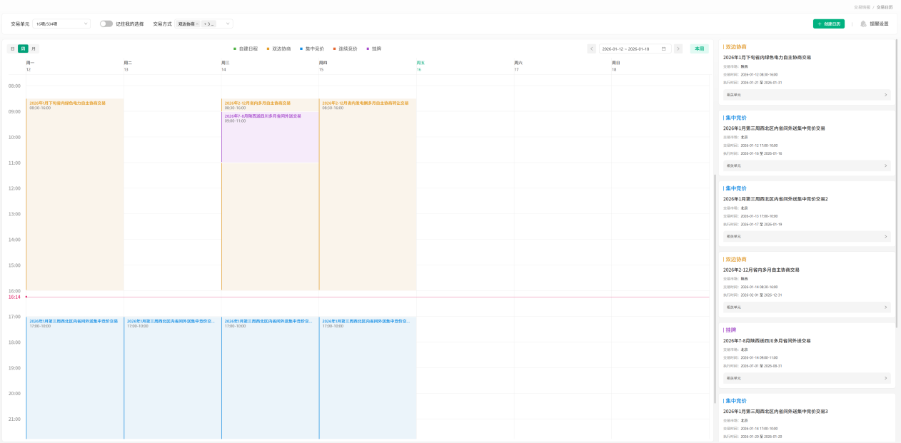

18. 月/日历表：右侧内容框默认展开，按钮为收起；点击右上角的日期选择器可选择其他月份，点击【本月】可返回展示当前日数据。

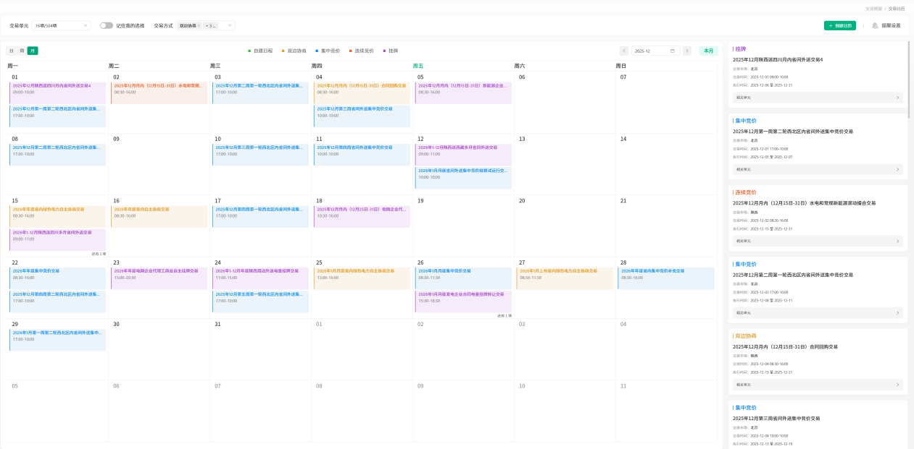

19. 平台提醒：选择平台提醒，根据设置提醒时间（如提前10分钟，则在屏幕右下角进行悬浮提醒框内容如下图）

####  业务事件8 相似日管理

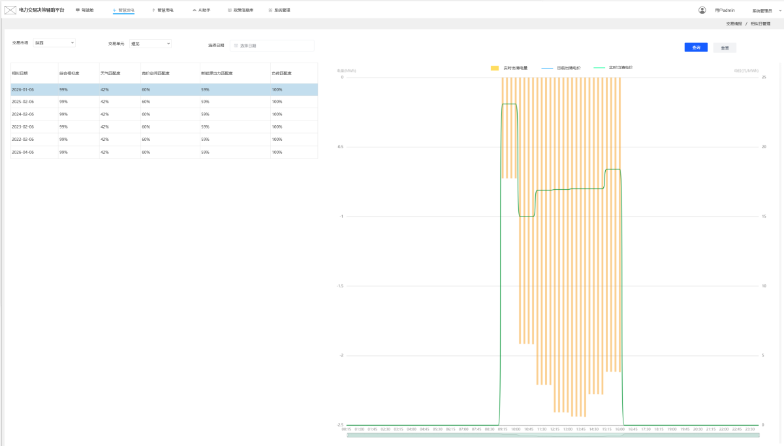

**界面逻辑说明**

<table style="width:84%;">
<colgroup>
<col style="width: 27%" />
<col style="width: 27%" />
<col style="width: 27%" />
</colgroup>
<thead>
<tr>
<th style="text-align: left;">动作名称</th>
<th style="text-align: left;">操作类型</th>
<th style="text-align: left;">逻辑说明</th>
</tr>
</thead>
<tbody>
<tr>
<td style="text-align: left;">交易市场选择</td>
<td style="text-align: left;">选择操作</td>
<td style="text-align: left;">1. 支持选择已接入的电力交易市场，如陕西等； 
2. 切换市场后，交易单元的下拉选项同步更新为当前市场下的可用单元，清空之前的选择。</td>
</tr>
<tr>
<td style="text-align: left;">交易单元选择</td>
<td style="text-align: left;">选择操作</td>
<td style="text-align: left;">选择需要查询的目标交易单元，如煜龙，用于匹配对应单元的相似日。</td>
</tr>
<tr>
<td style="text-align: left;">日期选择</td>
<td style="text-align: left;">选择操作</td>
<td style="text-align: left;">1. 支持选择需要查询的目标日期，用于匹配相似日； 
2. 选择日期后，等待用户点击查询触发匹配。</td>
</tr>
<tr>
<td style="text-align: left;">查询按钮</td>
<td style="text-align: left;">单击操作</td>
<td style="text-align: left;">1. 点击后，根据当前的交易市场、交易单元、目标日期，调用后台相似日匹配算法； 
2. 加载过程中，页面显示加载状态； 
3. 加载完成后，展示匹配出的相似日列表，默认选中第一个相似日，同时加载该相似日对应的实时出清电量、日前出清电价、实时出清电价的时序图表。</td>
</tr>
<tr>
<td style="text-align: left;">重置按钮</td>
<td style="text-align: left;">单击操作</td>
<td style="text-align: left;">点击后，将所有筛选条件恢复为默认值，清空相似日列表与右侧图表，等待用户重新筛选。</td>
</tr>
<tr>
<td style="text-align: left;">相似日列表行点击</td>
<td style="text-align: left;">单击操作</td>
<td style="text-align: left;">1. 点击某一行相似日数据后，自动切换选中状态，该行高亮展示； 
2. 右侧图表自动刷新，加载该相似日对应的实时出清电量、日前出清电价、实时出清电价的时序数据，展示该相似日的运行与价格走势； 
3. 图表刷新过程中，显示加载占位符。</td>
</tr>
<tr>
<td style="text-align: left;">图表交互</td>
<td style="text-align: left;">交互操作</td>
<td style="text-align: left;">1. 支持鼠标悬浮（Hover）查看详情，悬浮到某个时间点时，弹出提示框，展示该时间点的实时出清电量、日前出清电价、实时出清电价的数值与单位； 
2. 支持图例点击，可隐藏 / 显示对应的数据系列，方便用户聚焦关注的指标； 
3. 支持图表区域框选，放大查看某个时间段的详细数据，支持一键还原缩放。</td>
</tr>
</tbody>
</table>

**参数说明**

| 编号 | 参数名称 | 说明 |
|:---|:---|:---|
| 1\. | 交易市场 | 筛选维度，标识数据所属的电力交易市场 |
| 2\. | 交易单元 | 筛选维度，标识数据所属的交易单元，用于匹配对应单元的相似日 |
| 3\. | 目标日期 | 相似日匹配的目标日期，用于匹配相似的历史日期 |
| 4\. | 相似日日期 | 匹配出的历史日期，即与目标日期相似的历史日期 |
| 5\. | 综合相似度 | 目标日期与对应相似日的整体相似度得分，取值范围 0~100% |
| 6\. | 天气匹配度 | 两个日期在天气维度的匹配程度，取值范围 0~100% |
| 7\. | 竞价空间匹配度 | 两个日期在市场竞价空间维度的匹配程度，取值范围 0~100% |
| 8\. | 新能源出力匹配度 | 两个日期在新能源出力维度的匹配程度，取值范围 0~100% |
| 9\. | 负荷匹配度 | 两个日期在负荷维度的匹配程度，取值范围 0~100% |
| 10\. | 实时出清电量 | 对应相似日的 15 分钟粒度的实时出清电量数据，单位为 MWh，用于绘制柱状图 |
| 11\. | 日前出清电价 | 对应相似日的 15 分钟粒度的日前出清电价数据，单位为 元 / MWh，用于绘制折线图 |
| 12\. | 实时出清电价 | 对应相似日的 15 分钟粒度的实时出清电价数据，单位为 元 / MWh，用于绘制折线图 |

####  业务事件9 中长期行情

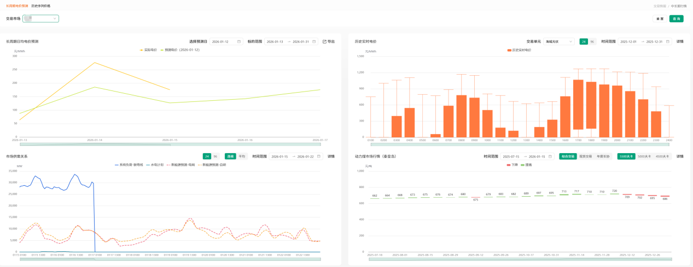

（一）长周期电价预测

<table style="width:84%;">
<colgroup>
<col style="width: 12%" />
<col style="width: 17%" />
<col style="width: 53%" />
</colgroup>
<thead>
<tr>
<th colspan="3" style="text-align: left;"><strong>界面逻辑说明</strong></th>
</tr>
</thead>
<tbody>
<tr>
<td style="text-align: left;"><strong>动作名称</strong></td>
<td style="text-align: left;"><strong>操作类型</strong></td>
<td style="text-align: left;"><strong>逻辑说明</strong></td>
</tr>
<tr>
<td colspan="3" style="text-align: left;">
<strong>长周期电价预测-搜索栏</strong>

</td>
</tr>
<tr>
<td style="text-align: left;">省份选择</td>
<td style="text-align: left;">下拉框选择</td>
<td style="text-align: left;">
(1) 点击选择省份，本期只显示陕西

(2) 单选
</td>
</tr>
<tr>
<td style="text-align: left;">查询</td>
<td style="text-align: left;">单击按钮</td>
<td style="text-align: left;">(1) 所有筛选项条件“与 ”关系组合筛查</td>
</tr>
<tr>
<td style="text-align: left;">重置</td>
<td style="text-align: left;">单击按钮</td>
<td style="text-align: left;">(1) 重置查询内容并刷新</td>
</tr>
<tr>
<td colspan="3" style="text-align: left;"><strong>界面逻辑说明</strong></td>
</tr>
<tr>
<td style="text-align: left;"><strong>动作名称</strong></td>
<td style="text-align: left;"><strong>操作类型</strong></td>
<td style="text-align: left;"><strong>逻辑说明</strong></td>
</tr>
<tr>
<td colspan="3" style="text-align: left;"><strong>长周期日均电价预测</strong>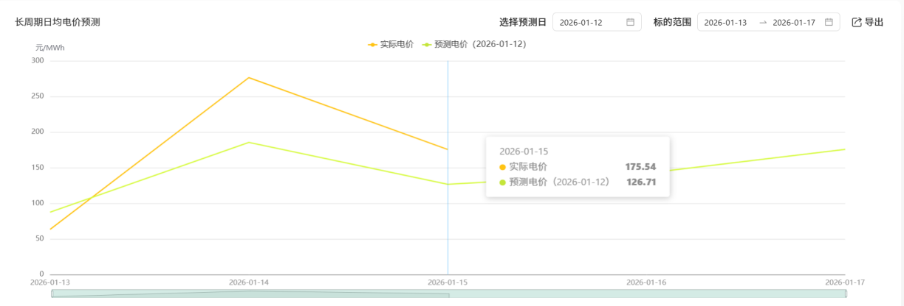</td>
</tr>
<tr>
<td style="text-align: left;">选择预测日</td>
<td style="text-align: left;">时间选择器</td>
<td style="text-align: left;">下表展示选中日期的预测数据（默认当天）</td>
</tr>
<tr>
<td style="text-align: left;">标的范围选择</td>
<td style="text-align: left;">时间范围选择器</td>
<td style="text-align: left;">下表展示选择时间范围24点的平均预测电价（默认D+1至月底最后一天）</td>
</tr>
<tr>
<td style="text-align: left;">表格展示内容</td>
<td style="text-align: left;">折线图</td>
<td style="text-align: left;">
实际电价（折线）：显示全省该日实际的日前算数均电价（修正前数据）

预测电价（xxxx-xx-xx）（折线）：显示选择的预测日预测的该日的现货电价信息
</td>
</tr>
<tr>
<td colspan="2" style="text-align: left;"><strong>其他说明</strong></td>
<td style="text-align: left;"></td>
</tr>
<tr>
<td colspan="3" style="text-align: left;"><strong>界面逻辑说明</strong></td>
</tr>
<tr>
<td style="text-align: left;"><strong>动作名称</strong></td>
<td style="text-align: left;"><strong>操作类型</strong></td>
<td style="text-align: left;"><strong>逻辑说明</strong></td>
</tr>
<tr>
<td colspan="3" style="text-align: left;">
<strong>历史实时电价</strong>

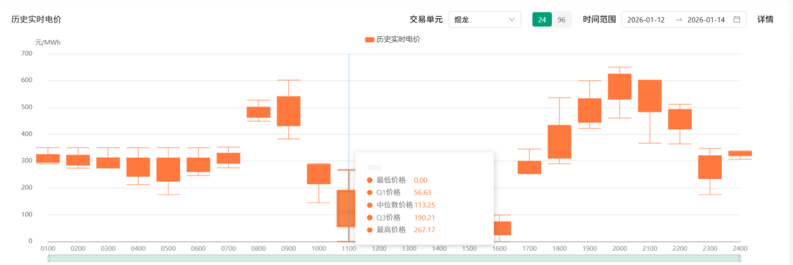

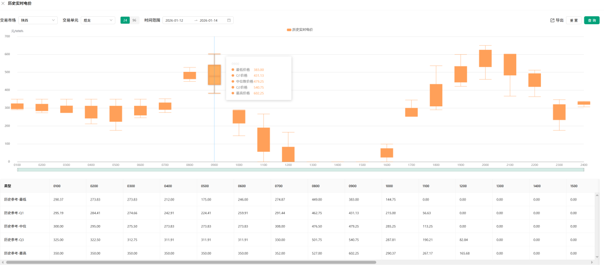
</td>
</tr>
<tr>
<td style="text-align: left;">交易单元</td>
<td style="text-align: left;">下拉选项</td>
<td style="text-align: left;">选择陕西下所有交易单元，单选，默认为陕西全省</td>
</tr>
<tr>
<td style="text-align: left;">时点切换</td>
<td style="text-align: left;">按钮</td>
<td style="text-align: left;">24 、96 时点切换，默认24时点</td>
</tr>
<tr>
<td style="text-align: left;">时间范围</td>
<td style="text-align: left;">时间选择控件</td>
<td style="text-align: left;">
(1) 以日为单位，选择一段范围

(2) 默认为上个月整月
</td>
</tr>
<tr>
<td style="text-align: left;">图表</td>
<td style="text-align: left;">砖型图</td>
<td style="text-align: left;"><ol type="1">
<li>
柱状最高超出横线部分展示最高价格
</li>
<li>
柱状最低超出横线部分展示最低价格
</li>
<li>
柱状最高点展示Q1价格
</li>
<li>
柱状最低点展示Q3价格
</li>
<li>
柱状中心展示中位数价格
</li>
</ol></td>
</tr>
<tr>
<td style="text-align: left;">图表</td>
<td style="text-align: left;">表格</td>
<td style="text-align: left;">根据查询条件展示所选交易单元历史参考价格，表格支持导出，导出数据与查询数据保持一致</td>
</tr>
<tr>
<td colspan="2" style="text-align: left;"><strong>其他说明</strong></td>
<td style="text-align: left;"></td>
</tr>
<tr>
<td colspan="3" style="text-align: left;"><strong>界面逻辑说明</strong></td>
</tr>
<tr>
<td style="text-align: left;"><strong>动作名称</strong></td>
<td style="text-align: left;"><strong>操作类型</strong></td>
<td style="text-align: left;"><strong>逻辑说明</strong></td>
</tr>
<tr>
<td colspan="3" style="text-align: left;">
<strong>市场供需关系</strong>

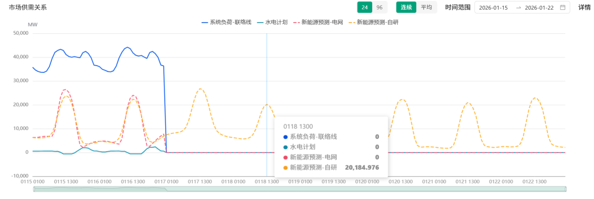

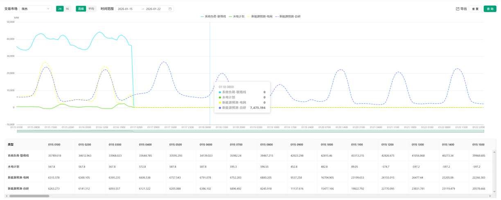
</td>
</tr>
<tr>
<td style="text-align: left;">连续/平均</td>
<td style="text-align: left;">按钮</td>
<td style="text-align: left;">连续或评价切换，默认为连续</td>
</tr>
<tr>
<td style="text-align: left;">时点切换</td>
<td style="text-align: left;">按钮</td>
<td style="text-align: left;">24 、96 时点切换，默认24时点</td>
</tr>
<tr>
<td style="text-align: left;">时间范围</td>
<td style="text-align: left;">时间选择控件</td>
<td style="text-align: left;">
(1) 以日为单位，选择一段范围

(2) 默认为D日到D+7日
</td>
</tr>
<tr>
<td style="text-align: left;">图表</td>
<td style="text-align: left;">折线图</td>
<td style="text-align: left;">折线图展示系统负荷-联络线、水电计划、新能源预测-电网和新能源预测-自研数据</td>
</tr>
<tr>
<td style="text-align: left;">图表</td>
<td style="text-align: left;">表格</td>
<td style="text-align: left;">根据查询条件展示所选日期内供需预测数据，表格支持导出，导出数据与查询数据保持一致</td>
</tr>
<tr>
<td colspan="2" style="text-align: left;"><strong>其他说明</strong></td>
<td style="text-align: left;"></td>
</tr>
<tr>
<td colspan="3" style="text-align: left;"><strong>界面逻辑说明</strong></td>
</tr>
<tr>
<td style="text-align: left;"><strong>动作名称</strong></td>
<td style="text-align: left;"><strong>操作类型</strong></td>
<td style="text-align: left;"><strong>逻辑说明</strong></td>
</tr>
<tr>
<td colspan="3" style="text-align: left;">
<strong>动力煤市场行情（秦皇岛）</strong>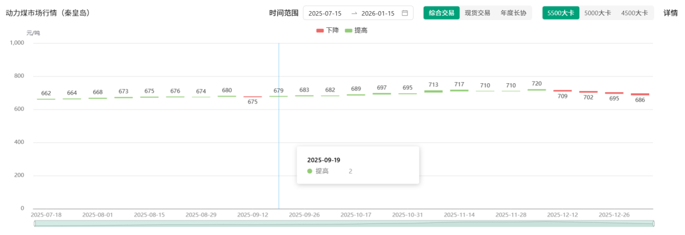

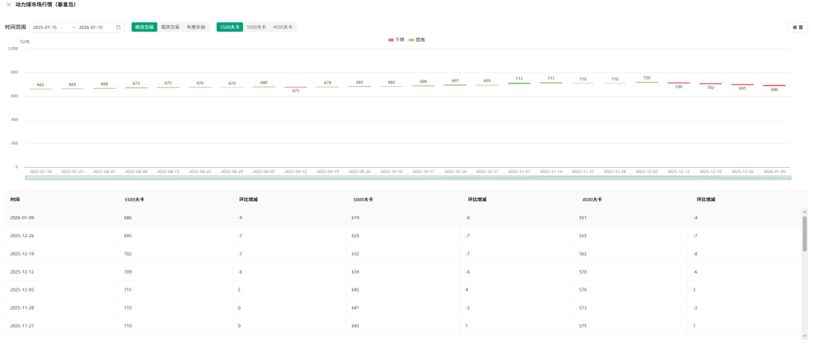
</td>
</tr>
<tr>
<td style="text-align: left;">查询条件</td>
<td style="text-align: left;">查询</td>
<td style="text-align: left;">
1. 查询条件“时间范围”，默认设置时间范围为当前日至前半年，根据查询时间范围显示所包含的月份。

2. “综合交易”、“现货交易”和“年度长协”切换页签，加载时默认显示“综合交易”页签。“综合交易”、“现货交易”和“年度长协”每个页签下均包含“5500大卡”、“5000大卡”和“4500大卡”。即，根据交易品种和不同热值，展示对应趋势图；

3. 点击“详情”按钮，弹出“详情页面”。
</td>
</tr>
<tr>
<td style="text-align: left;">图表</td>
<td style="text-align: left;">瀑布图</td>
<td style="text-align: left;">
1. 瀑布图，纵坐标单位为“元/吨”，横坐标在“综合交易”和“现货交易”页签时为日期（MMDD），在“年度长协”页签是为月份（YYMM）;

2. 每条数据在图形中显示全部数值，价格上升时在上方显示，价格下降时在下方显示；

3. 随动展示，展示日期和上升/下降数值。

4. 图例名称修改为：提高/下降，图例颜色见“图：图例样式”
</td>
</tr>
<tr>
<td style="text-align: left;">图表</td>
<td style="text-align: left;">表格</td>
<td style="text-align: left;">
1. 表格展现根据“综合交易”、“现货交易”和“年度长协”页签进行切换，展示的是任意交易类型的全部热值类型煤炭的价格和环比增减数据。

2. 表格样式及随动展示与当前功能其他详情页面中的表格保持一致。
</td>
</tr>
<tr>
<td colspan="2" style="text-align: left;"><strong>其他说明</strong></td>
<td style="text-align: left;"></td>
</tr>
</tbody>
</table>

（一）长周期电价预测

<table style="width:84%;">
<colgroup>
<col style="width: 12%" />
<col style="width: 17%" />
<col style="width: 53%" />
</colgroup>
<thead>
<tr>
<th colspan="3" style="text-align: left;"><strong>界面逻辑说明</strong></th>
</tr>
</thead>
<tbody>
<tr>
<td style="text-align: left;"><strong>动作名称</strong></td>
<td style="text-align: left;"><strong>操作类型</strong></td>
<td style="text-align: left;"><strong>逻辑说明</strong></td>
</tr>
<tr>
<td colspan="3" style="text-align: left;">
历史序列价格

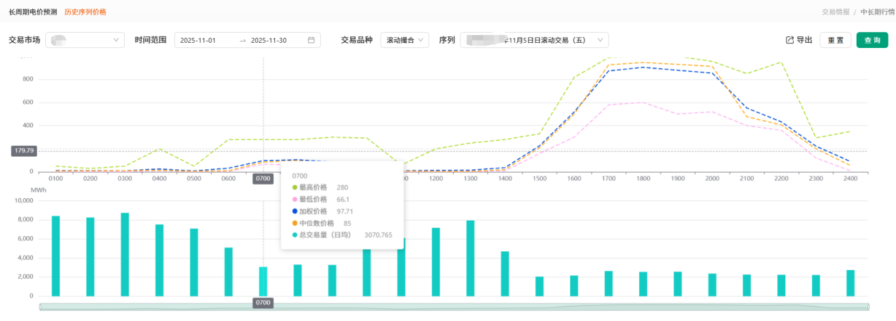
</td>
</tr>
<tr>
<td style="text-align: left;">省份选择</td>
<td style="text-align: left;">下拉单选</td>
<td style="text-align: left;">
(1) 选择有权限的省份，支持搜索；

(2) 单选

(3) 默认陕西
</td>
</tr>
<tr>
<td style="text-align: left;">时间选择</td>
<td style="text-align: left;">选择时间控件</td>
<td style="text-align: left;">(1) 以日为最小单位选择连续范围， (2) 默认为当前日;</td>
</tr>
<tr>
<td style="text-align: left;">交易品种</td>
<td style="text-align: left;">下拉单选</td>
<td style="text-align: left;">
(1) 集中竞价

(2) 滚动撮合
</td>
</tr>
<tr>
<td style="text-align: left;">序列</td>
<td style="text-align: left;">下拉单选</td>
<td style="text-align: left;">
(1) 下拉单选，支持搜索

(2) 需要与交易品种与时间范围级联
</td>
</tr>
<tr>
<td style="text-align: left;">查询</td>
<td style="text-align: left;">单击按钮</td>
<td style="text-align: left;">(1) 根据选择查询并刷新所有图表；</td>
</tr>
<tr>
<td style="text-align: left;">重置</td>
<td style="text-align: left;">单击按钮</td>
<td style="text-align: left;">(1) 重置搜索项为默认值刷新</td>
</tr>
<tr>
<td style="text-align: left;">导出</td>
<td style="text-align: left;">单击按钮</td>
<td style="text-align: left;">(1) 导出统计表格</td>
</tr>
<tr>
<td colspan="2" style="text-align: left;"><strong>其他说明</strong></td>
<td style="text-align: left;">各个字段数据源参看历史序列价格与数仓映射表</td>
</tr>
</tbody>
</table>

####  业务事件10 外送价格计算器

**界面设计：**

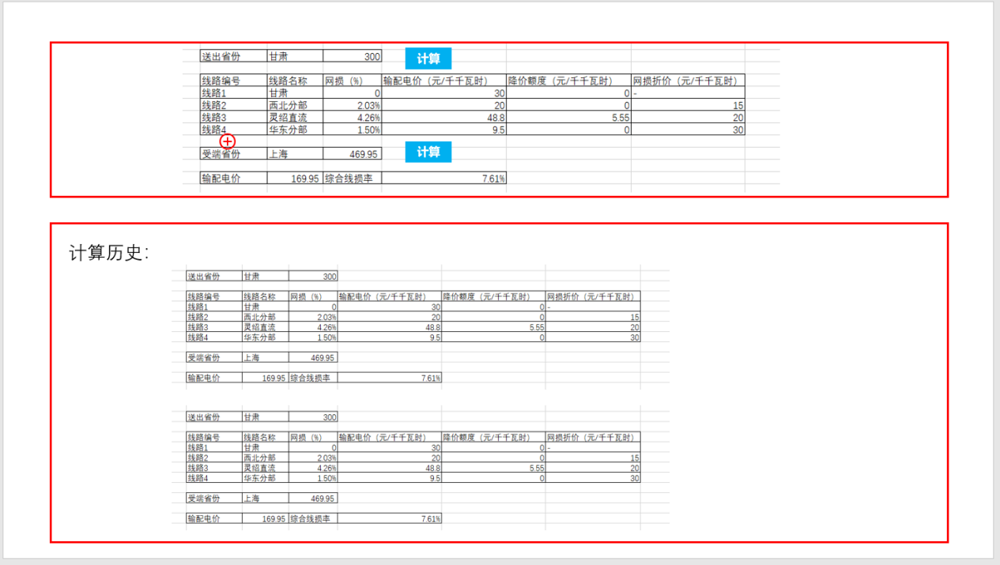

注释：

1.  页面上半部分为计算器配置区域：

<!-- -->

1.  送出省份、受端省份单选，必选；

<!-- -->

2.  送出省份、受端省份电价只能填写一个，计算按钮也只有一个可以使用，填写了其中一个数据，另外一个计算按钮状态为不可用；

<!-- -->

3.  线路可以添加，点击添加按钮之后，由用户在下拉选项框中选择线路名称，并自动展示后部的相关数据；

<!-- -->

4.  线路选择有以下要求：线路1必须选择类型属性为“省份”的；

<!-- -->

5.  用户点击计算按钮之后，页面计算，并保留相关计算结果，最多保留十条，刷新页面后不保留相关计算记录；

<!-- -->

6.  输配电价与综合线损率最后计算，计算公式如下：

<table style="width:83%;">
<colgroup>
<col style="width: 83%" />
</colgroup>
<thead>
<tr>
<th style="text-align: left;">
输配电价 = 受端省份电价 - 送出省份电价

综合线损率 = 1-（ 1 - A1 ）* ( 1 - B1) * ( 1 - C1 ) * ( 1 - D1)
</th>
</tr>
</thead>
<tbody>
</tbody>
</table>

2.  页面下半部分为计算器的结果短暂存储展示区域：

<!-- -->

1.  此部分数据滚动更新，只保留最近的10条记录，用户离开页面后不保留记录；

**计算逻辑：**

假定计算相关条件如下：

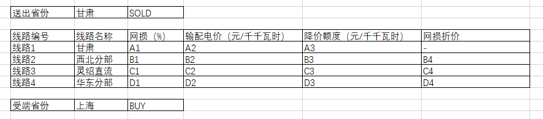

并指定：

用户填写送出省份电价，计算得出受端省份电价，这种情况叫做正算，反之为反算。

1.  正算算法：

| BUY = SOLD + A2 + B2 + B4 + C2 + C4 + D2 + D4 + Σ( A3, B3, C3, D3) |
|--------------------------------------------------------------------|

其中：

每一条线路的网损折价都跟其上面线路的情况有关系，具体而言，计算方法如下：

<table style="width:83%;">
<colgroup>
<col style="width: 83%" />
</colgroup>
<thead>
<tr>
<th style="text-align: left;">
B4 = ( SOLD + A2 ) * B1 / （ 1 - B1 ）

C4 = ( SOLD + A2 + B2 + B4 ) * C1 / (1 - C1)

D4 = ( SOLD + A2 + B2 + B4 + C2 + C4 ) * D1 / ( 1 - D1)
</th>
</tr>
</thead>
<tbody>
</tbody>
</table>

2.  反算算法：

| SOLD = BUY - A2 - B2 - B4 - C2 - C4 - D2 - D4 - Σ( A3, B3, C3, D3) |
|--------------------------------------------------------------------|

同样的，每一条线路的网损折价计算逻辑如下：

<table style="width:83%;">
<colgroup>
<col style="width: 83%" />
</colgroup>
<thead>
<tr>
<th style="text-align: left;">
B4 = ( BUY - Σ( A3, B3, C3, D3) - D2 - D4 - C2 - C4 - B2 ) * B1

C4 = ( BUY - Σ( A3, B3, C3, D3) - D2 - D4 - C2 ) * C1

D4 = ( BUY - Σ( A3, B3, C3, D3) - D2 ) * D1
</th>
</tr>
</thead>
<tbody>
</tbody>
</table>

####  业务事件11 公众号披露

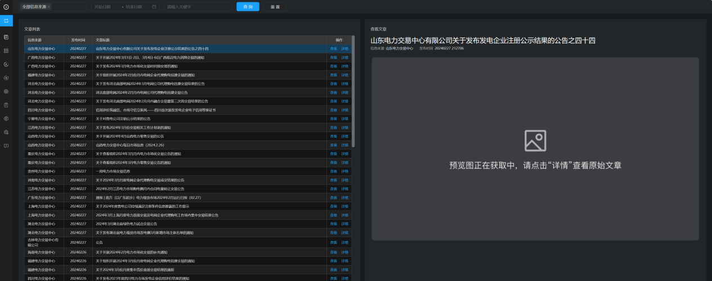

**图：交易中心公众号披露（参考）**

<table style="width:84%;">
<colgroup>
<col style="width: 27%" />
<col style="width: 27%" />
<col style="width: 27%" />
</colgroup>
<thead>
<tr>
<th colspan="3" style="text-align: center;"><strong>界面逻辑说明</strong></th>
</tr>
</thead>
<tbody>
<tr>
<td style="text-align: center;"><strong>动作名称</strong></td>
<td style="text-align: center;"><strong>操作类型</strong></td>
<td style="text-align: center;"><strong>逻辑说明</strong></td>
</tr>
<tr>
<td colspan="3" style="text-align: center;"><strong>图：交易中心公众号披露（参考）</strong></td>
</tr>
<tr>
<td rowspan="3" style="text-align: left;">页面详情</td>
<td style="text-align: left;">查询栏</td>
<td style="text-align: center;"><ol start="3" type="a">
<li>
“交易市场”下拉多选栏，默认全部交易市场；
</li>
</ol>
<ol start="4" type="a">
<li>
“时间范围”选择组件，加载默认时间默认当前日至钱一整年；
</li>
</ol>
<ol start="5" type="a">
<li>
“关键字”检索栏，输入框最大输入200字符，未输入时显示“请输入关键字”。检索功能支持模糊查询；
</li>
</ol>
<ol start="6" type="a">
<li>
“查询”按钮，点击按钮按筛选条件显示查询结果；
</li>
</ol>
<ol start="7" type="a">
<li>
“重置”按钮，点击按钮，将筛选条件恢复成默认加载状态。
</li>
</ol></td>
</tr>
<tr>
<td style="text-align: left;">文章列表</td>
<td style="text-align: center;"><ol start="3" type="1">
<li>
列表字段按先后顺序分为“信息来源”、“发布时间”、“文章标题”和“操作”。
</li>
</ol>
<ol start="2" type="a">
<li>
“信息来源”、“发布时间”、“文章标题”为爬虫获取，数仓聚合提供。
</li>
</ol>
<ol start="2" type="1">
<li>
“操作”列显示“查看”蓝字，点击后右侧“查看文章”显示文章内容。
</li>
</ol>
<ol start="3" type="1">
<li>
列表每页最大展示40行 ，页末有翻页提示组件。
</li>
</ol></td>
</tr>
<tr>
<td style="text-align: left;">查看文章</td>
<td style="text-align: center;"><ol type="1">
<li>
“文章查看”采用网页嵌套方式，直接展示交易中心发布文章点开的详细内容。
</li>
</ol>
<ol start="2" type="1">
<li>
“文章查看”包括“标题”、“信息来源”、“发布时间”。字体大小和形式参考图片“交易中心公众号披露（参考）”布局，基本效果一致即可。
</li>
</ol></td>
</tr>
<tr>
<td colspan="2" style="text-align: center;"><strong>其他说明</strong></td>
<td style="text-align: left;"></td>
</tr>
</tbody>
</table>

####  业务事件12 网架及热力图

**聆风网架图需求**

**功能点介绍**

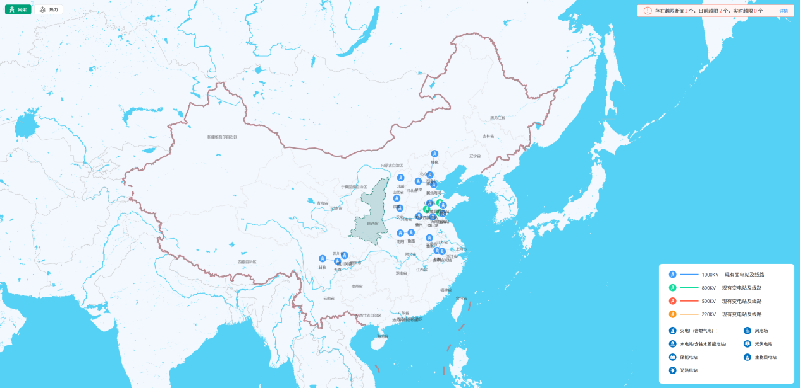

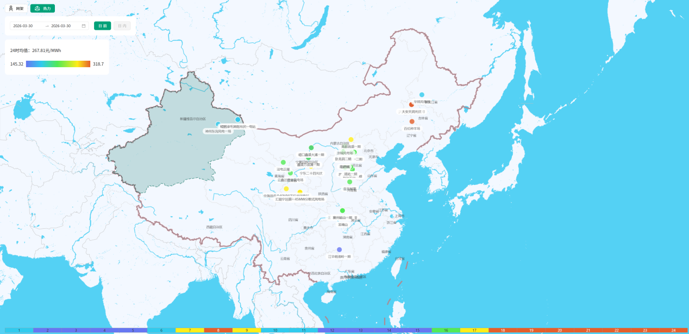

**网架图**

网架图的数据在“网架图配置”模块进行维护，根据维护的信息在地图上展示场站和连接线的内容。

2.  该功能默认展示“网架”tab信息。

<!-- -->

2.  地图默认显示1000kv、800kv、现有变电站及断面、越限线路。线路显示参考下图

<!-- -->

4.  查看全国的时候显示 1000kv和800kv，点击查看某个省份的时候显示500kv和220kv，通过展示的范围控制显示到哪个级别

<!-- -->

5.  鼠标悬浮在某省市时高亮显示，比如点击山西省 地图扩大至全屏，如下边第二个线路图样式。线路等详细信息进行逐步显示

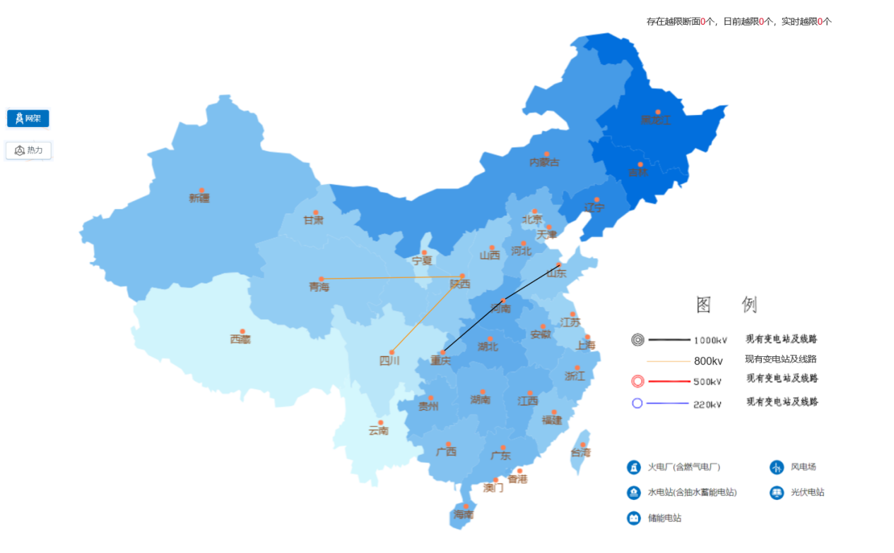

6.  提供缩放和平移功能，让用户更好查看不同区域的详细信息，确保地图在处理大量数据时能保持流畅的用户体验。

<!-- -->

7.  每个点位的包含如下信息：

<!-- -->

8.  名称：用于地图上标记的场站/变电站的名称

<!-- -->

4.  经度/纬度：用于地图打点

<!-- -->

3.  类型：

<!-- -->

3.  类型包含：1000kv变电站、800kv变电站、500kv变电站、220kv变电站、火电厂、风电厂、水电厂、光伏电站

<!-- -->

4.  不同类型的点显示不同的图标

<!-- -->

2.  连接点：

<!-- -->

3.  维护该场站/变电站和哪些场站/变电站相连接，可以理解为起点连接至终点。

<!-- -->

2.  一个场站/变电站可以连接多个场站/变电站

<!-- -->

3.  两个点之间有多个连接线时，连接线不重叠

<!-- -->

5.  通道类型：

<!-- -->

1.  包含：1000kv、800kv、500kv、220kv、其它

<!-- -->

2.  不同的千伏显示不同的连接线颜色和粗度。

<!-- -->

6.  通道数量

<!-- -->

1.  每两个点之间连接的通道数量

<!-- -->

7.  查看单省份有通往外省的通道时，如何显示

<!-- -->

1.  通道延伸至省份边界外一定距离，如果连接点在该范围内则显示对应的场站名字和图标。如果超出这个距离，就仅显示场站的名字，连接点终点显示为箭头。

<!-- -->

8.  越限信息：从山西交易中心获取“是否越限=是”的信息，进行展示。

<!-- -->

1.  点击“详情”弹窗显示越限的信息

> 

2.  交易中心路径如下

> 

9.  右下角的图例可以点击，点击后可以隐藏/显示对应的场站或变电站，和其连接的通道

**热力图**

热力图根据爬取来场站的日前电价和实时电价，显示场站的热力点

1.  默认日期的展示当天日前24时点的算数平均电价信息，当时间显示为今天时“日内”不可点击。

<!-- -->

2.  场站点的数据来源：

<!-- -->

1.  聆风按照“交易单元经纬度”内维护的数据，对点进行展示

<!-- -->

2.  能建的按照“场站基础信息”内的经纬度，对点进行展示

<!-- -->

3.  电价的数据来源：

<!-- -->

1.  日前：取该场站的“日前出清电价”，在省内现货出清内

<!-- -->

2.  日内：取该场站的“实时出清电价”，在省内现货出清内

> 

4.  颜色显示规则：

<!-- -->

1.  将所查范围内的最低电价-最高电价的区间，分割成15个区间。并从低到高划分依次取色。（ui给色）可参考

> 

2.  每个场站电价所在的区间内，显示对应的区间颜色。

<!-- -->

5.  底部24时点颜色显示及交互

<!-- -->

1.  底部每个时点，计算对应的算术平均价，根据价格显示对应的颜色。

<!-- -->

2.  每个时点可以点击，点击后地图上的热力数据变为对应时点的数据。

<!-- -->

6.  点击左侧电场，右侧弹框显示24小时电价，电场可多选，再次点击电场即可取消选择

> 

7.  多日显示规则

<!-- -->

1.  多日为选择一个时间段。

<!-- -->

2.  计算这个时间段内的日前和日内的算术平均价。

<!-- -->

3.  各场站多日算数均价的公式，多日的价格/价格数量。

**网架图配置**

该模块为单独维护网架图内的场站/变电站的点，和连接线的信息。

**网点配置**

列表

1.  所属省份默认为全部，可以下拉多选省份。 （当前开发版本，下拉仅显示山西）

<!-- -->

2.  名称支持模糊查询

<!-- -->

3.  东经北纬：限制为经纬度的数据格式。

<!-- -->

4.  列表按照创建时间倒序排列

<!-- -->

5.  类型可以下拉多选

新增弹窗

1.  增加地图选点功能，在地图上选择位置，自动获取经纬度填写。

<!-- -->

2.  名称：长度和数据格式不限。

<!-- -->

3.  类型为下拉单选，包含：1000kv变电站、800kv变电站、500kv变电站、200kv变电站、火电厂、风电厂、水电厂、光伏电站

**通道配置**

列表

1.  类型为下拉多选，默认为全部。下拉项包含：1000kv、800kv、500kv、220kv。

<!-- -->

2.  通道连接点：模糊查询连接点名称内的任意节点名称，也可以全部查询

<!-- -->

3.  通道数量：两个连接点内，所有类型的通道数量加和。

<!-- -->

4.  通道类型：两个连接点内，所有的类型，全部显示。

<!-- -->

5.  列表按照创建时间倒序排列

新增

1.  连接点为下拉单选，选择范围为“网点配置”内已维护的点。支持下拉选择时搜索

<!-- -->

2.  两个连接点不可选择同一个点，当选择两个相同节点时提示“不能在同一连接点上设置通道，请重新选择。” 提示并将连接点所选的两个连接点清空。

<!-- -->

3.  通道设置内：默认显示一条，最多新增至四条，删除最少为一条。删除时无需二次确认

<!-- -->

4.  通道类型为下拉单选，包含：1000kv、800kv、500kv、220kv。

<!-- -->

5.  通道数量格式需为数字。

<!-- -->

6.  相同通道的设置

<!-- -->

1.  多次新增时，只要两个连接点相同，都视为同一通道。 保存后的前后顺序，按照第一次的前后顺序保存。

<!-- -->

2.  单次/多次新增时，同类型的通道数量需要合并。

<!-- -->

1.  单次新增：设置两条通道，类型都为：1000kv，保存后为同一类型的通道，通道数量相加。

<!-- -->

2.  多次新增：将两次新增的同类型通道的数量加和。

####  业务事件13 合约管理

<table style="width:84%;">
<colgroup>
<col style="width: 16%" />
<col style="width: 14%" />
<col style="width: 53%" />
</colgroup>
<thead>
<tr>
<th colspan="3" style="text-align: left;"><strong>界面逻辑说明</strong></th>
</tr>
</thead>
<tbody>
<tr>
<td colspan="3" style="text-align: left;">
<strong>合约管理主页面</strong>

</td>
</tr>
<tr>
<td style="text-align: left;"><strong>动作名称</strong></td>
<td style="text-align: left;"><strong>操作类型</strong></td>
<td style="text-align: left;"><strong>逻辑说明</strong></td>
</tr>
<tr>
<td style="text-align: left;">时间选择</td>
<td style="text-align: left;">时间选择控件</td>
<td style="text-align: left;">
(1) 以日为单位，筛选所有合约执行时间与条件时段有交叠的合约；

(2) 默认为本月1号至今
</td>
</tr>
<tr>
<td style="text-align: left;">交易单元选择</td>
<td style="text-align: left;">下拉框选择</td>
<td style="text-align: left;">
(1) 点击弹出交易单元选择窗口，树形结构分为省份-交易单元二级，可级联选择

(2) 可多选，可搜索， (3) 默认全部省份-全部交易单元
</td>
</tr>
<tr>
<td style="text-align: left;">交易方向选择</td>
<td style="text-align: left;">下拉框单选</td>
<td style="text-align: left;">
(1) 对交易主体单元而言的合约交易方向，单选

(2) 包含全部、买入、卖出

(3) 默认全部
</td>
</tr>
<tr>
<td style="text-align: left;">关键字</td>
<td style="text-align: left;">文本输入框</td>
<td style="text-align: left;">(1) 在“合约名称”中进行模糊匹配，查找合约</td>
</tr>
<tr>
<td style="text-align: left;">查询</td>
<td style="text-align: left;">单击按钮</td>
<td style="text-align: left;">(1) 所有筛选项条件“与”关系组合筛查，并更新主合约列表；</td>
</tr>
<tr>
<td style="text-align: left;">重置</td>
<td style="text-align: left;">单击按钮</td>
<td style="text-align: left;">(1) 将所有筛查条件项恢复为默认，刷新页面</td>
</tr>
<tr>
<td style="text-align: left;">导出</td>
<td style="text-align: left;">单击按钮</td>
<td style="text-align: left;">(1) 导出所查询的合约</td>
</tr>
<tr>
<td style="text-align: left;">合约分析</td>
<td style="text-align: left;">单击按钮</td>
<td style="text-align: left;">(1) 点击跳转到合约分析页面，筛选项为勾选的合约</td>
</tr>
<tr>
<td style="text-align: left;">
复选

(列表操作)
</td>
<td style="text-align: left;">复选框</td>
<td style="text-align: left;">
(1) 对合约进行多选，配合“合约分析 ”功能使用，实 现批量操作；

(2) 合约多选若针对当前筛选出的全部合约信息，无论是否加载；
</td>
</tr>
<tr>
<td style="text-align: left;">
合约曲线查询

（列表操作）
</td>
<td style="text-align: left;">单击按钮</td>
<td style="text-align: left;"><ol type="1">
<li>
合约名称后icon点击弹出浮窗，展示对应合约的量价曲线详情
</li>
<li>
展示每月的月度量价曲线和每日的量价曲线，可切换月份或日期，如果合约执行期为单月则不显示切换图标，只展示合约所在月份量价，横坐标为日期或时点纵坐标为电量和电价，电量仪柱状展示，电价以折线展示；
</li>
<li>
日维度的量价图可切换96时点和24时点，96时点汇总到24时点，电量汇总展示，电价加权平均展示；加权平均逻辑：1时点电价=【（0:15电量*0:15电价）+（0:30电量*0:30电价）+（0:45电量*0:45电价）+（1:00电量*1:00电价）】/（0:15电量+0:30电量+0:45电量+1:00电量）
</li>
</ol>

</td>
</tr>
<tr>
<td style="text-align: left;">
详情

(列表操作)
</td>
<td style="text-align: left;">单击按钮</td>
<td style="text-align: left;"><ol type="1">
<li>
点击弹出合约详情弹窗，展示合约月、日、时点维度的数据；
</li>
<li>
当合约开始时间和结束时间跨月时，默认展示每个月合约的电量和电价，点击对应月份的电量后，展开该月每一日的电量和电价，点击对应日期的电量后，展开该日每个时点的电量和电价，可切换96时点和24时点
</li>
</ol>

</td>
</tr>
<tr>
<td colspan="2" style="text-align: left;"><strong>其他说明</strong></td>
<td style="text-align: left;"></td>
</tr>
</tbody>
</table>

**界面数据说明：**

<table style="width:84%;">
<colgroup>
<col style="width: 11%" />
<col style="width: 16%" />
<col style="width: 54%" />
</colgroup>
<thead>
<tr>
<th style="text-align: left;"><strong>数据名称</strong></th>
<th colspan="2" style="text-align: left;">合约管理主页面</th>
</tr>
</thead>
<tbody>
<tr>
<td style="text-align: left;"><strong>编号</strong></td>
<td style="text-align: left;"><strong>内容</strong></td>
<td style="text-align: left;"><strong>说明或约束</strong></td>
</tr>
<tr>
<td style="text-align: left;">1.</td>
<td style="text-align: left;">交易单元</td>
<td style="text-align: left;">（1）作为合约主体的交易单元名称</td>
</tr>
<tr>
<td style="text-align: left;">2.</td>
<td style="text-align: left;">合约名称</td>
<td style="text-align: left;"><ol type="1">
<li>
合约的名称，支持两行显示，如超过两合则显示为...
</li>
<li>
取爬虫的合约名称
</li>
</ol></td>
</tr>
<tr>
<td style="text-align: left;">3.</td>
<td style="text-align: left;">关联情况</td>
<td style="text-align: left;">
（1）当合约存在“父子 ”关系时，父合约在本字段展示“主合约 ”，子合约在本字段展示“转让合约 ”；

（2）不存在父子关系的合约，本字段一律展示为“-- ”；（目前陕西不涉及，均按“--”处理）
</td>
</tr>
<tr>
<td style="text-align: left;">4.</td>
<td style="text-align: left;">执行期</td>
<td style="text-align: left;"><ol type="1">
<li>
合约的执行时段，精确到日，展示为“yyyymmdd-yyyymmdd ”，日 期中间不加间隔符
</li>
<li>
取爬虫的合约对应开始时间-结束时间
</li>
</ol></td>
</tr>
<tr>
<td style="text-align: left;">5.</td>
<td style="text-align: left;">电量</td>
<td style="text-align: left;"><ol type="1">
<li>
合约在执行期内的总交易电量，以 MWh 为单位
</li>
<li>
取爬虫中长期合同曲线中对应曲线日期-对应时点的电量，电量需要有正负号修正逻辑，当合约类型为“合同转让”时，交易方向买入时电量为正，交易方向为卖出时电量为负，当合约类型不为“合同转让”时，交易方向买入时电量为负，交易方向为卖出时电量为正；
</li>
</ol></td>
</tr>
<tr>
<td style="text-align: left;">6.</td>
<td style="text-align: left;">均价</td>
<td style="text-align: left;"><ol type="1">
<li>
合约在执行期内的度电交易均价，以元/MWh 为单位；
</li>
<li>
电价取爬虫中长期合同曲线中对应曲线日期-对应时点电价，均价数值计算为加权平均，逻辑为合约全部电费/合约全部电量；
</li>
</ol></td>
</tr>
<tr>
<td style="text-align: left;">7.</td>
<td style="text-align: left;">交易市场</td>
<td style="text-align: left;">与所选交易单元交易市场保持一致</td>
</tr>
<tr>
<td style="text-align: left;">8.</td>
<td style="text-align: left;">交易对手</td>
<td style="text-align: left;">取爬虫获取的合约中非本交易交易的售电方或购电方名称；</td>
</tr>
<tr>
<td style="text-align: left;">9.</td>
<td style="text-align: left;">交易方向</td>
<td style="text-align: left;">当合约的售电方为当前交易单元时，交易方向为卖出，当合约的购电方为当前交易单元时，交易方向为买入</td>
</tr>
<tr>
<td style="text-align: left;">10.</td>
<td style="text-align: left;">合约类型</td>
<td style="text-align: left;">取爬虫所对应的合同类型名称</td>
</tr>
<tr>
<td colspan="2" style="text-align: left;"><strong>其他特殊说明</strong></td>
<td style="text-align: left;"></td>
</tr>
</tbody>
</table>

####  业务事件14 合约分析

<table style="width:84%;">
<colgroup>
<col style="width: 16%" />
<col style="width: 14%" />
<col style="width: 53%" />
</colgroup>
<thead>
<tr>
<th colspan="3" style="text-align: left;"><strong>界面逻辑说明</strong></th>
</tr>
</thead>
<tbody>
<tr>
<td colspan="3" style="text-align: left;"><strong>合约管理主页面</strong></td>
</tr>
<tr>
<td style="text-align: left;"><strong>动作名称</strong></td>
<td style="text-align: left;"><strong>操作类型</strong></td>
<td style="text-align: left;"><strong>逻辑说明</strong></td>
</tr>
<tr>
<td style="text-align: left;">时间选择</td>
<td style="text-align: left;">时间选择控件</td>
<td style="text-align: left;"><ol type="1">
<li>
选择时间段，默认定位当日的整月时间单位，如当前日期为3月15日，则默认为3月1日至3月31日；
</li>
</ol></td>
</tr>
<tr>
<td style="text-align: left;">交易市场选择</td>
<td style="text-align: left;">下拉框选择</td>
<td style="text-align: left;">(1) 点击选择当前用户有权限的交易市场，可多选，默认为全部</td>
</tr>
<tr>
<td style="text-align: left;">交易单元</td>
<td style="text-align: left;">级联多选框</td>
<td style="text-align: left;">
(1) 展示所选交易市场及其级联的有权限的交易单元，可多选；

(2) 默认为全部

</td>
</tr>
<tr>
<td style="text-align: left;">交易单元类型</td>
<td style="text-align: left;">下拉框选择</td>
<td style="text-align: left;"><ol type="1">
<li>
点击选择交易单元类型，码值为火电、水电、风电、光伏、独立储能、气电、虚拟电厂
</li>
<li>
默认为全部
</li>
</ol></td>
</tr>
<tr>
<td style="text-align: left;">交易品种</td>
<td style="text-align: left;">下拉框选择</td>
<td style="text-align: left;"><ol type="1">
<li>
默认全选所有交易品种
</li>
<li>
点击下拉框，弹出“交易品种”选择框，可取消选择，可多选，包含滚动撮合、集中竞价、双边协商、基数、挂牌交易、其他
</li>
<li>
交易品种定义：
</li>
</ol>

滚动撮合：名称中包含“滚动撮合、日滚动、融合交易”、

集中竞价：名称中包含“集中竞价、集中交易、竞价交易”

双边协商：名称中包含“双边协商、双边月度、转让交易、协商交易、绿色电力交易、双边”

挂牌交易：名称中包含“挂牌、挂牌交易、摘牌、代理购电、省间外送交易、单挂单摘”

基数合约：名称中包含“购售电合同、优先发电、基数、保障性优先发电量交易”

其他合约：名称中不包含以上5种品种关键词的合约；

其中陕西合约中包含“回购”的归类为“双边协商”
</td>
</tr>
<tr>
<td style="text-align: left;">24/96维度切换</td>
<td style="text-align: left;">切换按钮</td>
<td style="text-align: left;">点击可切换时点维度，96时点至24点汇总时，电量用加和汇总，电价用加权平均汇总</td>
</tr>
<tr>
<td style="text-align: left;">合约</td>
<td style="text-align: left;">多选框</td>
<td style="text-align: left;"><ol type="1">
<li>
根据前置选择的时间范围、交易单元、交易单元类型、交易品种筛选符合条件的合约，在弹窗中可输入合约关键字筛选合约名称，或根据合约买入卖出方向多选合约；
</li>
</ol>

</td>
</tr>
<tr>
<td style="text-align: left;">查询</td>
<td style="text-align: left;">单击按钮</td>
<td style="text-align: left;">(1) 所有筛选项条件“与 ”关系组合筛查，并更新主合约分析列表；</td>
</tr>
<tr>
<td style="text-align: left;">重置</td>
<td style="text-align: left;">单击按钮</td>
<td style="text-align: left;">(1) 将所有筛查条件项恢复为默认，刷新页面</td>
</tr>
<tr>
<td style="text-align: left;">导出</td>
<td style="text-align: left;">单击按钮</td>
<td style="text-align: left;"><ol type="1">
<li>
导出合约分析数据，导出的数据需按照如下规则导出：
</li>
</ol>
<ul>
<li>
当聚合维度包含交易单元、合约、日期、时点时，导出的列展示所选的日期和时点，行展示所选交易单元名称和合约名称，末行展示合计数据；
</li>
</ul>

<ul>
<li>
当聚合维度包含交易单元、合约、日期或时点三个元素时，导出的列展示日期或时点，行展示交易单元名称和合约名称，末行展示合计数据；
</li>
<li>
当聚合维度包含两个维度组合时，交易单元和合约默认展示在行，列展示日期或时点，如果为交易单元和合约维度导出，则行展示交易单元和合约，行仅展示电量和电价，末行展示合计数据；如果为日期和时点组合导出，则行展示日期，列展示时点，末行展示合计数据；
</li>
<li>
当聚合维度仅有一个时，列展示所选的聚合维度，行展示电量、电价，末行展示合计数据。
</li>
</ul></td>
</tr>
</tbody>
</table>

**列表数据说明：**

<table style="width:84%;">
<colgroup>
<col style="width: 11%" />
<col style="width: 16%" />
<col style="width: 54%" />
</colgroup>
<thead>
<tr>
<th style="text-align: left;"><strong>数据名称</strong></th>
<th colspan="2" style="text-align: left;">合约管理主页面</th>
</tr>
</thead>
<tbody>
<tr>
<td style="text-align: left;"><strong>编号</strong></td>
<td style="text-align: left;"><strong>内容</strong></td>
<td style="text-align: left;"><strong>说明或约束</strong></td>
</tr>
<tr>
<td style="text-align: left;">1.</td>
<td style="text-align: left;">聚合维度</td>
<td style="text-align: left;"><ol type="1">
<li>
聚合维度默认展示交易单元、合约、日期、时点，可去掉聚合维度或调整聚合维度顺序，调整后点击【聚合】，列表数据按最新的聚合维度展示；
</li>
<li>
根据所选聚合维度，以树形结构展示数据结果，时点汇总到日期时，电量按加和汇总，电价加权平均展示，汇总到合约、交易单元维度同理；
</li>
<li>
鼠标移入提示图标提示“功能支持的数据聚合维度包括“交易单元”、“合约”、“日期”、“时点”，您可通过增减维度数量、调整维度顺序来控制数据聚合，获得想要的效果。”
</li>
</ol></td>
</tr>
<tr>
<td style="text-align: left;">2.</td>
<td style="text-align: left;">合约量价图</td>
<td style="text-align: left;"><ol type="1">
<li>
合约量价图横坐标展示聚合维度最末项的维度，纵坐标展示电量和电价，其中电量以柱状图展示，电价以折线图展示；
</li>
<li>
聚合维度的除最末项维度外，其他三项维度可下拉选择，码值与查询条件保持一致；
</li>
</ol>

</td>
</tr>
<tr>
<td style="text-align: left;">3.</td>
<td style="text-align: left;">装机容量（MW）</td>
<td style="text-align: left;"><ol type="1">
<li>
取对应交易单元在机组配置中配置填写的装机容量；如果维度对应的非交易单元则展示“--”；
</li>
</ol></td>
</tr>
<tr>
<td style="text-align: left;">4.</td>
<td style="text-align: left;">合约执行期</td>
<td style="text-align: left;">（1）合约的执行时段，精确到日，展示为“yyyymmdd-yyyymmdd ”，日期中间不加间隔符，如果维度对应的非合约，则展示“--”；</td>
</tr>
<tr>
<td style="text-align: left;">5.</td>
<td style="text-align: left;">统计电量（MWh）</td>
<td style="text-align: left;">（1）合约在对应时点/日期/交易单元的交易电量，以 MWh 为单位</td>
</tr>
<tr>
<td style="text-align: left;">6.</td>
<td style="text-align: left;">均价（元/MWh）</td>
<td style="text-align: left;">
（1）合约在执行期内的度电交易均价，以元/MWh 为单位；

（2）均价数值计算逻辑为合约全部电费/合约全部电量；
</td>
</tr>
<tr>
<td colspan="2" style="text-align: left;"><strong>其他特殊说明</strong></td>
<td style="text-align: left;">所有数据来源取自爬虫，合约管理中有详细说明</td>
</tr>
</tbody>
</table>

####  业务事件15 现货价差预测

参数说明：

**1.界面逻辑说明**

<table style="width:84%;">
<colgroup>
<col style="width: 17%" />
<col style="width: 19%" />
<col style="width: 46%" />
</colgroup>
<thead>
<tr>
<th style="text-align: left;">动作名称</th>
<th style="text-align: left;">操作类型</th>
<th style="text-align: left;">逻辑说明</th>
</tr>
</thead>
<tbody>
<tr>
<td style="text-align: left;">交易市场</td>
<td style="text-align: left;">下拉单选</td>
<td><ol type="1">
<li>
支持选择已有权限的电力交易市场
</li>
</ol>

2. 切换市场后，交易单元的下拉选项同步更新为当前市场下的可用单元，清空之前的选择。
</td>
</tr>
<tr>
<td style="text-align: left;">交易单元</td>
<td style="text-align: left;">下拉单选</td>
<td style="text-align: left;">选择交易市场下的交易单元和对应省份的XX全省；</td>
</tr>
<tr>
<td style="text-align: left;">时间范围</td>
<td style="text-align: left;">选择操作</td>
<td style="text-align: left;">1. 选择连续的时间段，默认为D-3日-D+2日</td>
</tr>
<tr>
<td style="text-align: left;">查询</td>
<td style="text-align: left;">单击操作</td>
<td style="text-align: left;">1. 点击后，根据查询条件刷新所有图表数据</td>
</tr>
<tr>
<td style="text-align: left;">重置</td>
<td style="text-align: left;">单击操作</td>
<td style="text-align: left;">点击后，将所有筛选条件恢复为默认值，并刷新页面数据</td>
</tr>
<tr>
<td style="text-align: left;">导出按钮</td>
<td style="text-align: left;">单击操作</td>
<td style="text-align: left;">点击后，将当前筛选条件下的所有分析数据导出为 Excel 文件；</td>
</tr>
<tr>
<td style="text-align: left;">图表交互</td>
<td style="text-align: left;">交互操作</td>
<td><ol type="1">
<li>
日前-实时出清价差预测：折线图和柱状图，右上角提示文案“基于数据研判与AI模型，对未来短期现货价差出具预测结果，并依据各省的出清价格修正规则对价格进行修正。注意，如价差成因多为调度行为引起或市场数据披露不全，预测结果可信度会降低，请用户知悉。”
</li>
<li>
历史出清价差分布统计：梯形图与折线图组合，右上角提示文案：“本功能主要统计过去一段时间的原始出清价差情况，为用户提供价差总览视图以辅助博弈风险控制。”
</li>
<li>
市场供需对价差影响力统计：折线图，右上角提示文案“显示选定日期范围内各项披露数据对分时价差的影响情况，不同省份、不同时点的核心影响因素存在差异，该功能可辅助用户对价差进行分时精细化判断。本统计并不包括由于调度行为引起的价差，请知悉。”
</li>
</ol>

</td>
</tr>
<tr>
<td style="text-align: left;">维度切换</td>
<td style="text-align: left;">下拉单选</td>
<td style="text-align: left;">
在历史出清价差分布模块可切换价差展示维度，可选择平均价差、最低价差、Q1价差、中位数价差、Q3价差、最高价差

</td>
</tr>
</tbody>
</table>

**参数说明**

<table style="width:84%;">
<colgroup>
<col style="width: 11%" />
<col style="width: 24%" />
<col style="width: 47%" />
</colgroup>
<thead>
<tr>
<th style="text-align: left;">编号</th>
<th style="text-align: left;">参数名称</th>
<th style="text-align: left;">说明</th>
</tr>
</thead>
<tbody>
<tr>
<td style="text-align: left;">1.</td>
<td style="text-align: left;">现货日前出清价</td>
<td style="text-align: left;">对应时间点的日前市场出清价格，去爬虫数据；单位为 元 / MWh</td>
</tr>
<tr>
<td style="text-align: left;">2.</td>
<td style="text-align: left;">现货日前出清价预测</td>
<td style="text-align: left;">对应时间点的日前出清价格预测值，取算法数据；单位为 元 / MWh</td>
</tr>
<tr>
<td style="text-align: left;">3.</td>
<td style="text-align: left;">现货实时出清价</td>
<td style="text-align: left;">对应时间点的实时市场出清价格，取爬虫数据；单位为 元 / MWh</td>
</tr>
<tr>
<td style="text-align: left;">4.</td>
<td style="text-align: left;">现货实时出清价预测</td>
<td style="text-align: left;">对应时间点的实时出清价格预测值，取算法数据；单位为 元 / MWh</td>
</tr>
<tr>
<td style="text-align: left;">5.</td>
<td style="text-align: left;">现货出清价差</td>
<td style="text-align: left;">对应时间点的实时出清价与日前出清价的差值，计算公式：现货日前出清价-现货实时出清价；单位为 元 / MWh</td>
</tr>
<tr>
<td style="text-align: left;">6.</td>
<td style="text-align: left;">现货出清价差预测</td>
<td style="text-align: left;">对应时间点的出清价差预测值，计算公式：现货日前出清价预测-现货实时出清价预测；单位为 元 / MWh</td>
</tr>
<tr>
<td style="text-align: left;">7.</td>
<td style="text-align: left;">价差置信度</td>
<td style="text-align: left;">对应时间点的价差预测结果的置信程度，取值范围 0~100%，数据取算法数据</td>
</tr>
<tr>
<td style="text-align: left;">8.</td>
<td style="text-align: left;">现货出清价差分布</td>
<td style="text-align: left;">
平均价差：所选时间范围96个时点现货出清价差平均值，如00:15平均价差，∑（所选日期每日00:15的现货出清价差）/所选日期天数；

最低价差：所选时间范围96个时点现货出清价差，每个时点在所选时间范围对应的价差最小值；

Q1价差：所选时间范围96个时点现货出清价差，每个时点在所选时间范围对应的价差25%位置的值；

中位数价差：所选时间范围96个时点现货出清价差，每个时点在所选时间范围对应的价差中位数的值；

Q3价差：所选时间范围96个时点现货出清价差，每个时点在所选时间范围对应的价差75%位置的值；

最高价差：所选时间范围96个时点现货出清价差，每个时点在所选时间范围对应的价差最大值；
</td>
</tr>
<tr>
<td style="text-align: left;">9.</td>
<td style="text-align: left;">市场供需对价差影响力统计</td>
<td style="text-align: left;">
价差与竞价空间差相关性：

价差*竞价空间差&gt;0计为1，价差*竞价空间差&lt;0计为2，等于0时不记录

竞价空间差=电网D-1预测（竞价空间）-实时（竞价空间）

价差=现货日前出清价预测-现货实时出清价预测

价差与竞价空间差相关性=1的总数/（1的总数+2的总数）

价差与新能源差相关性：

价差*新能源差&gt;0计为1，价差*新能源差&lt;0计为2，等于0时不记录

新能源差=电网D-1预测（新能源总出力）-实时（新能源总出力）

价差=现货日前出清价预测-现货实时出清价预测

价差与新能源差相关性=1的总数/（1的总数+2的总数）

价差与联络线差相关性：

价差*联络线差&gt;0计为1，价差*联络线差&lt;0计为2，等于0时不记录

联络线差=电网D-1预测（联络线）-实时（联络线）

价差=现货日前出清价预测-现货实时出清价预测

价差与联络线差相关性=1的总数/（1的总数+2的总数）

价差与负荷差相关性：

价差*负荷差&gt;0计为1，价差*负荷差&lt;0计为2，等于0时不记录

负荷差=电网D-1预测（省内负荷）-实时（省内负荷）

价差=现货日前出清价预测-现货实时出清价预测

价差与负荷差相关性=1的总数/（1的总数+2的总数）
</td>
</tr>
<tr>
<td style="text-align: left;">10.</td>
<td style="text-align: left;">供需相关性</td>
<td style="text-align: left;">各供需因素与价差的相关程度，取值范围 0~1%，用于量化各因素对价差的影响</td>
</tr>
</tbody>
</table>

价差成因分析

**2.界面逻辑说明**

<table style="width:84%;">
<colgroup>
<col style="width: 17%" />
<col style="width: 19%" />
<col style="width: 46%" />
</colgroup>
<thead>
<tr>
<th style="text-align: left;">动作名称</th>
<th style="text-align: left;">操作类型</th>
<th style="text-align: left;">逻辑说明</th>
</tr>
</thead>
<tbody>
<tr>
<td style="text-align: left;">交易市场</td>
<td style="text-align: left;">下拉单选</td>
<td><ol type="1">
<li>
支持选择已有权限的电力交易市场
</li>
</ol>

2. 切换市场后，交易单元的下拉选项同步更新为当前市场下的可用单元，清空之前的选择。
</td>
</tr>
<tr>
<td style="text-align: left;">交易单元</td>
<td style="text-align: left;">下拉单选</td>
<td style="text-align: left;">选择交易市场下的交易单元和对应省份的XX全省；</td>
</tr>
<tr>
<td style="text-align: left;">时间</td>
<td style="text-align: left;">日期选择</td>
<td style="text-align: left;">默认D+1日，可单选日期进行查询</td>
</tr>
<tr>
<td style="text-align: left;">查询</td>
<td style="text-align: left;">单击操作</td>
<td style="text-align: left;">点击后，根据查询条件刷新所有图表数据</td>
</tr>
<tr>
<td style="text-align: left;">重置</td>
<td style="text-align: left;">单击操作</td>
<td style="text-align: left;">点击后，将所有筛选条件恢复为默认值，并刷新页面数据</td>
</tr>
</tbody>
</table>

**参数说明**

<table style="width:84%;">
<colgroup>
<col style="width: 11%" />
<col style="width: 24%" />
<col style="width: 47%" />
</colgroup>
<thead>
<tr>
<th style="text-align: left;">编号</th>
<th style="text-align: left;">参数名称</th>
<th style="text-align: left;">说明</th>
</tr>
</thead>
<tbody>
<tr>
<td style="text-align: left;">1.</td>
<td style="text-align: left;">现货出清价差（日前-实时）</td>
<td style="text-align: left;">现货价差：对应时间点的日前市场出清价格-实时市场出清价格；单位为 元 / MWh</td>
</tr>
<tr>
<td style="text-align: left;">2.</td>
<td style="text-align: left;">竞价空间差（日前-实时）</td>
<td style="text-align: left;">对应时间点的日前竞价空间-实时竞价空间；单位为 MW；日前竞价空间与实时竞价空间数值取市场信息披露界面竞价空间；</td>
</tr>
<tr>
<td style="text-align: left;">3.</td>
<td style="text-align: left;">竞价空间与价格相关曲线</td>
<td style="text-align: left;"><ol type="1">
<li>
散点图右上角提示“不同竞价空间下的出清价格可以一定程度上反映出全市场的市场化发电机组报价曲线，在披露数据准确且无外力影响的情况下，实时与日前规律应当一致，因此该曲线的一致性也可用作判断价差形成有无非市场因素干扰的标准。”；
</li>
<li>
实时&amp;日前价格是y轴，竞价空间是x轴，实时竞价空间-价格相关性和日前竞价空间-价格相关性数据取自市场信息披露界面现货价格和竞价空间表内数据；
</li>
</ol></td>
</tr>
<tr>
<td style="text-align: left;">4.</td>
<td style="text-align: left;">竞价空间差与价差一致性分析</td>
<td style="text-align: left;"><ol type="1">
<li>
堆叠图右上角提示“当无其他非市场因素介入时，现货出清价差主要由竞价空间差引起，二者为正相关关系，二者的实时日前差应同向；当二者方向相反时，一般可以认为存在非市场因素扰动，详见价差成因分析。”
</li>
<li>
日前-实时价差：日前出清价-实时出清价，折线展示
</li>
<li>
（日前-实时）竞价空间：日前竞价空间-实时竞价空间，日前竞价空间取市场信息披露中D-1预测竞价空间，实时竞价空间即取市场信息披露实时竞价空间，柱状图展示
</li>
<li>
差向一致段：日前-实时价差预（日前-实时）竞价空间差值均为正或均为负，将对应时段整片标识；
</li>
<li>
差向相异段：日前-实时价差预（日前-实时）竞价空间差值正负号相反段，将对应时段整片标识；
</li>
</ol></td>
</tr>
<tr>
<td style="text-align: left;">5</td>
<td style="text-align: left;">竞价空间差额组成分析</td>
<td style="text-align: left;"><ol type="1">
<li>
+（日前-实时）竞价空间，计算逻辑为电网D-1竞价空间-实时竞价空间
</li>
<li>
-（日前-实时）新能源差，计算逻辑为-1*（电网D-1新能源总出力-实时新能源总出力）
</li>
<li>
+（日前-实时）联络线差，计算逻辑为电网D-1联络线-实时联络线
</li>
<li>
+（日前-实时）省内负荷差，计算逻辑为电网D-1省内负荷差-实时联络线
</li>
</ol></td>
</tr>
</tbody>
</table>

####  业务事件16 现货电价预测

<table style="width:84%;">
<colgroup>
<col style="width: 12%" />
<col style="width: 17%" />
<col style="width: 53%" />
</colgroup>
<thead>
<tr>
<th colspan="3" style="text-align: left;"><strong>界面逻辑说明</strong></th>
</tr>
</thead>
<tbody>
<tr>
<td style="text-align: left;"><strong>动作名称</strong></td>
<td style="text-align: left;"><strong>操作类型</strong></td>
<td style="text-align: left;"><strong>逻辑说明</strong></td>
</tr>
<tr>
<td colspan="3" style="text-align: left;">
<strong>现货价格预测</strong>

</td>
</tr>
<tr>
<td style="text-align: left;">交易市场</td>
<td style="text-align: left;">下拉框选择</td>
<td style="text-align: left;"><ol type="1">
<li>
点击选择用户有权限的交易市场
</li>
<li>
单选
</li>
</ol></td>
</tr>
<tr>
<td style="text-align: left;">预测类型</td>
<td style="text-align: left;">下拉框选择</td>
<td style="text-align: left;"><ol type="1">
<li>
下拉可选择日前/实时
</li>
<li>
默认为实时
</li>
</ol></td>
</tr>
<tr>
<td style="text-align: left;">交易单元</td>
<td style="text-align: left;">下拉框选择</td>
<td style="text-align: left;">
(1) 点击选择所选交易市场下的交易单元及XX全省，即所选交易市场对应全省数据

(2) 单选

(3) 单选默认展示XX全省
</td>
</tr>
<tr>
<td style="text-align: left;">重置时间</td>
<td style="text-align: left;">单击按钮</td>
<td style="text-align: left;"><ol type="1">
<li>
点击后所有查询条件中的时间条件恢复默认
</li>
</ol></td>
</tr>
<tr>
<td style="text-align: left;">价格预测范围</td>
<td style="text-align: left;">日期选择器</td>
<td style="text-align: left;"><ol type="1">
<li>
选择连续的日期
</li>
<li>
默认展示D+1至D+3
</li>
</ol></td>
</tr>
<tr>
<td style="text-align: left;">价格统计范围</td>
<td style="text-align: left;">日期选择器</td>
<td style="text-align: left;"><ol type="1">
<li>
选择不连续的日期
</li>
<li>
默认展示D-7至D-1日
</li>
<li>
可选择多段不连续的时间范围，每段时间不允许重复，如果重复则toast提示“所选时间与已选时间重复，请重新选择”
</li>
</ol>

</td>
</tr>
<tr>
<td style="text-align: left;">预测版本</td>
<td style="text-align: left;">切换选择</td>
<td style="text-align: left;"><ol type="1">
<li>
单击可切换预测版本
</li>
<li>
当“价格预测范围”所选开始日期或结束日期大于等于当前日期时，版本展示当前日期的D-15日至D-1日；当“价格预测范围”所选开始日期和结束日期均小于当前日期，则版本展示所选结束日期的D-15日至D-1日；默认版本为D-1日；
</li>
<li>
点击播放按钮可自动切换预测版本播放，每2s切换一次，播放过程中点击暂停可停在当前版本
</li>
</ol></td>
</tr>
<tr>
<td style="text-align: left;">图表</td>
<td style="text-align: left;">堆叠图</td>
<td style="text-align: left;">

<ol type="1">
<li>
折线展示日前/实时电价预测和日前/实时电价，鼠标移入后显示日前/实时电价预测的日均值和日前/实时电价日均值；
</li>
<li>
当预测类型为实时时，展示实时预测值和实时电价，当预测类型为日前时，展示日前预测值和日前电价；
</li>
<li>
砖块图展示历史日前价，范围为所选的价格统计范围时间区间内最低、最高、Q1、Q3、中位数价格；
</li>
<li>
鼠标移入后展示预测价、日均价和历史价；
</li>
</ol></td>
</tr>
<tr>
<td style="text-align: left;">图表</td>
<td style="text-align: left;">表格</td>
<td style="text-align: left;">
根据查询条件展示时点详细数据，可支持导出，导出的数据与查询结果保持一致，模板如：

</td>
</tr>
<tr>
<td style="text-align: left;">说明</td>
<td colspan="2" style="text-align: left;">该页面无查询按钮，所有筛选条件切换后刷新页面数据</td>
</tr>
<tr>
<td colspan="3" style="text-align: left;"><strong>界面逻辑说明</strong></td>
</tr>
<tr>
<td style="text-align: left;"><strong>动作名称</strong></td>
<td style="text-align: left;"><strong>操作类型</strong></td>
<td style="text-align: left;"><strong>逻辑说明</strong></td>
</tr>
<tr>
<td colspan="3" style="text-align: left;"><strong>全省供需分析</strong></td>
</tr>
<tr>
<td style="text-align: left;">统计口径</td>
<td style="text-align: left;">下拉选择</td>
<td style="text-align: left;"><ol type="1">
<li>
下拉单选
</li>
<li>
码值96点连续、96点平均、日、月
</li>
<li>
默认展示96点连续
</li>
</ol></td>
</tr>
<tr>
<td style="text-align: left;">时间范围</td>
<td style="text-align: left;">时间范围选择器</td>
<td style="text-align: left;"><ol type="1">
<li>
选择连续的时间
</li>
<li>
默认D-3日至D+4日
</li>
</ol></td>
</tr>
<tr>
<td style="text-align: left;">预测版本</td>
<td style="text-align: left;">按钮切换</td>
<td style="text-align: left;"><ol type="1">
<li>
点击可切换预测版本
</li>
<li>
点击播放按钮可自动切换预测版本播放
</li>
<li>
展示选项为时间范围截止日D-1和D-2日，当时间范围超过当前日期，则展示当前日期及当前日期的D-5日至D日
</li>
</ol></td>
</tr>
<tr>
<td style="text-align: left;">图表</td>
<td style="text-align: left;">曲线图</td>
<td style="text-align: left;">
展示所选预测版本，预测目标日期的系统负荷-联络线、水电计划、新能源预测-电网和新能源预测-自研数据；

图表数据支持导出为Excel，导出结果与查询结果保持一致

</td>
</tr>
</tbody>
</table>

<table style="width:86%;">
<colgroup>
<col style="width: 6%" />
<col style="width: 23%" />
<col style="width: 55%" />
</colgroup>
<thead>
<tr>
<th style="text-align: left;">序号</th>
<th style="text-align: left;">字段名称</th>
<th style="text-align: left;">说明</th>
</tr>
</thead>
<tbody>
<tr>
<td style="text-align: left;">1</td>
<td style="text-align: left;">实时：预测电价</td>
<td style="text-align: left;">
取对应场站、对应时点算法预测值（包含全省和各交易单元）

预测实时电价日均：预测实时电价当日的算术平均值，即∑（96时点预测实时电价）/96
</td>
</tr>
<tr>
<td style="text-align: left;">2</td>
<td style="text-align: left;">实时电价</td>
<td style="text-align: left;">取爬虫对应场站对应时点-实时出清电价</td>
</tr>
<tr>
<td style="text-align: left;">3</td>
<td style="text-align: left;">实时电价日均</td>
<td style="text-align: left;">实时电价当日的算术平均值，即∑（96时点实时电价）/96</td>
</tr>
<tr>
<td style="text-align: left;">4</td>
<td style="text-align: left;">历史实时价</td>
<td style="text-align: left;">
最低：所选价格统计范围与当前预测日，所在时点对比实时价格最低值；

Q1：所选价格统计范围与当前预测日，所在时点对比实时价格在25%位置的值；

中位：所选价格统计范围与当前预测日，所在时点对比实时价格在中位值；

Q3：所选价格统计范围与当前预测日，所在时点对比实时价格在75%位置的值；

最高：所选价格统计范围与当前预测日，所在时点对比实时价格最高值；
</td>
</tr>
<tr>
<td style="text-align: left;">5</td>
<td style="text-align: left;">日前：预测电价</td>
<td style="text-align: left;">
取对应场站、对应时点算法预测值（包含全省和各交易单元）

预测实时电价日均：预测实时电价当日的算术平均值，即∑（96时点预测实时电价）/96
</td>
</tr>
<tr>
<td style="text-align: left;">6</td>
<td style="text-align: left;">日前电价</td>
<td style="text-align: left;">取爬虫对应场站对应时点-日前出清电价</td>
</tr>
<tr>
<td style="text-align: left;">7</td>
<td style="text-align: left;">日前电价日均</td>
<td style="text-align: left;">日前电价当日的算术平均值，即∑（96时点日前电价）/96</td>
</tr>
<tr>
<td style="text-align: left;">8</td>
<td style="text-align: left;">历史日前价</td>
<td style="text-align: left;">
最低：所选价格统计范围与当前预测日，所在时点对比日前价格最低值；

Q1：所选价格统计范围与当前预测日，所在时点对比日前价格在25%位置的值；

中位：所选价格统计范围与当前预测日，所在时点对比日前价格在中位值；

Q3：所选价格统计范围与当前预测日，所在时点对比日前价格在75%位置的值；

最高：所选价格统计范围与当前预测日，所在时点对比日前价格最高值；
</td>
</tr>
<tr>
<td style="text-align: left;">9</td>
<td style="text-align: left;">系统负荷-联络线</td>
<td style="text-align: left;">系统负荷预测数据-联络线预测数据，均取电网预测，数据源取爬虫</td>
</tr>
<tr>
<td style="text-align: left;">10</td>
<td style="text-align: left;">水电计划</td>
<td style="text-align: left;">水电（含抽蓄）总出力电网预测数据，取爬虫</td>
</tr>
<tr>
<td style="text-align: left;">11</td>
<td style="text-align: left;">新能源预测-电网</td>
<td style="text-align: left;">取爬虫新能源预测数据</td>
</tr>
<tr>
<td style="text-align: left;">12</td>
<td style="text-align: left;">新能源预测-自研</td>
<td style="text-align: left;">取算法预测数据</td>
</tr>
<tr>
<td style="text-align: left;">13</td>
<td style="text-align: left;">统计口径说明</td>
<td style="text-align: left;">
96点连续：每项数据在所选时间范围内按96时点每个时点的值；

96点平均：每项数据在所选时间范围内展示96个时点，每个时点对应日期的算术平均值；

日：每项数据在所选时间范围每日的累加值；

月：每项数据在所选时间范围按月的累加值；
</td>
</tr>
</tbody>
</table>

####  业务事件17 现货报价策略

**界面逻辑说明**

<table style="width:84%;">
<colgroup>
<col style="width: 27%" />
<col style="width: 27%" />
<col style="width: 27%" />
</colgroup>
<thead>
<tr>
<th style="text-align: left;">动作名称</th>
<th style="text-align: left;">操作类型</th>
<th style="text-align: left;">逻辑说明</th>
</tr>
</thead>
<tbody>
<tr>
<td style="text-align: left;">日期选择</td>
<td style="text-align: left;">选择操作</td>
<td style="text-align: left;">1. 支持选择需要配置报价的日期，默认加载当日的配置； 
2. 切换日期后，自动加载对应日期的已保存报价配置，以及该日期的默认建议报价，刷新页面所有机组的配置内容； 
3. 同时加载对应日期的业务提示信息，展示在页面左侧，告知用户当日报价的特殊说明。</td>
</tr>
<tr>
<td style="text-align: left;">机组总开关</td>
<td style="text-align: left;">切换操作</td>
<td style="text-align: left;">1. 开关为关闭状态时，该机组下所有时段的配置项全部禁用，该机组默认全部不参与调频市场； 
2. 开关为开启状态时，该机组下的时段配置项恢复可编辑，自动加载该机组各时段的默认建议配置。</td>
</tr>
<tr>
<td style="text-align: left;">是否参与下拉选择</td>
<td style="text-align: left;">选择操作</td>
<td style="text-align: left;">1. 针对单个时段，选择该机组该时段是否参与调频市场； 
2. 选择 “否” 时，对应时段的报价输入框自动禁用，清空已填写的报价数值； 
3. 选择 “是” 时，报价输入框自动启用，默认填充该时段的建议报价。</td>
</tr>
<tr>
<td style="text-align: left;">报价输入</td>
<td style="text-align: left;">输入操作</td>
<td style="text-align: left;">1. 仅支持输入正数，保留 2 位小数，输入范围为 0~1000 元 / 兆瓦； 
2. 输入非法字符（如负数、字母）时，实时给出输入错误提示，提示 “请输入合法的报价数值”。</td>
</tr>
<tr>
<td style="text-align: left;">返回按钮</td>
<td style="text-align: left;">单击操作</td>
<td style="text-align: left;">1. 点击后返回上一级页面； 
2. 如有未保存的修改，弹出二次确认提示：“您有未保存的修改，是否确认放弃修改并返回？”，用户确认后再执行返回。</td>
</tr>
<tr>
<td style="text-align: left;">保存按钮</td>
<td style="text-align: left;">单击操作</td>
<td style="text-align: left;">1. 提交前校验配置合法性：所有开启的机组，标记为 “参与” 的时段，必须填写完整的报价数值； 
2. 校验通过后，提交配置到后台保存，保存成功后给出提示 “报价策略保存成功”； 
3. 保存后自动将修改结果反馈至报价中心及能源公司市场营销部，满足业务管控要求。</td>
</tr>
<tr>
<td style="text-align: left;">保存并导出按钮</td>
<td style="text-align: left;">单击操作</td>
<td style="text-align: left;">1. 先执行保存操作，完成配置的保存； 
2. 然后将当前日期下所有机组的报价策略导出为 Excel 文件，文件包含日期、机组名称、时段、是否参与、报价信息，供用户下载留存。</td>
</tr>
</tbody>
</table>

**参数说明**

| 编号 | 参数名称 | 说明 |
|:---|:---|:---|
| 1\. | 配置日期 | 报价策略对应的日期，唯一标识一份报价策略 |
| 2\. | 机组参与开关 | 机组整体是否参与调频市场的总开关，控制该机组所有时段的配置可用性 |
| 3\. | 时段参与标识 | 单个时段内，机组是否参与该时段调频市场的标识，可选是 / 否 |
| 4\. | 时段报价 | 单个时段内，机组的申报报价，单位为元 / 兆瓦，仅参与时段需要填写 |

**权限说明**

| 按钮名称     | 路径                    | 是否权限控制 |
|:-------------|:------------------------|:-------------|
| 日期选择     | 交易决策 - 现货报价策略 | 是           |
| 机组总开关   | 交易决策 - 现货报价策略 | 是           |
| 是否参与选择 | 交易决策 - 现货报价策略 | 是           |
| 报价输入     | 交易决策 - 现货报价策略 | 是           |
| 返回         | 交易决策 - 现货报价策略 | 是           |
| 保存         | 交易决策 - 现货报价策略 | 是           |
| 保存并导出   | 交易决策 - 现货报价策略 | 是           |

\|（注：文档部分内容可能由 AI 生成)

####  业务事件18 省内现货申报

**功能入口**

1\. 新增菜单“智慧发电-\>交易操作台-\>省内现货申报”

**页面总览**

**筛选**

1\. 交易市场下拉单选，仅显示“河北南网”

2\. 交易单元下拉单选，根据用户的权限显示可选交易单元

3\. 运行日默认为D+1日，可切换历史日期，D+2及未来的日期置灰不可选

**申报时间及AI连续申报**

1\. 人工申报截止时间为D日的09:40，AI申报截止时间为09:20。

2\. AI连续申报

a\. 默认为关闭状态，开启/关闭时需要二次提醒。

|  |  |
|----|----|

b . AI连续申报开启时，需要每天09:20自动申报D+1日的策略。 若在09:20前有人工申报成功的策略，则AI策略不再自动申报。

3\. 倒计时展示及策略展示

a\. AI连续申报开启时，策略内默认选择AI策略。

b\. AI连续申报关闭时，策略内默认选择人工策略。

c\. 切换人工/AI策略时，倒计时也随着切换。

d\. 时间结束后，倒计时消失

**电价预测**

1\. 从算法获取运行日的日前电价预测和实时电价预测进行展示。

2\. 数据最后更新时间为数仓拿到算法提供的电价预测数据的时间，日前和实时取其最新。

**AI策略**

1\. AI策略默认取预测总收益最大的策略进行展示和申报。算法提供的用电侧的方案为负值，需要处理成正值，并用正值进行申报。

2\. 发电侧参与/不参与日前申报、实时参与调频/电能量/都参与/不参与、都可以进行切换，用电侧参与/不参与日前，参与/不参与实时都可以进行切换。 任意切换后都需要都需要展示对应的策略，并实时动态展示模拟出清的结果。

3\. SOC值由算法进行提供，置灰不可修改。

4\. 调频报价由后端提供，调频报价=D-1日24点出清的调频算数平均价-1。 四舍五入取整数。

5\. 调频报价的输入框可修改，数据限制为整数。修改保存后生效。

6\. 调频速率：该数据自动同步前一天AI策略的数据。该数据可修改，数据限制为整数。修改保存后生效。

7\. 任意侧的96点的策略输入框置灰，不允许修改 。

8\. 切换后，点击“保存”后方案生效，AI到时申报所保存的策略。 保存时提示：保存成功，将自动申报该方案！

9\. 展示的策略内容发生变化时（包含修改参数，切换参与方式）切换到人工策略，需提示：策略未保存，是否保存当前策略？

**人工策略**

1\. 人工策略默认展示一个未填写的空策略，每个策略默认是空值，参与方式默认为 参与/都参与。

2\. 切换到不参与时，对应的96点策略输入框置灰。

3\. SOC值自动从“典型参数配置”内同步过来，可以修改。

4\. 点击“重置”无需二次确认，将对应的策略清空即可。

5\. 点击“导入”直接从本地选择文件进行上传， 上传成功后提示“导入成功”并填充策略，上传失败后提示“导入失败”即可。

6\. 策略填写需限制为整数，不可填写小数。

7\. 方案保存后，进行模拟出清测算，并展示模拟出清结果。

8\. 申报时提示“是否申报该策略？” 是则将方案推送给爬虫进行申报。

9\. 方案编辑后未保存直接申报，需要先将方案保存后再进行申报。

10\. 申报后的方案，需要展示“最新申报”的标识。

11\. 方案删除时需询问“是否删除该方案”，方案的数量不设上限。

12\. 策略输入时不允许超过装机容量，在保存时做校验。

**策略引用**

1\. 策略引用分为引用AI策略和历史策略，需要进行下拉单选。两个都为弹窗。

2\. 引用历史策略时，筛选条件默认为空。

3\. 选择日期后索引对应的方案，方案为下拉单选后进行展示。 点击确定后将所选方案覆盖当前方案。

4\. 引用AI策略时，时间展示为当前申报的运行日，不可修改。

5\. 策略默认展示收益最高的策略

6\. 发用两侧的参与方式可以进行修改，修改后策略内容随之变化。 点击确定后将所选方案覆盖当前方案。

**参数配置**

1\. 交易单元回显所在交易单元，不可修改

2\. 参数配置内都为非必填项。

3\. 更新时间为数据发生变动后的最后保存时间。

**策略申报**

1\. 由于交易中心分两个页面申报发电侧和用电侧的方案，需要将方案分成发电侧方案和用电侧方案后再传给爬虫。

2\. 发用两侧只传参与交易的方案，不参与的不需要传，爬虫也不需要进行申报。

**模拟出清结果**

因为申报数据包含了发用两侧的申报及出清数据，所以需要将发用两侧的日前申报曲线和实时申报曲线进行融合。

统计数据

1\. 预测总收益=预测放电收益+预测充电成本

2\. 预测放电收益=所有时点预测放电收益求和

3\. 预测充电成本=所有时点预测充电成本求和

4\. 预测放电量=（所有时点的日前放电量+实时放电量）/4

5\. 预测充电量=（所有时点的日前用电量+实时用电量）/4

单时点数据

1\. 预测放电收益=算法提供

2\. 预测充电成本=算法提供

3\. 日前模拟出清=发电侧日前申报电量+用电侧日前申报电量。 发用两侧不能对同一个时点进行申报。

4\. 实时模拟出清=发电侧实时申报电量+用电侧实时申报电量。发用两侧不能对同一个时点进行申报。

5\. 日前出清结果=发电侧日前出清电量-用电侧日前出清电量。 交易中心出清的真实数据

6\. 实时出清结果=发电侧实时出清电量-用电侧实时出清电量。发用两侧不能对同一个时点进行申报。

**策略对比**

1.  该功能用于对不同的策略的收益的成本进行对比分析

<!-- -->

2.  展示全部的人工策略和AI策略，勾选后策略的模拟总出清收益在下面展示。

<!-- -->

3.  所选方案的同指标进行对比，并标记出最优，最差，最多，最少。

<!-- -->

4.  预测总收益：按照数值大小对比，数值最大为最优秀，数值最小为最差。 以最大值为基准，计算其他方案同指标的差值，及降低的百分比。

<!-- -->

5.  预测放电收益：按照数值大小对比，数值最大为最优秀，数值最小为最差。以最大值为基准，计算其他方案同指标的差值，及降低的百分比。

<!-- -->

6.  预测充电成本：按照数值大小对比，数值最小为最优秀，数值最大为最差。以最小值为基准，计算其他方案同指标的差值，及升高的百分比。

<!-- -->

7.  预测放电量：按照数值大小对比，数值最大为最多，数值最小为最少。以最大值为基准，计算其他方案同指标的差值，及降低的百分比。

<!-- -->

8.  预测充电量：按照数值大小对比，数值最大为最多，数值最小为最少。以最大值为基准，计算其他方案同指标的差值，及降低的百分比。

**操作日志**

1.  操作日志模块参考山东日前申报策略的操作日志模块

<!-- -->

2.  操作日志内容包含：新增方案 、修改方案 、申报方案 、删除方案 、申报AI方案 、修改典型参数 。

**策略执行**

1.  该功能用于记录所有申报策略的申报执行结果，以及AI申报的结果。

<!-- -->

2.  有多条申报申报操作时，列表内记录多个申报方案。点击查看下方策略进行变化。

<!-- -->

3.  策略仅展示，不可修改

**短信发送**

AI无方案申报失败：\[中广核\]申报模块:省内现货申报策略\[xxxxx（场站名称）无AI方案\],于 年:月:日 时:分:秒时间申报失败，请及时排查原因，不要影响交易正常申报。

交易中心申报失败：\[中广核\]申报模块:省内现货申报策略\[xxxxx（场站名称）\],于 年:月:日 时:分:秒时间申报失败，请及时排查原因，不要影响交易正常申报。

**需求补充**

2026-2-3补充

1.  申报结束后，人工和AI策略不可以再进行修改。

<!-- -->

2.  人工策略页面内：申报、新增、模版下载、策略引用、保存、删除、重置、导入按钮隐藏。 参与/不参与/调频/电能量的选项及所有策略的输入框都置灰不可修改。

<!-- -->

3.  AI策略页面内：保存 按钮隐藏。 参与/不参与仍然可以切换查看策略。

|  |  |
|----|----|

2026-2-6补充

1.  申报执行内增加为4个状态。 只要出现申报失败的场景都需要发送短信。 短信模版和失败的相同。

####  业务事件19 省间现货申报

1\. 页面分为查询区和列表区两个部分：

a\. 查询区：

<table style="width:84%;">
<colgroup>
<col style="width: 20%" />
<col style="width: 20%" />
<col style="width: 20%" />
<col style="width: 20%" />
</colgroup>
<thead>
<tr>
<th style="text-align: center;"><strong>申报日</strong></th>
<th style="text-align: center;"><strong>交易中心</strong></th>
<th style="text-align: center;"><strong>交易单元</strong></th>
<th style="text-align: center;"><strong>申报状态</strong></th>
</tr>
</thead>
<tbody>
<tr>
<td style="text-align: left;">默认当日，可选择历史及未来日期</td>
<td style="text-align: left;">下拉</td>
<td style="text-align: left;">下拉，多选</td>
<td style="text-align: left;">
未申报：没有方案、未申报

已申报：有方案，已申报（多次申报，只要有一次申报成功，既视为已申报）

申报失败：窗口期内申报失败。
</td>
</tr>
<tr>
<td style="text-align: center;"><strong>时间</strong></td>
<td style="text-align: center;"><strong>查询</strong></td>
<td style="text-align: center;"><strong>操作日志</strong></td>
<td style="text-align: left;"></td>
</tr>
<tr>
<td style="text-align: left;">系统时间 （年月日、时分秒、星期）</td>
<td style="text-align: left;">点击后，在列表区展示查询结果</td>
<td style="text-align: left;">展示操作日志</td>
<td style="text-align: left;"></td>
</tr>
</tbody>
</table>

b\. 操作日志：

新增方案：记录标的日、时点、交易单元、申报电量、申报电价，新增方案时间

申报结果：分为申报成功及申报失败。记录申报日期、时点。（日内会有多个申报结果）

c.列表区：

2\. 申报人：当前登录者

a.申报总览：

每个交易标的日的申报结果（由爬虫返回具体数值），图表展示具体结果。

列表内容：标的日及产品、交易单元名称、时点、申报电量（整数）、申报电价（整数）、限额电量（入库原始数据）。

单位(量: MWh 价: 元/MWh)

更新时间：最后一条申报数据入库时间。点击刷新按钮，只刷新库中最新数据，不获取交易中心最新数据。时间格式：年月日、时分秒。

图形内容：展示某一交易单元上报数据，可切换交易单元。横轴时点、左轴电量、右轴电价。

b.批量设置：可多选交易单元进行统一方案设置。

在用户选择某一标的日产品后，可多选交易单元，点击批量设置按钮，进入申报页面，分为左列表、右图界面：

列表界面：

选择交易单元：可添加、删除参与交易的交易单元。

选择时间点：默认96点都参与交易，底色为绿色，如果点击选择时点，则选择参与交易的时间点，可反选，可滑动选择，确定后，不参与交易的时间点底色红色标记。

选择时间点后可批量设置申报电量策略和电价策略：

申报电量：

策略：装机容量、电力限额 （山西默认电力限额、甘肃默认装机容量）

比例：默认100%，不可超出装机容量，整数。

固定值：不可小于0，不可超出装机容量，整数。

策略与固定值为单选。

申报电价：

策略：0、40（元/MWh）、AI策略（山西默认0，甘肃默认40）

录入：大于0、小于3000的整数。

注：现AI策略还在开发中，无值

列表展示：

页签统一名称：按时段申报电力电价。

表头为待申报的交易单元。

列表内容包括开始时段、结束时段申报电量策略、比例，固定值，申报电价策略、录入（以上校验规则与批量设置相同）。

点击保存，保存方案设置，返回列表页；点击返回，不保存方案，返回列表页。

图形内容：展示交易单元上报数据。横轴时点、左轴电量、右轴电价。

列表：

页签：展示交易品种及日期

友情提示：提示今日及明日可申报产品

列表：包含交易市场、交易单元、申报单元类型、最大申报电力（装机容量）、最大申报电价、最小申报电价、申报状态、操作（申报：无方案未申报窗口期未关闭、修改：已申报窗口期未关闭、查看：未申报窗口期关闭、已申报窗口期关闭）

单一交易单元申报：与批量申报相同，无法多选交易单元。

单一交易单元操作栏：未申报、修改、查看

查看：查看该交易单元某一标的产品申报结果及量价曲线

日内与日前操作一致。

规则：

<table style="width:84%;">
<colgroup>
<col style="width: 12%" />
<col style="width: 12%" />
<col style="width: 12%" />
<col style="width: 12%" />
<col style="width: 12%" />
<col style="width: 12%" />
<col style="width: 12%" />
</colgroup>
<thead>
<tr>
<th colspan="7" style="text-align: center;">标的日为11月10号</th>
</tr>
</thead>
<tbody>
<tr>
<td style="text-align: left;"></td>
<td colspan="2" style="text-align: center;">日前</td>
<td colspan="4" style="text-align: center;">日内</td>
</tr>
<tr>
<td style="text-align: left;"></td>
<td style="text-align: center;"><strong>山西</strong></td>
<td style="text-align: center;"><strong>甘肃</strong></td>
<td style="text-align: center;"><strong>山西</strong></td>
<td style="text-align: center;"><strong>甘肃</strong></td>
<td colspan="2" style="text-align: center;"><strong>交易时段</strong></td>
</tr>
<tr>
<td rowspan="12" style="text-align: center;">申报时间</td>
<td rowspan="12" style="text-align: center;">交易日11：00-11：30</td>
<td rowspan="12" style="text-align: center;">交易日11点前</td>
<td colspan="2" style="text-align: center;">2023/11/9 21:55:00 到 2023-11-09 22:10:00</td>
<td style="text-align: left;"><strong>00:15-02:00</strong></td>
<td style="text-align: left;"></td>
</tr>
<tr>
<td colspan="2" style="text-align: center;">2023/11/9 23:55:00 到 2023-11-10 00:10:00</td>
<td style="text-align: left;">02:15-04:00</td>
<td style="text-align: left;"></td>
</tr>
<tr>
<td colspan="2" style="text-align: center;">2023/11/10 1:55:00 到 2023-11-10 02:10:00</td>
<td style="text-align: left;">04:15-06:00</td>
<td style="text-align: left;"></td>
</tr>
<tr>
<td colspan="2" style="text-align: center;">2023/11/10 3:55:00 到 2023-11-10 04:10:00</td>
<td style="text-align: left;">06:15-08:00</td>
<td style="text-align: left;"></td>
</tr>
<tr>
<td colspan="2" style="text-align: center;">2023-11-10 05:55:00 到 2023-11-10 06:10:00</td>
<td style="text-align: left;">08:15-10:00</td>
<td style="text-align: left;"></td>
</tr>
<tr>
<td colspan="2" style="text-align: center;">2023-11-10 07:55:00 到 2023-11-10 08:10:00</td>
<td style="text-align: left;">10:15-12:00</td>
<td style="text-align: left;"></td>
</tr>
<tr>
<td colspan="2" style="text-align: center;">2023/11/10 9:55:00 到 2023-11-10 10:10:00</td>
<td style="text-align: left;">12:15-14:00</td>
<td style="text-align: left;"></td>
</tr>
<tr>
<td colspan="2" style="text-align: center;">2023-11-10 11:55:00 到 2023-11-10 12:10:00</td>
<td style="text-align: left;">14:15-16:00</td>
<td style="text-align: left;"></td>
</tr>
<tr>
<td colspan="2" style="text-align: center;">2023-11-10 13:55:00 到 2023-11-10 14:10:00</td>
<td style="text-align: left;">16:15-18:00</td>
<td style="text-align: left;"></td>
</tr>
<tr>
<td colspan="2" style="text-align: center;">2023-11-10 15:55:00 到 2023-11-10 16:10:00</td>
<td style="text-align: left;">18:15-20:00</td>
<td style="text-align: left;"></td>
</tr>
<tr>
<td colspan="2" style="text-align: center;">2023-11-10 17:55:00 到 2023-11-10 18:10:00</td>
<td style="text-align: left;">20:15-22:00</td>
<td style="text-align: left;"></td>
</tr>
<tr>
<td colspan="2" style="text-align: center;">2023/11/10 19:55:00 到 2023-11-10 20:10:00</td>
<td style="text-align: left;">22:15-24:00</td>
<td style="text-align: left;"></td>
</tr>
<tr>
<td style="text-align: left;">标的日</td>
<td colspan="2" style="text-align: center;">获取友情提示日期</td>
<td colspan="2" style="text-align: center;">当日</td>
<td colspan="2" rowspan="6" style="text-align: left;"></td>
</tr>
<tr>
<td style="text-align: left;">申报路径</td>
<td colspan="2" style="text-align: center;">省间现货交易-日前交易申报</td>
<td colspan="2" style="text-align: center;">省间现货交易-日内交易申报</td>
</tr>
<tr>
<td style="text-align: left;">出清路径</td>
<td colspan="2" style="text-align: center;">省间现货交易-省内单元出清结果</td>
<td colspan="2" style="text-align: center;">省间现货交易-省内单元出清结果</td>
</tr>
<tr>
<td style="text-align: left;">电量申报</td>
<td style="text-align: left;">限额向下取整</td>
<td style="text-align: left;">装机容量</td>
<td style="text-align: left;">限额向下取整</td>
<td style="text-align: left;">装机容量</td>
</tr>
<tr>
<td style="text-align: left;">电价申报</td>
<td style="text-align: right;">0</td>
<td style="text-align: right;">40</td>
<td style="text-align: right;">0</td>
<td style="text-align: right;">40</td>
</tr>
<tr>
<td style="text-align: left;">申报逻辑</td>
<td style="text-align: center;"><ol start="4" type="i">
<li>
默认限额，如无法获取限额，申报装机
</li>
</ol>
<ol start="6" type="a">
<li>
固定值如果不超限额，按照固定值申报
</li>
</ol></td>
<td style="text-align: left;">1、申报装机</td>
<td style="text-align: left;">
1、默认限额，如无法获取限额，申报失败

2、固定值如果不超限额，按照固定值申报
</td>
<td style="text-align: left;">1、申报装机</td>
</tr>
</tbody>
</table>

####  业务事件20 集中竞价申报

<table style="width:84%;">
<colgroup>
<col style="width: 11%" />
<col style="width: 23%" />
<col style="width: 48%" />
</colgroup>
<thead>
<tr>
<th style="text-align: left;">序号</th>
<th style="text-align: left;">规则名称</th>
<th style="text-align: left;">规则内容</th>
</tr>
</thead>
<tbody>
<tr>
<td style="text-align: left;">1</td>
<td style="text-align: left;">查询条件</td>
<td style="text-align: left;">
1.路径：智慧发电-交易操作台-集中竞价申报

2.当交易市场选择陕西时，时间取爬虫获取的陕西集中竞价交易的身边开始日期，进行标注，支持单选；

3.当选择日期后序列联动展示该日期下集中竞价交易的交易名称，下拉单选；

4.选择日期和序列后，展示该交易下的交易申报数据。

例如：如上图所示，爬取该条交易公告后，在聆风平台集中竞价申报页面，日期标注【26】号，选择26号后，序列名称下拉选项中展示【2026年1月月度集中竞价交易】
</td>
</tr>
<tr>
<td style="text-align: left;">2</td>
<td style="text-align: left;">申报方案</td>
<td style="text-align: left;">
1.申报方案支持配置多个，新增方案后，可多选当前交易市场的交易单元，用户可点击新增按钮新增方案，但新增方案未保存时不可再次新增方案，方案可删除但需二次确认，但最少不可低于一个方案；

首次进入页面，选择了交易序列后，默认生成方案1列表

方案未保存时，点击切换方案，提示：

2.每个申报方案数据独立，不互相影响，如果申报的交易单元重复，则最新提交申报的数据覆盖已有数据；

3.申报时间取自爬虫该交易公告的申报开始时间和申报结束时间，在申报开始时间前，申报按钮为【定时申报】，在开始时间和结束时间之间时，申报按钮为【立即申报】，在结束时间后，申报按钮为隐藏所有字段置灰不允许编辑；

补充说明

同一个方案允许重复申报，但已经申报成功的字段置灰不能修改且再次提交申报时，已经申报成功的数据不做申报，仅申报未申报过或者申报失败过的数据；

4.定时申报可选择申报提交的时间，时间需在申报开始时间和申报结束时间之间，系统时间等于定时申报时间之后，系统自动提交申报；

5.选择定时申报的时间后，展示按钮【取消定时（定时时间）】，需二次弹窗确认“是否确认取消定时申报”后，完成取消定时申报，取消后，如果按钮展示判断规则同上；

6.交易单元默认为空，选择框中默认展示“请选择交易单元”，定时申报和立即申报需校验交易单元不为空，如果为空则定时申报或立即申报按钮点击时提示“请选选择交易单元”；点击立即申报时需二次提醒弹窗：

</td>
</tr>
<tr>
<td style="text-align: left;">3.</td>
<td style="text-align: left;">申报数据填写</td>
<td style="text-align: left;">
1.数据来源：申报时间段取爬虫当前交易的所有申报时间段，可切换不同的时间段进行申报，切换时已填写的数据页面缓存不清空；

2.页面固定字段：

<ol start="2" type="i">
<li>
序号：每个时间段均为1-72；
</li>
</ol>
<ol start="3" type="i">
<li>
交易时间段：当前选择的所在时间段；（1-72均一致）
</li>
</ol>
<ol start="7" type="a">
<li>
时间范围：24时点，0:00-1:00至23:00~24:00；（三个阶梯段重复）
</li>
</ol>
<ol start="2" type="i">
<li>
阶梯段：1-1~24-1至1-3~24-3；（24时点-三个阶梯段）
</li>
</ol>
<ol start="8" type="1">
<li>
分时段编号：段1至段24（三个阶梯段重复）；
</li>
</ol>

3.页面动态字段：

<ol start="2" type="a">
<li>
电量：当选择装机容量比例申报时，可录入0-100的数字，最多输入三位小数，当选择固定值时，可录入0或正数，最多输入三位小数；（装机容量来源【电力交易-配置-机组配置-装机容量】），非必填，默认为空
</li>
</ol>
<ol start="9" type="1">
<li>
电价：可录入数字，最多输入三位小数，非必填，默认为空；
</li>
</ol>
<ol start="2" type="a">
<li>
序列限额：取爬虫数据当前交易公告，当前申报时段的序列限额；
</li>
</ol>
<ol start="3" type="a">
<li>
累计预申报电量：等于已填入的电量总和，当申报成功，累计预申报电量变更为累计申报电量；
</li>
</ol>
<ol start="10" type="1">
<li>
申报时间段范围：可切换，当选择的交易序列为XX月月度集中竞价交易时，默认展示XX月月初日至月末日，当选择的交易序列为XXXX年年度集中竞价交易时，默认展示XXXX年1月至12月，每月月初日至月末日；爬虫获取数据后，如默认数据与爬虫数据不符则展示爬虫数据；
</li>
</ol>

4.批量设置：输入申报电量和申报电价后，多选时段进行批量申报，录入规则与列表电量、电价规则一致；

5.申报校验：

<ol start="2" type="1">
<li>
提交申报时，需要获取交易平台的限额数据进行校验，如果校验未通过，则在聆风平台日志中展示申报失败；
</li>
</ol>
<ol start="3" type="1">
<li>
接受限额调剂：申报时如果勾选了接受限额调剂，当申报的电量或电价不符合限额数据，则将申报的实际数据改为限额的最大数据或最小数据，以保证申报成功，按限额调剂修改申报数据后，聆风平台申报的数值以最终申报数值为准；
</li>
</ol>

<ol start="2" type="a">
<li>
举例：电量可申报电量为最大限额，所填报的电量不可超过最大限额，当电量按装机容量的百分比进行申报时，需换算出具体的申报电量，并保留三位小数向下取整，当申报电量大于可申报电量时，按可申报电量进行申报；电价申报区别包含下限和上限，当申报的电价小于电价下限时，按电价下限进行申报，当申报的电价大于电价上限时，按电价的上限进行申报
</li>
</ol>
<ol start="3" type="a">
<li>
当所申报的电量未超过可申报电量的最大限额，但超过了申报的月限额时，不进行限额调整，如果有多个交易单元进行同一个方案的申报，则超过月限额的交易单元返回申报失败，未超过月限额的按正常逻辑进行申报。
</li>
</ol>

6.提交申报或自动申报后，申报成功的时间段电价和电量置灰不允许修改和填写，申报失败的时间段电价和电量支持修改和填写；

7.交易限额查询：查询当前交易序列所选择的交易市场的交易限额数据，进入页面时展示所选交易单元和所有时段，交易单元名称后展示该交易单元当前月的月限额，数据均只获取一次，不做更新

</td>
</tr>
<tr>
<td style="text-align: left;">4.</td>
<td style="text-align: left;">操作日志</td>
<td style="text-align: left;">
点击操作日志后侧边弹出操作日志列表，操作状态分为：

<ol start="4" type="1">
<li>
修改方案内容（交易员点击保存或设置定时申报时前触发）（展示修改后的全部申报内容）
</li>
</ol>
<ol start="2" type="a">
<li>
设置定时申报（完成定时申报设置时触发）（展示设置好的定时申报时间）
</li>
</ol>
<ol start="3" type="a">
<li>
取消定时申报（撤销定时申报时触发）（展示原定的定时申报时间）
</li>
</ol>
<ol start="5" type="1">
<li>
提请立即申报（点击立即申报或到达定时申报设定的时间时触发）（展示所有的申报内容）
</li>
</ol>
<ol start="2" type="a">
<li>
申报部分成功（申报内容有失败时触发）（展示成功的申报内容）
</li>
</ol>
<ol start="3" type="a">
<li>
申报失败（申报内容有失败时触发）（展示失败的申报内容）
</li>
</ol>
<ol start="6" type="1">
<li>
申报成功（申报内容全部成功时触发）（展示全部的申报内容）
</li>
</ol>

</td>
</tr>
</tbody>
</table>

####  业务事件21 滚动撮合申报

**功能说明**

1\. 交易申报功能：

**市场行情K线图**

**申报看板**

**买五卖五**

**成交与挂单**

1\. 该模块展示所选场站,在该序列内的成交和挂单信息.

2\. 成交量从0基准线开始,挂单量在成交量的数据上进行堆叠。

3\. 买入数据为负，卖出数据为正。

**成交信息&委托单**

1\. 该模块的成交信息和“自动盯盘”内的数据保持相同，并且在开市时，同一序列内，自动跟单和交易申报的成交信息及挂单信息保持相同

**成交信息**

申报时间：删除该字段

**委托单**

成交状态

是否下架=下架，

- 挂牌电量=未成交电量 -\>全部撤销

<!-- -->

- 挂爬电量≠未成交电量, 未成交电量\>0 -\>部分撤销

<!-- -->

- 挂牌电量=已成交电量 -\>全部成交

是否下架=未下架

- 挂牌电量=未成交电量 -\>未成交

<!-- -->

- 挂牌电量≠已成交电量 ,已成交电量\> 0 -\>部分成交

撤牌电量

- 状态=全部撤销/部分撤销，撤牌电量=挂牌电量-已成交电量

<!-- -->

- 状态=未成交/部分成交/全部成交，撤牌电量=0

####  业务事件22 挂牌交易申报

主界面

1.操作栏

<table style="width:84%;">
<colgroup>
<col style="width: 12%" />
<col style="width: 17%" />
<col style="width: 53%" />
</colgroup>
<thead>
<tr>
<th colspan="3" style="text-align: center;"><strong>界面逻辑说明</strong></th>
</tr>
</thead>
<tbody>
<tr>
<td style="text-align: center;"><strong>动作名称</strong></td>
<td style="text-align: center;"><strong>操作类型</strong></td>
<td style="text-align: center;"><strong>逻辑说明</strong></td>
</tr>
<tr>
<td style="text-align: center;"><strong>交易市场</strong></td>
<td style="text-align: center;"><strong>下拉组件</strong></td>
<td style="text-align: left;">展示用户权限下的所有交易市场，按照默认顺序展示，默认选中第一个交易市场，不可多选</td>
</tr>
<tr>
<td style="text-align: center;"><strong>时间</strong></td>
<td style="text-align: center;"><strong>时间选择组件</strong></td>
<td style="text-align: left;">默认展示当前日期，可切换，并在选择界面标注出有交易序列的日期</td>
</tr>
<tr>
<td style="text-align: center;"><strong>交易代码</strong></td>
<td style="text-align: center;"><strong>下拉单选</strong></td>
<td style="text-align: left;">展示爬虫获取的交易序列名称，当前日期如果多条序列则去重展示，名称相同的仅展示一条</td>
</tr>
<tr>
<td style="text-align: center;"><strong>摘牌交易单元</strong></td>
<td style="text-align: center;"><strong>下拉单选</strong></td>
<td style="text-align: left;">展示所选交易市场下用户有权限的交易单元，可搜索，仅支持单选，默认为空</td>
</tr>
<tr>
<td style="text-align: center;"><strong>时段类型</strong></td>
<td style="text-align: center;"><strong>下拉多选</strong></td>
<td style="text-align: left;">展示0:00-1:00···23:00-24:00,24个时段，默认为全选，可多选，选择后刷新列表数据</td>
</tr>
<tr>
<td style="text-align: center;"><strong>挂牌状态</strong></td>
<td style="text-align: center;"><strong>下拉多选</strong></td>
<td style="text-align: left;">展示部分成交、未成交、已撤单、全部成交，默认为全选，可多选，选择后刷新列表数据</td>
</tr>
<tr>
<td style="text-align: center;"><strong>限额查看</strong></td>
<td style="text-align: center;"><strong>单击按钮</strong></td>
<td style="text-align: center;">

<ul>
<li>
点击限额查看后在弹窗中可查看交易限额；
</li>
</ul>
<ul>
<li>
交易单元：可选择用户权限下的所有交易单元，默认为全部，可多选；
</li>
</ul>
<ul>
<li>
查询：点击后查询所选交易单元的限额数据；
</li>
</ul>
<ul>
<li>
刷新：交易申报进行中时，可点击后登入所选交易单元查看限额数据，需二次提示“刷新当前查询结果，涉及结果列表中交易单元的账号，已经登录交易平台将被退出，是否确认刷新?”，确认后获取数据，数据未返回时，刷新按钮不允许重复点击；交易申报开始前或结束后，刷新按钮置灰不允许点击；
</li>
</ul>
<ul>
<li>
列表按24个时段展示所查询的交易单元挂牌限额和摘牌限额，数据取爬虫的挂牌限额和摘牌限额数据；
</li>
</ul></td>
</tr>
<tr>
<td style="text-align: center;"><strong>刷新</strong></td>
<td style="text-align: center;"><strong>单击按钮</strong></td>
<td style="text-align: left;">点击后获取交易中心最新数据并刷新列表</td>
</tr>
<tr>
<td style="text-align: center;"><strong>我要挂牌</strong></td>
<td style="text-align: center;"><strong>单击按钮</strong></td>
<td style="text-align: center;">

<ul>
<li>
交易单元：可选择用户权限下的交易单元，默认为空；
</li>
</ul>
<ul>
<li>
挂牌电量、挂牌电价批量设置：支持输入正数，且最多输入三位小数，勾选多选框后，将填入的挂牌电量和挂牌电价录入所选时段的电量和电价中；
</li>
</ul>
<ul>
<li>
时段类型展示24个时段；
</li>
</ul>
<ul>
<li>
电量、电价支持录入正数，最多输入三位小数，申报时，电量和电价有其一填写了值，另一个则不允许为空；
</li>
</ul>
<ul>
<li>
申报：申报时需判断交易单元不能为空，且必须有一个时段填写了电量、电价才可申报，否则在对应字段红字提示：“请先选择交易单元”/“请录入挂牌电量”/“请录入挂牌电价”，提交申报后爬虫在交易中心进行申报需判断限额并返回申报结果。
</li>
</ul></td>
</tr>
</tbody>
</table>

2.挂牌信息列表字段

<table style="width:84%;">
<colgroup>
<col style="width: 12%" />
<col style="width: 71%" />
</colgroup>
<thead>
<tr>
<th colspan="2" style="text-align: center;"><strong>界面逻辑说明</strong></th>
</tr>
</thead>
<tbody>
<tr>
<td style="text-align: center;"><strong>字段名称</strong></td>
<td style="text-align: center;"><strong>逻辑说明</strong></td>
</tr>
<tr>
<td style="text-align: center;"><strong>交易申报时间</strong></td>
<td style="text-align: left;">所选交易序列申报开始年月日 时分-申报结束年月日 时分，取爬虫获取的申报开始时间和申报截止时间</td>
</tr>
<tr>
<td style="text-align: center;"><strong>申报状态</strong></td>
<td style="text-align: center;"><ul>
<li>
当前时间如果在交易申报时间前，申报状态展示“未开始”
</li>
</ul>
<ul>
<li>
当前时间如果在交易申报时间内，申报状态展示“申报中”
</li>
</ul>
<ul>
<li>
当前时间如果在交易申报时间后，申报状态展示“已结束”
</li>
</ul></td>
</tr>
<tr>
<td style="text-align: center;"><strong>序号</strong></td>
<td style="text-align: left;">列表数据序号编号，1~正无穷</td>
</tr>
<tr>
<td style="text-align: center;"><strong>购售方</strong></td>
<td style="text-align: left;">来源于爬虫挂牌列表中的购售方</td>
</tr>
<tr>
<td style="text-align: center;"><strong>市场成员</strong></td>
<td style="text-align: left;">来源于爬虫挂牌列表中的市场成员</td>
</tr>
<tr>
<td style="text-align: center;"><strong>交易单元</strong></td>
<td style="text-align: left;">来源于爬虫挂牌列表中的交易单元</td>
</tr>
<tr>
<td style="text-align: center;"><strong>时段类型</strong></td>
<td style="text-align: left;">来源于爬虫挂牌列表中的时段类型</td>
</tr>
<tr>
<td style="text-align: center;"><strong>挂牌电量</strong></td>
<td style="text-align: left;">来源于爬虫挂牌列表中的挂牌电量</td>
</tr>
<tr>
<td style="text-align: center;"><strong>挂牌电价</strong></td>
<td style="text-align: left;">来源于爬虫挂牌列表中的挂牌电价，默认电价按从低到高排序</td>
</tr>
<tr>
<td style="text-align: center;"><strong>剩余挂牌量</strong></td>
<td style="text-align: left;">来源于爬虫挂牌列表中的剩余挂牌量</td>
</tr>
<tr>
<td style="text-align: center;"><strong>挂牌状态</strong></td>
<td style="text-align: left;">来源于爬虫挂牌列表中的挂牌状态</td>
</tr>
<tr>
<td style="text-align: center;"><strong>操作</strong></td>
<td style="text-align: left;">
点击后可进行摘牌操作，按钮展示规则：

<ul>
<li>
挂牌状态为部分成交、未成交时，按钮状态展示蓝色字体可点击
</li>
</ul>
<ul>
<li>
挂牌状态为已撤单、全部成交时，按钮状态置灰不可点击
</li>
</ul>

点击摘牌后打开摘牌弹窗：

<ul>
<li>
摘牌交易单元：默认与列表所选交易单元保持一致，可下拉更换交易单元，支持单选
</li>
</ul>
<ul>
<li>
摘牌时段：与列表保持一致
</li>
</ul>
<ul>
<li>
请输入摘牌电量：支持录入0以上的数字，最多输入三位小数，且不可大于摘牌限量
</li>
</ul>
<ul>
<li>
摘牌限量：取爬虫摘牌限额字段，如果爬虫数据为空，则不限制输入的电量限额，显示格式“--”
</li>
</ul>
<ul>
<li>
摘牌电价：与列表保持一致
</li>
</ul>
<ul>
<li>
点击【确认】后爬虫进行摘牌申报，申报时需获取最新限额进行判断是否能成功申报，申报后返回申报结果，点击时判断交易单元和摘牌电量不允许为空
</li>
</ul>
<ul>
<li>
点击【取消】后关闭弹窗
</li>
</ul></td>
</tr>
<tr>
<td style="text-align: center;"><strong>分页</strong></td>
<td style="text-align: left;">根据列表数据进行分页查询，可选每页展示10条/20条/50条数据，默认为10条</td>
</tr>
</tbody>
</table>

3.摘挂牌记录列表

<table style="width:84%;">
<colgroup>
<col style="width: 12%" />
<col style="width: 71%" />
</colgroup>
<thead>
<tr>
<th colspan="2" style="text-align: center;"><strong>界面逻辑说明</strong></th>
</tr>
</thead>
<tbody>
<tr>
<td style="text-align: center;"><strong>字段名称</strong></td>
<td style="text-align: center;"><strong>逻辑说明</strong></td>
</tr>
<tr>
<td style="text-align: center;"><strong>摘牌成交记录</strong></td>
<td style="text-align: center;">

1.交易单元：展示用户权限下所有交易单元，默认全选，可多选；

2.查询：点击后根据所选交易单元=摘牌方交易单元查询数据刷新列表；

3.列表【挂牌方】交易单元名称、【摘牌方】交易单元名称、时段类型、成交电量、成交电价、交成交时间取爬虫摘牌记录字段对应值；

4.摘牌申报记录：点击后弹窗展示申报记录列表

<ul>
<li>
交易单元：默认与成交记录列表所选的交易单元保持一致，可多选交易单元，按用户权限展示交易单元；
</li>
</ul>
<ul>
<li>
查询：点击查询后根据所选交易单元=摘牌方交易单元查询并刷新列表数据；
</li>
</ul>
<ul>
<li>
列表数据根据每次通过聆风平台进行摘牌操作时，所操作的记录进行展示，申报状态由爬虫返回，提交时间取点击申报时的年月日时分；
</li>
</ul></td>
</tr>
<tr>
<td style="text-align: center;"><strong>挂牌记录</strong></td>
<td style="text-align: center;">

1.交易单元：展示用户权限下所有交易单元，默认全选，可多选；

2.查询：点击后根据所选交易单元查询数据刷新列表；

3.列表交易单元名称、购售方、时段类型、挂牌电量、挂牌电价、挂牌时间、成交电量、未成交电量、状态取爬虫挂牌记录下多对应字段值；

4.操作：撤单操作，当状态为未成交、部分成交时可进行撤单操作，对应多选框与撤单按钮可点击，点击后二次确认“请确认是否进行撤单”如果确认则登入交易中心进行撤单操作；当状态为已撤单或已成交时，对应多选框和撤单按钮置灰不可点击；

5.批量撤单：需先勾选需要撤单的条目，点击后二次确认“请确认是否进行撤单”如果确认则登入交易中心进行撤单操作；

6.撤单记录：点击后弹窗展示撤单记录列表，数据来源于爬虫撤单明细字段所对应值；

<ul>
<li>
交易单元：默认与成交记录列表所选的交易单元保持一致，可多选交易单元，按用户权限展示交易单元；
</li>
</ul>
<ul>
<li>
查询：点击查询后根据所选交易单元查询并刷新列表数据；
</li>
</ul>

7.成交记录：点击后弹窗展示成交记录列表，数据来源于爬虫成交结果明细字段所对应值；

<ul>
<li>
交易单元：默认与成交记录列表所选的交易单元保持一致，可多选交易单元，按用户权限展示交易单元；
</li>
</ul>
<ul>
<li>
查询：点击查询后根据所选交易单元查询并刷新列表数据；
</li>
</ul>

</td>
</tr>
</tbody>
</table>

4.成交总览

<table style="width:84%;">
<colgroup>
<col style="width: 12%" />
<col style="width: 71%" />
</colgroup>
<thead>
<tr>
<th colspan="2" style="text-align: center;"><strong>界面逻辑说明</strong></th>
</tr>
</thead>
<tbody>
<tr>
<td style="text-align: center;"><strong>字段名称</strong></td>
<td style="text-align: center;"><strong>逻辑说明</strong></td>
</tr>
<tr>
<td style="text-align: center;"><strong>成交总览</strong></td>
<td style="text-align: center;">

1.交易单元：展示用户权限下所有交易单元，默认第一个交易单元，单选，选择后刷新图表；

2.图表：柱状展示24时点成交的电量，折线图展示24时点成交均价；

<ul>
<li>
横坐标展示24个时点；
</li>
</ul>
<ul>
<li>
纵坐标展示电量和电价；
</li>
</ul>
<ul>
<li>
电量：所在时点挂牌和摘牌电量总和，需正负号修正，挂牌交易成功电量为正，摘牌交易成功电量为负；
</li>
</ul>
<ul>
<li>
电价：所在时点挂牌和摘牌电价加权平均，（挂牌电量*挂牌电价+摘牌电量*摘牌电价）/（挂牌电量+摘牌电量），无正负号修正；
</li>
</ul></td>
</tr>
</tbody>
</table>

####  业务事件23 中长期交易出清

界面内功能不做任何更新只根据已有样式展示爬取到的数据

<table style="width:84%;">
<colgroup>
<col style="width: 12%" />
<col style="width: 17%" />
<col style="width: 53%" />
</colgroup>
<thead>
<tr>
<th colspan="3" style="text-align: center;"><strong>界面逻辑说明</strong></th>
</tr>
</thead>
<tbody>
<tr>
<td style="text-align: center;"><strong>动作名称</strong></td>
<td style="text-align: center;"><strong>操作类型</strong></td>
<td style="text-align: center;"><strong>逻辑说明</strong></td>
</tr>
<tr>
<td colspan="3" style="text-align: center;"><strong>图：操作栏</strong></td>
</tr>
<tr>
<td style="text-align: center;"><strong>时间</strong></td>
<td style="text-align: left;"><strong>时间选择组件</strong></td>
<td style="text-align: center;"><ol type="1">
<li>
时间范围默认显示当月1日至当前日
</li>
</ol></td>
</tr>
<tr>
<td style="text-align: center;"><strong>交易单元</strong></td>
<td style="text-align: left;"><strong>下拉多选</strong></td>
<td style="text-align: center;"><ol type="1">
<li>
点击下拉框展示全部省份的所有的交易单元，可多选，默认选择全部交易单元
</li>
</ol></td>
</tr>
<tr>
<td style="text-align: center;"><strong>交易品种</strong></td>
<td style="text-align: left;"><strong>下拉组件</strong></td>
<td style="text-align: center;"><ol type="1">
<li>
交易品种根据选择的时间和交易单元，自动查找选中的交易单元在对应的时间范围内所有的交易品种，仅可单选默认选择顺序为集中竞价、双边交易、滚动撮合、挂牌交易、基数合约、其他合约。如果没有对应的交易品种则显示为空。
</li>
<li>
将交易品种对应的交易中心的交易类型为
</li>
</ol>
<blockquote>

滚动撮合：序列名称中包含”滚动撮合、日滚动、融合交易、“

集中竞价：序列名称中包含”集中竞价、集中交易、竞价交易“

双边协商：序列名称中包含”双边协商、双边月度、转让交易、协商交易、绿色电力交易、双边“

挂牌交易：序列名称中包含”挂牌、挂牌交易、摘牌、代理购电、省间外送交易、单挂单摘“

基数合约：序列名称中包含”购售电合同、优先发电、基数、保障性优先发电量交易“

其他合约：序列名称中不包含以上5种品种关键词的合约

黄色部分为本次新增交易品种仅陕西生效

</blockquote></td>
</tr>
<tr>
<td style="text-align: center;"><strong>序列</strong></td>
<td style="text-align: left;"><strong>下拉组件</strong></td>
<td style="text-align: center;"><ol type="1">
<li>
展示选中的交易单元在选择中的时间范围内所有选中的交易品种的序列名称去重展示。可多选
</li>
</ol></td>
</tr>
</tbody>
</table>

**点击图片可查看完整电子表格**

<table style="width:84%;">
<colgroup>
<col style="width: 12%" />
<col style="width: 17%" />
<col style="width: 53%" />
</colgroup>
<thead>
<tr>
<th colspan="3" style="text-align: center;"><strong>界面逻辑说明</strong></th>
</tr>
</thead>
<tbody>
<tr>
<td style="text-align: center;"><strong>动作名称</strong></td>
<td style="text-align: center;"><strong>操作类型</strong></td>
<td style="text-align: center;"><strong>逻辑说明</strong></td>
</tr>
<tr>
<td colspan="3" style="text-align: center;"><strong>图：操作栏</strong></td>
</tr>
<tr>
<td style="text-align: center;"><strong>聚合维度</strong></td>
<td style="text-align: left;"><strong>操控组件</strong></td>
<td style="text-align: center;"><ol type="1">
<li>
聚合维度为“交易单元”、“序列”、“月份”、“日期”、“时点”。
</li>
<li>
初始化加载时，默认显示“交易单元”、“序列”、“月份”、“日期”。
</li>
<li>
默认排序根据聚合维度变化而变化，遵守时间升序、交易单元后台排序规则。
</li>
<li>
二级表头有生降序按钮，通过点击切换以该表头内容进行升序或降序
</li>
<li>
交易交过查询表和申报数据查询表中合约名称相同的内容聚合后展示
</li>
</ol></td>
</tr>
<tr>
<td style="text-align: center;"><strong>聚合表</strong></td>
<td style="text-align: left;"><strong>数据展示</strong></td>
<td style="text-align: left;">
1.黑字为计算规则，蓝字需根据下方介绍查找数据来源。

2.蓝字介绍如下：

<ol type="1">
<li>
交易方向：交易结果查询中售方市场成员名称和交易单元一致是为卖出，当购方市场成员名称和交易单元一致时为买入。（名称包含即可例如交易单元：靖边县风润风电和成员名称：靖边县风润风电有限公司两者相同），合并后既含有买入又有含有卖出时用"-"占位
</li>
<li>
成交电量：交易结果查询表中售方电量，当交易方向为买入时成交电量需要乘-1
</li>
<li>
成交电价：交易结果查询表中售方电价
</li>
<li>
申报电量：申报数据查询表中申报电量，当交易方向为买入时申报电量需要乘-1
</li>
<li>
申报电价：申报数据查询表中申报电价
</li>
</ol></td>
</tr>
</tbody>
</table>

####  业务事件24 省内现货出清

<table style="width:84%;">
<colgroup>
<col style="width: 12%" />
<col style="width: 17%" />
<col style="width: 53%" />
</colgroup>
<thead>
<tr>
<th colspan="3" style="text-align: left;"><strong>界面逻辑说明</strong></th>
</tr>
</thead>
<tbody>
<tr>
<td style="text-align: left;"><strong>动作名称</strong></td>
<td style="text-align: left;"><strong>操作类型</strong></td>
<td style="text-align: left;"><strong>逻辑说明</strong></td>
</tr>
<tr>
<td colspan="3" style="text-align: left;">
<strong>省内现货出清</strong>

</td>
</tr>
<tr>
<td style="text-align: left;">交易市场</td>
<td style="text-align: left;">下拉框选择</td>
<td style="text-align: left;">
(1) 点击选择省份，只显示有权限的省份

(2) 单选，默认展示陕西
</td>
</tr>
<tr>
<td style="text-align: left;">时间范围</td>
<td style="text-align: left;">时间选择控件</td>
<td style="text-align: left;">(1) 以日为单位选择数据查询时段，默认展示 D-7 到 D-1</td>
</tr>
<tr>
<td style="text-align: left;">交易单元选择</td>
<td style="text-align: left;">下拉框选择</td>
<td style="text-align: left;">
(1)每个交易市场下增加一个XX全省的交易单元，如陕西全省，其余交易单元与交易市场级联，下拉单选，支持模糊搜索。

(2)默认为XX全省
</td>
</tr>
<tr>
<td style="text-align: left;">时点维度</td>
<td style="text-align: left;">下拉选择</td>
<td style="text-align: left;">可选项：96时点、48时点、24时点，默认为96时点</td>
</tr>
<tr>
<td style="text-align: left;">查询</td>
<td style="text-align: left;">单击按钮</td>
<td style="text-align: left;">(1)根据选择项组合查询数据，点击后刷新页面数据</td>
</tr>
<tr>
<td style="text-align: left;">导出</td>
<td style="text-align: left;">单击按钮</td>
<td style="text-align: left;">(1)导出数据详情 excel 表格，表格模板如下：</td>
</tr>
<tr>
<td colspan="2" style="text-align: left;"><strong>其他说明</strong></td>
<td style="text-align: left;"></td>
</tr>
</tbody>
</table>

**界面数据说明：**

<table style="width:84%;">
<colgroup>
<col style="width: 11%" />
<col style="width: 16%" />
<col style="width: 54%" />
</colgroup>
<thead>
<tr>
<th style="text-align: left;"><strong>数据名称</strong></th>
<th colspan="2" style="text-align: left;">省内现货出清</th>
</tr>
</thead>
<tbody>
<tr>
<td style="text-align: left;"><strong>编号</strong></td>
<td style="text-align: left;"><strong>内容</strong></td>
<td style="text-align: left;"><strong>说明或约束</strong></td>
</tr>
<tr>
<td style="text-align: left;">1.</td>
<td style="text-align: left;">中长期电量</td>
<td style="text-align: left;">
单位为MWh，取合约分析所选时段的合约电量总量，在图标中展示为柱状图；

基础数据由96-48-24时点聚合时，中长期电量汇总展示；

基础数据由24-48-96时点聚合时，中长期电量均分展示；
</td>
</tr>
<tr>
<td style="text-align: left;">2.</td>
<td style="text-align: left;">日前出清功率</td>
<td style="text-align: left;">
单位 MW ，数据源数仓爬取；

基础数据由96-48-24时点聚合时，日前出清功率汇总展示；

基础数据由24-48-96时点聚合时，日前出清功率均分展示；
</td>
</tr>
<tr>
<td style="text-align: left;">3.</td>
<td style="text-align: left;">实时出清功率</td>
<td style="text-align: left;">
单位 MW ，数据源数仓爬取；

基础数据由96-48-24时点聚合时，实时出清功率汇总展示；

基础数据由24-48-96时点聚合时，实时出清功率均分展示；
</td>
</tr>
<tr>
<td style="text-align: left;">4.</td>
<td style="text-align: left;">日前出清电价</td>
<td style="text-align: left;">
单位元/MWh ，数据源数仓爬取；

基础数据由96-48-24时点聚合时，日前出清电价算术平均展示；

基础数据由24-48-96时点聚合时，日前出清电价与每时段与上一维度时段保持一致，比如1:00电价=100，则0:15，0:30，0:45，1:00电价亦为100；
</td>
</tr>
<tr>
<td style="text-align: left;">5.</td>
<td style="text-align: left;">实时出清电价</td>
<td style="text-align: left;">
单位元/MWh ，数据源数仓爬取；

基础数据由96-48-24时点聚合时，实时出清电价算术平均展示；

基础数据由24-48-96时点聚合时，实时出清电价与每时段与上一维度时段保持一致，比如1:00电价=100，则0:15，0:30，0:45，1:00电价亦为100；
</td>
</tr>
<tr>
<td style="text-align: left;">6.</td>
<td style="text-align: left;">量价图</td>
<td style="text-align: left;"><ol type="1">
<li>
以曲线分别展示“日前出清功率 ”、“实时出清功率”、“日前出清电价”、“实时出清电价”数据；其中日前出清电价和实时出清电价在折线图单独展示；
</li>
<li>
以柱状展示“中长期电量”数据；
</li>
</ol>

（3）横坐标为按照所选时间平铺展示，密度已所选时点维度为准；纵坐标为功率、电量与电价；
</td>
</tr>
<tr>
<td style="text-align: left;">7.</td>
<td style="text-align: left;">详情表格</td>
<td style="text-align: left;">按查询的维度展示所选时间范围各数据时点值</td>
</tr>
<tr>
<td colspan="2" style="text-align: left;"><strong>其他特殊说明</strong></td>
<td style="text-align: left;"></td>
</tr>
</tbody>
</table>

####  业务事件25 省间现货出清

<table style="width:84%;">
<colgroup>
<col style="width: 12%" />
<col style="width: 17%" />
<col style="width: 53%" />
</colgroup>
<thead>
<tr>
<th colspan="3" style="text-align: center;"><strong>界面逻辑说明</strong></th>
</tr>
</thead>
<tbody>
<tr>
<td style="text-align: center;"><strong>动作名称</strong></td>
<td style="text-align: center;"><strong>操作类型</strong></td>
<td style="text-align: center;"><strong>逻辑说明</strong></td>
</tr>
<tr>
<td style="text-align: center;"><strong>时间范围</strong></td>
<td style="text-align: left;"><strong>时间选择组件</strong></td>
<td style="text-align: center;"><ol type="1">
<li>
默认显示当月1日至当前日。
</li>
</ol></td>
</tr>
<tr>
<td style="text-align: center;"><strong>交易市场</strong></td>
<td style="text-align: left;"><strong>下拉组件</strong></td>
<td style="text-align: center;"><ol type="1">
<li>
点击下拉框，弹出所有交易市场并选择陕西。
</li>
</ol></td>
</tr>
<tr>
<td style="text-align: center;"><strong>机组</strong></td>
<td style="text-align: left;"><strong>下拉组件</strong></td>
<td style="text-align: center;"><ol type="1">
<li>
点击下拉框，弹出所有交易单元。
</li>
<li>
默认选择全部。
</li>
</ol></td>
</tr>
<tr>
<td style="text-align: center;"><strong>交易品种</strong></td>
<td style="text-align: left;"><strong>切换</strong></td>
<td style="text-align: center;"><ol type="1">
<li>
点击下拉框，弹出所有交易品种。
</li>
<li>
默认选择日前。
</li>
</ol></td>
</tr>
<tr>
<td style="text-align: center;"><strong>导出</strong></td>
<td style="text-align: left;"><strong>下载</strong></td>
<td style="text-align: center;"><ol type="1">
<li>
支持预览、下载筛选的聚合表数据
</li>
</ol>

导出样式：与平台保持一致，聚合表维度选择什么样，导出保持一致
</td>
</tr>
<tr>
<td colspan="2" style="text-align: center;"><strong>其他说明</strong></td>
<td style="text-align: left;"></td>
</tr>
</tbody>
</table>

**聚合表**

<table style="width:84%;">
<colgroup>
<col style="width: 9%" />
<col style="width: 13%" />
<col style="width: 14%" />
<col style="width: 13%" />
<col style="width: 14%" />
<col style="width: 18%" />
</colgroup>
<thead>
<tr>
<th style="text-align: center;">聚合维度</th>
<th style="text-align: center;">申报电量（MWh）</th>
<th style="text-align: center;">申报电价(元/MWh)</th>
<th style="text-align: center;">出清电量（MWh）</th>
<th style="text-align: center;">出清电价(元/MWh)</th>
<th style="text-align: center;">省内日前电价（元/MWh）</th>
</tr>
</thead>
<tbody>
<tr>
<td style="text-align: center;">交易单元</td>
<td style="text-align: center;">月份数据累计</td>
<td style="text-align: center;">
月份数据累计

=申报电量*申报电价/总申报电量
</td>
<td style="text-align: center;">月份数据累计</td>
<td style="text-align: center;">
月份数据累计

=出清电价总和/出清电价数量
</td>
<td style="text-align: center;">
月份数据累计

算术平均
</td>
</tr>
<tr>
<td style="text-align: center;">月份</td>
<td style="text-align: center;">日期数据累计</td>
<td style="text-align: center;">
日期数据累计

=申报电量*申报电价/总申报电量
</td>
<td style="text-align: center;">日期数据累计</td>
<td style="text-align: center;">
日期数据累计

=出清电价总和/出清电价数量
</td>
<td style="text-align: center;">
日期数据累计

算术平均
</td>
</tr>
<tr>
<td style="text-align: center;">日期</td>
<td style="text-align: center;">时点数据累计</td>
<td style="text-align: center;">
时点数据累计

=申报电量*申报电价/总申报电量
</td>
<td style="text-align: center;">时点数据累计</td>
<td style="text-align: center;">
时点数据累计

=出清电价总和/出清电价数量
</td>
<td style="text-align: center;">
时点数据累计

算术平均
</td>
</tr>
<tr>
<td style="text-align: center;">时点</td>
<td style="text-align: center;">该时点申报电量</td>
<td style="text-align: center;">该时点出清电价</td>
<td style="text-align: center;">该时点出清电量</td>
<td style="text-align: center;">该时点出清电价</td>
<td style="text-align: center;">该时点日前电价</td>
</tr>
</tbody>
</table>

**数据统计图**

**聚合功能**

与平台功能保持一致

<table style="width:84%;">
<colgroup>
<col style="width: 12%" />
<col style="width: 17%" />
<col style="width: 53%" />
</colgroup>
<thead>
<tr>
<th colspan="3" style="text-align: center;"><strong>界面逻辑说明</strong></th>
</tr>
</thead>
<tbody>
<tr>
<td style="text-align: center;"><strong>动作名称</strong></td>
<td style="text-align: center;"><strong>操作类型</strong></td>
<td style="text-align: center;"><strong>逻辑说明</strong></td>
</tr>
<tr>
<td style="text-align: center;"><strong>聚合维度</strong></td>
<td style="text-align: center;"><strong>操控组件</strong></td>
<td style="text-align: center;"><ol type="1">
<li>
聚合维度有“交易单元”、“月份”、“日期”、“时点”、。
</li>
<li>
页面默认显示“交易单元”、“月份”、“日期”。
</li>
<li>
默认排序根据聚合维度选择进行聚合展示，可拖拽维度进行调整聚合情况。
</li>
<li>
切换维度后，右侧统计图表也换进行切换相应的维度 可进行下拉选择。
</li>
<li>
二级表头有生降序按钮，通过点击切换以该表头内容进行升序或降序，同时数据根据升降进行切换。
</li>
</ol></td>
</tr>
<tr>
<td colspan="2" style="text-align: center;"><strong>其他说明</strong></td>
<td style="text-align: left;"></td>
</tr>
</tbody>
</table>

####  业务事件26 对标分析

**界面逻辑说明**

| 动作名称     | 操作类型 | 逻辑说明                                           |
|:-------------|:---------|:---------------------------------------------------|
| 交易市场选择 | 选择操作 | 1\. 支持选择已接入的电力交易市场，如陕西、山西等； |

**参数说明**

| 编号 | 参数名称 | 说明 |
|:---|:---|:---|
| 1\. | 交易市场 | 筛选维度，标识数据所属的电力交易市场 |
| 2\. | 时间范围 | 分析的时间区间，用于筛选对应时间段的交易数据 |
| 3\. | 对标群体 | 用于对比的参考主体集合，支持全市场、同集团、同规模、自定义四种类型 |
| 4\. | 对标指标 | 用户选择的要分析的核心指标，用于切换不同维度的对标分析 |
| 5\. | 交易收益 | 核心对标指标，交易主体的净收益，单位为 元 |
| 6\. | 报价偏差 | 核心对标指标，申报报价与市场出清价的平均偏差，单位为 元 / MWh |
| 7\. | 出力偏差 | 核心对标指标，实际出力与计划出力的平均偏差率，单位为 % |
| 8\. | 中标率 | 核心对标指标，申报电量的中标比例，单位为 % |
| 9\. | 行业排名 | 用户在对标群体内的指标排名，反映用户的行业位置 |
| 10\. | 领先比例 | 用户领先的对标主体的比例，如领先 85% 代表用户超过了 85% 的对标主体 |

####  业务事件27 结算单管理

<table style="width:84%;">
<colgroup>
<col style="width: 12%" />
<col style="width: 17%" />
<col style="width: 53%" />
</colgroup>
<thead>
<tr>
<th colspan="3" style="text-align: left;"><strong>界面逻辑说明</strong></th>
</tr>
</thead>
<tbody>
<tr>
<td style="text-align: left;"><strong>动作名称</strong></td>
<td style="text-align: left;"><strong>操作类型</strong></td>
<td style="text-align: left;"><strong>逻辑说明</strong></td>
</tr>
<tr>
<td colspan="3" style="text-align: left;">
结算单管理（路径：智慧发电-出清与结算-结算单管理）

</td>
</tr>
<tr>
<td style="text-align: left;">交易市场</td>
<td style="text-align: left;">下拉框选择</td>
<td style="text-align: left;">
(1) 下拉可选择有权限的交易市场

(2) 单选
</td>
</tr>
<tr>
<td style="text-align: left;">交易单元</td>
<td style="text-align: left;">下拉框选择</td>
<td style="text-align: left;"><ol type="1">
<li>
多选
</li>
<li>
默认展示所选交易市场下有权限的交易单元
</li>
</ol></td>
</tr>
<tr>
<td style="text-align: left;">时间范围</td>
<td style="text-align: left;">日期选择器</td>
<td style="text-align: left;"><ol start="3" type="1">
<li>
选择连续的日期
</li>
<li>
默认展示当月1号至D日
</li>
</ol></td>
</tr>
<tr>
<td style="text-align: left;">类型</td>
<td style="text-align: left;">下拉框选择</td>
<td style="text-align: left;"><ol start="4" type="1">
<li>
单选，默认为全部
</li>
<li>
码值为全部、发电侧、用电侧、发用一体
</li>
</ol></td>
</tr>
<tr>
<td colspan="3" style="text-align: left;"><strong>界面逻辑说明</strong></td>
</tr>
<tr>
<td style="text-align: left;"><strong>动作名称</strong></td>
<td style="text-align: left;"><strong>操作类型</strong></td>
<td style="text-align: left;"><strong>逻辑说明</strong></td>
</tr>
<tr>
<td colspan="3" style="text-align: left;">
<strong>列表结算单</strong>

</td>
</tr>
<tr>
<td style="text-align: left;">日清分</td>
<td style="text-align: left;">按钮切换</td>
<td style="text-align: left;"><ol type="1">
<li>
文件列表数据来源：交易中心爬虫
</li>
<li>
支持下载源文件
</li>
<li>
支持在线预览，可查看文件中数据全部内容
</li>
</ol></td>
</tr>
<tr>
<td style="text-align: left;">月结算</td>
<td style="text-align: left;">按钮切换</td>
<td style="text-align: left;"><ol type="1">
<li>
文件列表数据来源：交易中心爬虫
</li>
<li>
支持下载源文件
</li>
<li>
支持在线预览，可查看文件中数据全部内容
</li>
<li>
支持识别
</li>
</ol></td>
</tr>
<tr>
<td style="text-align: left;">月附表</td>
<td style="text-align: left;">按钮切换</td>
<td style="text-align: left;"><ol type="1">
<li>
文件列表数据来源：交易中心爬虫
</li>
<li>
支持下载源文件
</li>
<li>
支持在线预览，可查看文件中数据全部内容
</li>
</ol></td>
</tr>
<tr>
<td style="text-align: left;">月调整</td>
<td style="text-align: left;">按钮切换</td>
<td style="text-align: left;"><ol type="1">
<li>
文件列表数据来源：交易中心爬虫
</li>
<li>
支持下载源文件
</li>
<li>
支持在线预览，可查看文件中数据全部内容
</li>
<li>
支持识别
</li>
</ol></td>
</tr>
<tr>
<td style="text-align: left;">识别</td>
<td style="text-align: left;">列表操作</td>
<td style="text-align: left;">
支持对月结算单和月调整单进行数据识别，点击后进入智慧发电配置-电费结算单填报进行识别保存；

其中，“识别”按钮存在两种状态：

①蓝色状态，表示结算单数据尚未进行识别校核与确认保存，该状态下场站该份结算单数据将无法在【结算单分类汇总】展示；

②黑色状态，表示结算单数据已进行识别校核并确认保存，数据入库，该状态下场站该份结算单数据支持在【结算单分类汇总】展示；
</td>
</tr>
</tbody>
</table>

####  业务事件28 结算单分类汇总

图：通用栏

图：选择交易单元

<table style="width:84%;">
<colgroup>
<col style="width: 27%" />
<col style="width: 27%" />
<col style="width: 27%" />
</colgroup>
<thead>
<tr>
<th colspan="3" style="text-align: center;">界面逻辑说明</th>
</tr>
</thead>
<tbody>
<tr>
<td style="text-align: center;">动作名称</td>
<td style="text-align: center;">操作类型</td>
<td style="text-align: center;">逻辑说明</td>
</tr>
<tr>
<td colspan="3" style="text-align: center;">图：通用栏、图：选择交易单元</td>
</tr>
<tr>
<td style="text-align: center;">交易单元</td>
<td style="text-align: left;">弹出选择窗口</td>
<td style="text-align: center;"><ol type="1">
<li>
点击交易单元选择框，弹出选择交易单元窗口。
</li>
<li>
选择交易单元窗口分左右两个小页面，左边包括搜索框和交易单元树状结构。右边为已选交易单元列表。
</li>
<li>
搜索框支持模糊查询
</li>
<li>
交易单元树状结构，第一级为交易市场（省份/区域/自治区/直辖市），第二级为交易市场内的发电集团，第三级为发电集团下的交易单元。
</li>
<li>
已选页面，需要显示已选数量，点击“清空”删除全部已选，点击交易单元后面的“×”按钮删除某一个已选交易单元。
</li>
<li>
点击“取消”和窗口右上角“×”按钮关闭交易单元选择窗口。
</li>
<li>
点击“确定”按钮关闭交易单元选择窗口，通用栏交易单元框显示选择了多少项交易单元。
</li>
</ol></td>
</tr>
<tr>
<td style="text-align: center;">时间选择</td>
<td style="text-align: left;">时间选择下拉框控件</td>
<td style="text-align: center;"><ol type="1">
<li>
以月为单位，选择起止月份
</li>
<li>
默认今年1月至当前月
</li>
</ol></td>
</tr>
<tr>
<td style="text-align: center;">科目</td>
<td style="text-align: left;">多选下拉框控件</td>
<td style="text-align: center;"><ol type="1">
<li>
选项前有复选框，默认全选
</li>
</ol></td>
</tr>
<tr>
<td style="text-align: center;">重置</td>
<td style="text-align: left;">单击按钮</td>
<td style="text-align: center;"><ol type="1">
<li>
清空查询条件
</li>
</ol></td>
</tr>
<tr>
<td style="text-align: center;">查询</td>
<td style="text-align: left;">单击按钮</td>
<td style="text-align: center;"><ol type="1">
<li>
根据筛选条件展示查询结果
</li>
</ol></td>
</tr>
<tr>
<td colspan="2" style="text-align: center;">其他说明</td>
<td style="text-align: left;"></td>
</tr>
</tbody>
</table>

> **结算单分类明细表**

图：结算单分类明细表

<table style="width:84%;">
<colgroup>
<col style="width: 27%" />
<col style="width: 27%" />
<col style="width: 27%" />
</colgroup>
<thead>
<tr>
<th colspan="3" style="text-align: center;">界面逻辑说明</th>
</tr>
</thead>
<tbody>
<tr>
<td style="text-align: center;">动作名称</td>
<td style="text-align: center;">操作类型</td>
<td style="text-align: center;">逻辑说明</td>
</tr>
<tr>
<td colspan="3" style="text-align: center;">图：结算单分类明细表</td>
</tr>
<tr>
<td style="text-align: center;">聚合维度选择</td>
<td style="text-align: left;">自选可移动组件</td>
<td style="text-align: center;"><ol type="1">
<li>
聚合维度包括交易单元、月和年。
</li>
<li>
选择维度后，点击“聚合”按钮与右侧“分类明细”图形联动。
</li>
<li>
聚合度逻辑与“省内现货复盘”功能中聚合度组件使用方法一致。即聚合维度的最后一个单位是图的横坐标，最后一个维度之前的维度是筛选条件。聚合度的每个聚合维度都可以前后自由移动。
</li>
<li>
排在最后一个聚合维度以前的聚合维度，需要在右侧“分类明细”右上角，以下拉框查询条件的方式展示出来。其中，“交易单元”为单选，“月”和“年”为多选。
</li>
</ol></td>
</tr>
<tr>
<td style="text-align: center;">表格</td>
<td style="text-align: left;">表格</td>
<td style="text-align: center;"><ol type="1">
<li>
结算编码点开下级后，需要退后2个字符。将结算编码以梯度后退的模式进行展示，这样可以更直观查看结算科目的层级。
</li>
<li>
点开交易单元的结算编码后，编码行以高亮形式展现，用以区别于其他行。
</li>
<li>
表格字段的标头增加“升序/降序”图标，点击字段可按升序/降序排序。鼠标悬浮字段上显示“点击按升序排序”和“点击按降序排序”。
</li>
<li>
页面初始化进入后，字段悬浮默认显示“点击按降序排序”，第一次点击字段后按降序排序。
</li>
</ol></td>
</tr>
<tr>
<td colspan="2" style="text-align: center;">其他说明</td>
<td style="text-align: left;"></td>
</tr>
</tbody>
</table>

**分类明细**

图：分类明细—交易单元

<table style="width:84%;">
<colgroup>
<col style="width: 27%" />
<col style="width: 27%" />
<col style="width: 27%" />
</colgroup>
<thead>
<tr>
<th colspan="3" style="text-align: center;">界面逻辑说明</th>
</tr>
</thead>
<tbody>
<tr>
<td style="text-align: center;">动作名称</td>
<td style="text-align: center;">操作类型</td>
<td style="text-align: center;">逻辑说明</td>
</tr>
<tr>
<td colspan="3" style="text-align: center;">图： 分类明细——交易单元</td>
</tr>
<tr>
<td style="text-align: center;">交易单元</td>
<td style="text-align: left;">下拉多选框</td>
<td style="text-align: center;"><ol type="1">
<li>
默认全部交易单元
</li>
<li>
支持模糊查询和多选。
</li>
<li>
“分类明细”栏中“交易单元”下拉框显示内容，应与“结算单分类明细表”栏中展示的交易单元进行联动展示。左边显示几个交易单元，右边“交易单元”下拉框中就应该显示几个交易单元。
</li>
<li>
选择交易单元后，切换图形，保持筛选状态。
</li>
</ol></td>
</tr>
<tr>
<td colspan="2" style="text-align: center;">其他说明</td>
<td style="text-align: left;"></td>
</tr>
</tbody>
</table>

图：分类明细—分月分析—图

图：分类明细—分月分析—表

<table style="width:84%;">
<colgroup>
<col style="width: 27%" />
<col style="width: 27%" />
<col style="width: 27%" />
</colgroup>
<thead>
<tr>
<th colspan="3" style="text-align: center;">界面逻辑说明</th>
</tr>
</thead>
<tbody>
<tr>
<td style="text-align: center;">动作名称</td>
<td style="text-align: center;">操作类型</td>
<td style="text-align: center;">逻辑说明</td>
</tr>
<tr>
<td colspan="3" style="text-align: center;">图： 分类明细——分月分析——图、分类明细——分月分析——表</td>
</tr>
<tr>
<td style="text-align: center;">柱形图</td>
<td style="text-align: left;">柱形图</td>
<td style="text-align: center;"><ol type="1">
<li>
图形要与左侧“结算单分类明细报表”栏中的“聚合维度选择”联动展示。
</li>
<li>
聚合维度筛选下拉框包括交易单元、月和年。其中交易单元和月默认为全部，年默认展示3年。
</li>
<li>
数据源取自图下表格，计算逻辑根据聚合维度进行筛选或累加。
</li>
</ol></td>
</tr>
<tr>
<td style="text-align: center;">表格</td>
<td style="text-align: left;">表格</td>
<td style="text-align: center;"><ol type="1">
<li>
表格为固定内容展示，不与图形和聚合维度进行联动。
</li>
<li>
数据源及计算逻辑与原功能保持一致。
</li>
</ol></td>
</tr>
<tr>
<td colspan="2" style="text-align: center;">其他说明</td>
<td style="text-align: left;"></td>
</tr>
</tbody>
</table>

**电能分析**

图：分类明细—电能分析—交易单元

图：分类明细—电能分析—月

图：分类明细—电能分析—年

<table style="width:84%;">
<colgroup>
<col style="width: 27%" />
<col style="width: 27%" />
<col style="width: 27%" />
</colgroup>
<thead>
<tr>
<th colspan="3" style="text-align: center;">界面逻辑说明</th>
</tr>
</thead>
<tbody>
<tr>
<td style="text-align: center;">动作名称</td>
<td style="text-align: center;">操作类型</td>
<td style="text-align: center;">逻辑说明</td>
</tr>
<tr>
<td colspan="3" style="text-align: center;">图： 分类明细——电能分析——表格</td>
</tr>
<tr>
<td style="text-align: center;">图形</td>
<td style="text-align: left;">图形</td>
<td style="text-align: center;"><ol type="1">
<li>
图形要与左侧“结算单分类明细报表”栏中的“聚合维度选择”联动展示。
</li>
<li>
聚合维度筛选下拉框包括交易单元、月和年。其中交易单元和月默认为全部，年默认展示3年。
</li>
<li>
数据源取自图下表格，计算逻辑根据聚合维度进行筛选或累加。
</li>
</ol></td>
</tr>
<tr>
<td style="text-align: center;">表格</td>
<td style="text-align: left;">表格</td>
<td style="text-align: center;"><ol type="1">
<li>
表格中字段名要全部显示，可增加横纵向滚动条。
</li>
<li>
表格为固定内容展示，不与图形和聚合维度进行联动。
</li>
<li>
数据源及计算逻辑与原功能保持一致。
</li>
</ol></td>
</tr>
<tr>
<td colspan="2" style="text-align: center;">其他说明</td>
<td style="text-align: left;"></td>
</tr>
</tbody>
</table>

**其他费用**

图：分类明细—其他费用—交易单元

图：分类明细—其他费用—月

图：分类明细—其他费用—年

<table style="width:84%;">
<colgroup>
<col style="width: 27%" />
<col style="width: 27%" />
<col style="width: 27%" />
</colgroup>
<thead>
<tr>
<th colspan="3" style="text-align: center;">界面逻辑说明</th>
</tr>
</thead>
<tbody>
<tr>
<td style="text-align: center;">动作名称</td>
<td style="text-align: center;">操作类型</td>
<td style="text-align: center;">逻辑说明</td>
</tr>
<tr>
<td colspan="3" style="text-align: center;">图：分类明细——其他电费</td>
</tr>
<tr>
<td style="text-align: center;">图形</td>
<td style="text-align: left;">图形</td>
<td style="text-align: center;"><ol type="1">
<li>
图形要与左侧“结算单分类明细报表”栏中的“聚合维度选择”联动展示。
</li>
<li>
聚合维度筛选下拉框包括交易单元、月和年。其中交易单元和月默认为全部，年默认展示3年。
</li>
<li>
数据源取自图下表格，计算逻辑根据聚合维度进行筛选或累加。
</li>
</ol></td>
</tr>
<tr>
<td style="text-align: center;">表格</td>
<td style="text-align: left;">表格</td>
<td style="text-align: center;"><ol type="1">
<li>
表格中字段名要全部显示，可增加横纵向滚动条。
</li>
<li>
表格为固定内容展示，不与图形和聚合维度进行联动。
</li>
<li>
数据源及计算逻辑与原功能保持一致。
</li>
</ol></td>
</tr>
<tr>
<td colspan="2" style="text-align: center;">其他说明</td>
<td style="text-align: left;"></td>
</tr>
</tbody>
</table>

####  业务事件29 中长期策略复盘

1.筛选项【模拟剔除】下拉多选，选项为“日滚动交易”、“周/旬交易”、“月交易”，默认选择“日滚动交易”

2.聚合维度交易单元、日期、时点

2.26年查询表字段更新：

日滚、W+1周融合、M+1月融合

1)  **现货结算**

| **层级** | **日前正现货电量(MWh)** | **日前正现货费用(元)** | **日前负现货电量(MWh)** | **日前负现货费用(元)** | **实时正现货电量(MWh)** | **实时正现货费用（元）** | **实时负现货电量(MWh)** | **实时负现货费用（元）** | **现货结算（元）** |
|:---|:---|:---|:---|:---|:---|:---|:---|:---|:---|
| **合计** | 同下 | 同下 | 同下 | 同下 | 同下 | 同下 | 同下 | 同下 | 同下 |
| **交易单元** | 同下 | 同下 | 同下 | 同下 | 同下 | 同下 | 同下 | 同下 | 同下 |
| **日期** | 时点数据累加 | 时点数据累加 | 时点数据累加 | 时点数据累加 | 时点数据累加 | 时点数据累加 | 时点数据累加 | 时点数据累加 | 时点数据累加 |
| **时点** | 日前正偏差电量 | 日前正偏差电费 | 日前负偏差电量 | 日前负偏差电费 | 实时正偏差电量 | 实时正偏差电费 | 实时负偏差电量 | 实时负偏差电费 | 实时负现货费用+实时正现货费用+日前负现货费用+日前正现货费用 |

2)  **滚动交易考核回收及中长期结算**

<table>
<colgroup>
<col style="width: 8%" />
<col style="width: 15%" />
<col style="width: 15%" />
<col style="width: 15%" />
<col style="width: 15%" />
<col style="width: 15%" />
<col style="width: 15%" />
</colgroup>
<thead>
<tr>
<th style="text-align: left;"><strong>层级</strong></th>
<th style="text-align: left;"><strong>新能源超额获利回收费用（元）</strong></th>
<th style="text-align: left;"><strong>阻塞费用（元）</strong></th>
<th style="text-align: left;"><strong>对冲费用（元）</strong></th>
<th style="text-align: left;"><strong>现持有中长期电量（MWh）</strong></th>
<th style="text-align: left;"><strong>中长期均价(元/MWh)</strong></th>
<th style="text-align: left;"><strong>中长期结算费用（元）</strong></th>
</tr>
</thead>
<tbody>
<tr>
<td style="text-align: left;"><strong>合计</strong></td>
<td style="text-align: left;">同下</td>
<td style="text-align: left;">同下</td>
<td style="text-align: left;">同下</td>
<td style="text-align: left;">同下</td>
<td style="text-align: left;">同下</td>
<td style="text-align: left;">同下</td>
</tr>
<tr>
<td style="text-align: left;"><strong>交易单元</strong></td>
<td style="text-align: left;">同下</td>
<td style="text-align: left;">同下</td>
<td style="text-align: left;">同下</td>
<td style="text-align: left;">同下</td>
<td style="text-align: left;">同下</td>
<td style="text-align: left;">同下</td>
</tr>
<tr>
<td style="text-align: left;"><strong>日期</strong></td>
<td style="text-align: left;">时点数据累加</td>
<td style="text-align: left;">时点数据累加</td>
<td style="text-align: left;">时点数据累加</td>
<td style="text-align: left;">时点数据累加</td>
<td style="text-align: left;">中长期结算费用/现持有中长期电量</td>
<td style="text-align: left;">时点数据累加</td>
</tr>
<tr>
<td style="text-align: left;"><strong>时点</strong></td>
<td style="text-align: left;">当实际结算电量&gt;实时出清电量时，【（实际结算电量-实时出清电量）*（实时出清电价-40）】*-1，反之=0</td>
<td style="text-align: left;">滚撮交易前中长期合约*（日前出清电价-全省日前参考点电价）</td>
<td style="text-align: left;">
当日前出清电价&lt;全省日前参考电价时，取min（实际结算电量，滚撮交易前中长期合约电量）*（全省日前参考点电价-日前出清电价）

当日前出清电价&gt;=全省日前参考电价时，滚撮交易前中长期合约电量*（日前出清电价-全省日前参考电价）
</td>
<td style="text-align: left;">聆风平台合约分析中的合约电量</td>
<td style="text-align: left;">聆风平台合约分析中的合约电价</td>
<td style="text-align: left;">现持有中长期电量*中长期均价</td>
</tr>
</tbody>
</table>

3)  **日滚动交易结算**

| **层级** | **D+2电量（MWh）** | **转出均价** | **D+2交易价差费用（元）** | **W+1电量（MWh）** | **转出均价** | **W+1交易价差费用（元）** | **M+1电量（MWh）** | **转出均价** | **M+1交易价差费用（元）** |
|:---|:---|:---|:---|:---|:---|:---|:---|:---|:---|
| **合计** | 同下 | 同下 | 同下 | 同下 | 同下 | 同下 | 同下 | 同下 | 同下 |
| **交易单元** | 同下 | 同下 | 同下 | 同下 | 同下 | 同下 | 同下 | 同下 | 同下 |
| **日期** | 时点数据累加 | D+2交易价差费用/D+2电量 | 时点数据累加 | 时点数据累加 | W+1交易价差费用/W+1电量 | 时点数据累加 | 时点数据累加 | M+1交易价差费用/M+1电量 | 时点数据累加 |
| **时点** | 合约分析中合约名称包含日滚的合约电量之和 | D+2交易价差费用/D+2电量 | （合约分析中合约名称包含日滚的合约\*该合约对应电价）累加值 | 合约分析中合约名称包含W+1的合约电量之和 | W+1交易价差费用/W+1电量 | （合约分析中合约名称包含W+1的合约\*该合约对应电价）累加值 | 合约分析中合约名称包含“M+1”的合约电量 | M+1交易价差费用/M+1电量 | （合约分析中合约名称包含M+1的合约\*该合约对应电价）累加值 |

4)  **结算与盈亏**

| **层级** | **实际结算电量** | **综合结算均价** | **综合结算费用** | **滚动盈亏** |
|:---|:---|:---|:---|:---|
| **合计** | 同下 | 同下 | 同下 | 同下 |
| **交易单元** | 同下 | 同下 | 同下 | 同下 |
| **日期** | 时点数据累加 | 综合结算费用/实际结算电量 | 时点数据累加 | 时点数据累加 |
| **时点** | 实际结算电量 | 综合结算费用/实际结算电量 | 中长期结算费用+现货结算+实际中长期阻塞电费+实际对冲电费+新能源超额获利回收 | 综合结算费用-滚撮交易前综合结算电费 |

上述表中标红字段计算逻辑或来源：

实时出清电量： 交易中心路径：

取日前出清功率/4

滚撮交易前中长期合约电量：合约分析中合约电量-合约名称包含“日滚”或合约中包含“W+1”或合约中包含“M+1”的合约电量

规则：

当模拟剔除选择“日滚动交易”时剔除包含“日滚”的合约；

当模拟剔除选择“周/旬交易”时剔除包含“W+1”的合约；

当模拟剔除选择“月交易”时剔除包含“M+1”的合约；

如果多选则一起剔除。

日前出清电价：交易中心路径：

取日前电厂结算价格

全省日前参考点电价：交易中心路径：

取统一结算点价格（出清）

实际中长期阻塞电费=现持有中长期电量\*（日前出清电价-全省日前参考点电价）

实际对冲电费=min（现持有中长期电量，实际结算电量）\*（全省日前参考电价-日前出清电价）

滚撮交易前综合结算电费=滚撮交易前中长期电费+（日前出清电量-滚撮交易前中长期电量）\*日前出清电价+实时正偏差电费+实时负偏差电费+阻塞电费+对冲费用+新能源超额获利回收费用

滚动盈亏后展示提示角标，鼠标移入后展示提示文案：滚动盈亏展示实际收益与模拟剔除部分中长期交易后的收益差

当滚动盈亏为负数时，对应的行展示为标红状态

上表中标黄字段取自取交易中心信息披露-\>发电特定信息-\>日结算对应字段

3.右侧展示图

名称为“盈亏对比”展示综合结算费用、日滚动盈亏柱状图，横坐标展示聚合维度的第一个维度，纵坐标展示价格

####  业务事件30 省间现货复盘

**界面及逻辑说明：**

图 1 省间现货复盘主页面

图 2 数据表全图

图 3 数据图全局

<table style="width:84%;">
<colgroup>
<col style="width: 14%" />
<col style="width: 12%" />
<col style="width: 57%" />
</colgroup>
<thead>
<tr>
<th colspan="3" style="text-align: left;"><strong>界面逻辑说明</strong></th>
</tr>
</thead>
<tbody>
<tr>
<td style="text-align: left;"><strong>动作名称</strong></td>
<td style="text-align: left;"><strong>操作类型</strong></td>
<td style="text-align: left;"><strong>逻辑说明</strong></td>
</tr>
<tr>
<td colspan="3" style="text-align: left;"><strong>省间现货复盘</strong></td>
</tr>
<tr>
<td style="text-align: left;">省份选择</td>
<td style="text-align: left;">下拉框选择</td>
<td style="text-align: left;">
(1) 点击选择省份，只显示有权限的省份

(2) 单选，支持搜索
</td>
</tr>
<tr>
<td style="text-align: left;">时间选择</td>
<td style="text-align: left;">时间选择控件</td>
<td style="text-align: left;">(1) 以日为单位选择数据查询时段，默认展示 D-7 到 D-1</td>
</tr>
<tr>
<td style="text-align: left;">交易单元选择</td>
<td style="text-align: left;">下拉框选择</td>
<td style="text-align: left;">
(1) 与省份级联，点击弹出交易单元选择窗口，样式规则同上

(2) 默认为全部
</td>
</tr>
<tr>
<td style="text-align: left;">颗粒度</td>
<td style="text-align: left;">状态选择</td>
<td style="text-align: left;">
(1) 96/24 时点可选，影响下方聚合维度中 ”时点“维度的颗粒度；

(2) 如选择 24 时点，则最小颗粒度为小时；

(3) 96 切到 24 时，电量累加，电价加权平均；
</td>
</tr>
<tr>
<td style="text-align: left;">查询</td>
<td style="text-align: left;">单击按钮</td>
<td style="text-align: left;">(2) 根据选择项查询数据</td>
</tr>
<tr>
<td style="text-align: left;">导出</td>
<td style="text-align: left;">单击按钮</td>
<td style="text-align: left;">(1) 导出数据详情 excel 表格</td>
</tr>
<tr>
<td style="text-align: left;">聚合维度</td>
<td style="text-align: left;">原生控件</td>
<td style="text-align: left;">
(1) 聚合维度支持：“交易单元 ”，“ 日期 ”，“时点 ”

(2) 默认选择“交易单元 ”-“ 日期 ”-"时点"（默认顺序）；

(3) 聚合时最少需选择一个维度；

(4) 规则同上(合约分析里面有)
</td>
</tr>
<tr>
<td colspan="3" style="text-align: left;"><strong>界面逻辑说明</strong></td>
</tr>
<tr>
<td style="text-align: left;"><strong>动作名称</strong></td>
<td style="text-align: left;"><strong>操作类型</strong></td>
<td style="text-align: left;"><strong>逻辑说明</strong></td>
</tr>
<tr>
<td style="text-align: left;">聚合</td>
<td style="text-align: left;">单击按钮</td>
<td style="text-align: left;">(1) 根据聚合维度选择重新聚合展示，图与表同步更新</td>
</tr>
<tr>
<td style="text-align: left;">
排序

(数据表操作)
</td>
<td style="text-align: left;">单击箭头</td>
<td style="text-align: left;">
(1) 支持横向、纵向滚动条，滚动时表头冻结；

(2) 支持根据数据项进行排序，排序只针对一级维度；
</td>
</tr>
<tr>
<td style="text-align: left;">
父级筛选

(数据图操作)
</td>
<td style="text-align: left;">下拉选择</td>
<td style="text-align: left;">
(1) 假设当前聚合维度为 N 个，统计图横坐标为第 N 个维度，用户可对 1~N-1 的父维度进行选择；

(2) 选择后同步刷新图；
</td>
</tr>
<tr>
<td colspan="2" style="text-align: left;"><strong>其他说明</strong></td>
<td style="text-align: left;"></td>
</tr>
</tbody>
</table>

**界面数据说明：**

<table style="width:84%;">
<colgroup>
<col style="width: 14%" />
<col style="width: 12%" />
<col style="width: 56%" />
</colgroup>
<thead>
<tr>
<th style="text-align: left;"><strong>数据名称</strong></th>
<th colspan="2" style="text-align: left;">省间现货复盘</th>
</tr>
</thead>
<tbody>
<tr>
<td style="text-align: left;"><strong>编号</strong></td>
<td style="text-align: left;"><strong>内容</strong></td>
<td style="text-align: left;"><strong>说明或约束</strong></td>
</tr>
<tr>
<td style="text-align: left;">1</td>
<td style="text-align: left;">省间日前-电量</td>
<td style="text-align: left;">
（1）单位 MWh ，时点数据源数仓爬取

（2）汇总：聚合维度下数据加总
</td>
</tr>
<tr>
<td style="text-align: left;">2</td>
<td style="text-align: left;">省间日前-电价</td>
<td style="text-align: left;">
（1）单位元/MWh ，时点数据源数仓爬取

（2）汇总：电费汇总/电量汇总
</td>
</tr>
<tr>
<td style="text-align: left;">3</td>
<td style="text-align: left;">
省间日前-电费

(不展示计算电价用)
</td>
<td style="text-align: left;">
（1）时点：时点电价乘以时点电量

（2）汇总：聚合维度下数据加总
</td>
</tr>
<tr>
<td style="text-align: left;">4</td>
<td style="text-align: left;">省间日内-电量</td>
<td style="text-align: left;">
（1）单位 MWh ，时点数据源数仓爬取

（2）汇总：聚合维度下数据加总
</td>
</tr>
<tr>
<td style="text-align: left;">5</td>
<td style="text-align: left;">省间日内-电价</td>
<td style="text-align: left;">
（1）单位元/MWh ，时点数据源数仓爬取

（2）汇总：电费汇总/电量汇总
</td>
</tr>
<tr>
<td style="text-align: left;">6</td>
<td style="text-align: left;">
省间日内-电费

(不展示计算电价用)
</td>
<td style="text-align: left;">
（1）时点：时点电价乘以时点电量

（2）汇总：聚合维度下数据加总
</td>
</tr>
<tr>
<td style="text-align: left;">7</td>
<td style="text-align: left;">
省间合计电量

(不展示计算电价用)
</td>
<td style="text-align: left;">
（1）省间日前电量+省间日内电量

（2）汇总：聚合维度下数据加总
</td>
</tr>
<tr>
<td style="text-align: left;">8</td>
<td style="text-align: left;">省内实时电价</td>
<td style="text-align: left;">（1）汇总：省内参考电费/省间合计电量</td>
</tr>
<tr>
<td style="text-align: left;">9</td>
<td style="text-align: left;">
省内参考电费

(不展示计算电价用)
</td>
<td style="text-align: left;">
（1）时点：爬取

（2）汇总：聚合维度下数据加总
</td>
</tr>
<tr>
<td style="text-align: left;">10</td>
<td style="text-align: left;">盈亏差额</td>
<td style="text-align: left;">（1）公式：（省间日前电价-省内实时电价） ×省间日前电量+（省间日 内电价-省内实时电价） ×省间日内电量</td>
</tr>
<tr>
<td style="text-align: left;">11</td>
<td style="text-align: left;">数据图</td>
<td style="text-align: left;">
（1）盈亏差额：

a.横坐标聚合维度最后一维

b.纵坐标盈亏差额

c.柱图

（2）电价对比：

a.横坐标聚合维度最后一维，

b.纵坐标分为省间日前电价、省间日内电价、省内实时电价

c.折线

（3）省间成交电量：

a.横坐标聚合维度最后一维

b.纵坐标分为省间日前电量、省间日内电量

c.柱图叠图
</td>
</tr>
</tbody>
</table>

####  业务事件31 省内现货复盘

**功能入口**

功能入口：智慧发电==》复盘分析==》省内现货复盘

**操作栏**

<table style="width:84%;">
<colgroup>
<col style="width: 12%" />
<col style="width: 17%" />
<col style="width: 53%" />
</colgroup>
<thead>
<tr>
<th colspan="3" style="text-align: center;"><strong>界面逻辑说明</strong></th>
</tr>
</thead>
<tbody>
<tr>
<td style="text-align: center;"><strong>动作名称</strong></td>
<td style="text-align: center;"><strong>操作类型</strong></td>
<td style="text-align: center;"><strong>逻辑说明</strong></td>
</tr>
<tr>
<td colspan="3" style="text-align: center;"><strong>图：操作栏</strong></td>
</tr>
<tr>
<td style="text-align: center;"><strong>交易市场</strong></td>
<td style="text-align: left;"><strong>下拉组件</strong></td>
<td style="text-align: center;"><ol type="1">
<li>
交易市场选择陕西时生效
</li>
</ol></td>
</tr>
<tr>
<td style="text-align: center;"><strong>交易单元</strong></td>
<td style="text-align: left;"><strong>下拉多选</strong></td>
<td style="text-align: center;"><ol type="1">
<li>
点击下拉框展示所有陕西的交易单元，可多选，默认选择全部交易单元
</li>
</ol></td>
</tr>
<tr>
<td style="text-align: center;"><strong>时间</strong></td>
<td style="text-align: left;"><strong>时间选择组件</strong></td>
<td style="text-align: center;"><ol type="1">
<li>
时间范围默认显示当月1日至当前日
</li>
</ol></td>
</tr>
</tbody>
</table>

**数据面板**

<table style="width:84%;">
<colgroup>
<col style="width: 12%" />
<col style="width: 17%" />
<col style="width: 53%" />
</colgroup>
<thead>
<tr>
<th colspan="3" style="text-align: center;"><strong>界面逻辑说明</strong></th>
</tr>
</thead>
<tbody>
<tr>
<td style="text-align: center;"><strong>动作名称</strong></td>
<td style="text-align: center;"><strong>操作类型</strong></td>
<td style="text-align: center;"><strong>逻辑说明</strong></td>
</tr>
<tr>
<td colspan="3" style="text-align: center;"><strong>图：操作栏</strong></td>
</tr>
<tr>
<td style="text-align: center;"><strong>综合统计</strong></td>
<td style="text-align: left;"><strong>数据展示</strong></td>
<td style="text-align: left;">
综合统计收入：聚合表中综合电费

综合统计电量：聚合表中综合电量

综合统计电价：聚合表中综合电价
</td>
</tr>
<tr>
<td style="text-align: center;"><strong>中长期</strong></td>
<td style="text-align: left;"><strong>数据展示</strong></td>
<td style="text-align: left;">
中长期收入：聚合表中交易单元维度省内净合同电费+省间净合同电费

中长期电量：聚合表中交易单元维度省内净合同电量+省间净合同电量

中长期电价：中长期收入/中长期电量
</td>
</tr>
<tr>
<td style="text-align: center;"><strong>现货</strong></td>
<td style="text-align: left;"><strong>数据展示</strong></td>
<td style="text-align: left;">
现货收入：聚合表中交易单元维度省间日前电费+省间日内电费+省内日内电费

现货电量：聚合表中交易单元维度省间日前电量+省间日内电量+省内日内电量

现货电价：现货收入/现货电量
</td>
</tr>
<tr>
<td style="text-align: center;"><strong>回收及考核</strong></td>
<td style="text-align: left;"><strong>数据展示</strong></td>
<td style="text-align: left;">默认展示0，去掉注释</td>
</tr>
</tbody>
</table>

**聚合表**

**点击图片可查看完整电子表格**

<table style="width:84%;">
<colgroup>
<col style="width: 12%" />
<col style="width: 17%" />
<col style="width: 53%" />
</colgroup>
<thead>
<tr>
<th colspan="3" style="text-align: center;"><strong>界面逻辑说明</strong></th>
</tr>
</thead>
<tbody>
<tr>
<td style="text-align: center;"><strong>动作名称</strong></td>
<td style="text-align: center;"><strong>操作类型</strong></td>
<td style="text-align: center;"><strong>逻辑说明</strong></td>
</tr>
<tr>
<td colspan="3" style="text-align: center;"><strong>图：操作栏</strong></td>
</tr>
<tr>
<td style="text-align: center;"><strong>聚合维度</strong></td>
<td style="text-align: left;"><strong>操控组件</strong></td>
<td style="text-align: center;"><ol type="1">
<li>
聚合维度为“交易单元”、“月份”、“日期”、“时点”。
</li>
<li>
初始化加载时，默认显示“交易单元”、“月份”、“日期”。
</li>
<li>
默认排序根据聚合维度变化而变化，遵守时间升序、交易单元后台排序规则。
</li>
<li>
二级表头有生降序按钮，通过点击切换以该表头内容进行升序或降序
</li>
</ol></td>
</tr>
<tr>
<td style="text-align: center;"><strong>聚合表</strong></td>
<td style="text-align: left;"><strong>数据展示</strong></td>
<td style="text-align: left;">如上表所示</td>
</tr>
</tbody>
</table>

**聚合图形**

<table style="width:98%;">
<colgroup>
<col style="width: 14%" />
<col style="width: 20%" />
<col style="width: 62%" />
</colgroup>
<thead>
<tr>
<th colspan="3" style="text-align: center;"><strong>界面逻辑说明</strong></th>
</tr>
</thead>
<tbody>
<tr>
<td style="text-align: center;"><strong>动作名称</strong></td>
<td><strong>操作类型</strong></td>
<td style="text-align: center;"><strong>逻辑说明</strong></td>
</tr>
<tr>
<td colspan="3" style="text-align: center;"><strong>图：操作栏</strong></td>
</tr>
<tr>
<td style="text-align: left;"><strong>电量分析表</strong></td>
<td style="text-align: left;"><strong>数据展示</strong></td>
<td style="text-align: left;">
电量分析表（柱状图 数据堆叠）

中长期电量：聚合表中所选交易单元月维度省内净合同电量+省间净合同电费

省间现货电量：聚合表中所选交易单元月维度省间日前电量+省间日内电量

去掉存量省内现货日前结算电量和省内现货试试结算电量，展示省内现货电量

省内现货电量=聚合表中所选交易单元月维度省内日内偏差电量
</td>
</tr>
<tr>
<td style="text-align: left;"><strong>中长期占比</strong></td>
<td style="text-align: left;"><strong>数据展示</strong></td>
<td style="text-align: left;">去掉中长期占比图表</td>
</tr>
<tr>
<td style="text-align: left;"><strong>结算电价分析</strong></td>
<td style="text-align: left;"><strong>数据展示</strong></td>
<td style="text-align: left;">
结算电价分析（折线图）

中长期均价：聚合表中（省内净合同电费+省间净合同电费）/（省内净合同电量+省间净合同电量）

省间现货日前电价：聚合表中省间日前电价

省间现货实时电价：聚合表中省间日内电价

省内现货日前电价：聚合表中省内日前电价电价

省内现货实时电价：聚合表中省内日内电价
</td>
</tr>
</tbody>
</table>

####  业务事件32 预测功率调整复盘

<table style="width:100%;">
<colgroup>
<col style="width: 11%" />
<col style="width: 10%" />
<col style="width: 77%" />
</colgroup>
<thead>
<tr>
<th colspan="3" style="text-align: left;"><strong>界面逻辑说明</strong></th>
</tr>
</thead>
<tbody>
<tr>
<td style="text-align: left;"><strong>动作名称</strong></td>
<td style="text-align: left;"><strong>操作类型</strong></td>
<td style="text-align: left;"><strong>逻辑说明</strong></td>
</tr>
<tr>
<td colspan="3" style="text-align: left;"><strong>中长期策略复盘</strong></td>
</tr>
<tr>
<td style="text-align: left;">省份选择</td>
<td style="text-align: left;">下拉框选择</td>
<td style="text-align: left;">
(1) 点击选择省份，只显示有权限的省份

(2) 单选
</td>
</tr>
<tr>
<td style="text-align: left;">时间选择</td>
<td style="text-align: left;">时间选择控件</td>
<td style="text-align: left;">(1) 以日为单位选择数据查询时段，默认展示本月至当前日</td>
</tr>
<tr>
<td style="text-align: left;">交易单元选择</td>
<td style="text-align: left;">下拉框选择</td>
<td style="text-align: left;">
(1) 与省份级联，点击弹出交易单元选择窗口，同上

(2) 默认全部
</td>
</tr>
<tr>
<td style="text-align: left;">交易员选择</td>
<td style="text-align: left;">下拉框选择</td>
<td style="text-align: left;">
(1) 下拉选择交易员，支持搜索；

(2) 默认全部
</td>
</tr>
<tr>
<td style="text-align: left;">下发状态选择</td>
<td style="text-align: left;">下拉框选择</td>
<td style="text-align: left;">
(1) 下拉选择状态，包含全部、成功、失败三项

(2) 默认全部
</td>
</tr>
<tr>
<td style="text-align: left;">颗粒度</td>
<td style="text-align: left;">状态按钮</td>
<td style="text-align: left;">(1) 点击切换 24/96 时点切换</td>
</tr>
<tr>
<td style="text-align: left;">数据口径</td>
<td style="text-align: left;">切换按钮</td>
<td style="text-align: left;">
(1) 有“测算数据 ”与“结算数据 ”两种口径可选，默认“测算数据 ”

(2) 数据口径筛选依据为数据表中对应标识位（“ 1 ”为测算，“2 ”为结 算）
</td>
</tr>
<tr>
<td style="text-align: left;">查询</td>
<td style="text-align: left;">单击按钮</td>
<td style="text-align: left;">(1) 根据选择项查询数据</td>
</tr>
<tr>
<td style="text-align: left;">导出</td>
<td style="text-align: left;">单击按钮</td>
<td style="text-align: left;">(1) 导出当前条件数据表格</td>
</tr>
<tr>
<td style="text-align: left;">聚合维度</td>
<td style="text-align: left;">原生控件</td>
<td style="text-align: left;">
(1) 聚合维度支持：“交易单元 ”，“ 日期 ”，“时点 ”

(2) 默认选择“交易单元 ”-“ 日期 ”（默认顺序）；

(3) 聚合时最少需选择一个维度；

(4) 规则同上(合约分析里面有)
</td>
</tr>
<tr>
<td style="text-align: left;">聚合</td>
<td style="text-align: left;">单击按钮</td>
<td style="text-align: left;">(1) 根据聚合维度选择重新聚合展示，图与表同步更新</td>
</tr>
<tr>
<td style="text-align: left;">
排序

(数据表操作)
</td>
<td style="text-align: left;">单击箭头</td>
<td style="text-align: left;">
(1) 支持横向、纵向滚动条，滚动时表头冻结；

(2) 支持根据数据项进行排序，排序只针对一级维度；
</td>
</tr>
<tr>
<td style="text-align: left;">
父级筛选

(数据图操作)
</td>
<td style="text-align: left;">下拉选择</td>
<td style="text-align: left;">
(1) 假设当前聚合维度为 N 个，统计图横坐标为第 N 个维度，用户可对 1~N-1 的父维度进行选择；

(2) 需要级联

(3) 选择后同步刷新图；
</td>
</tr>
</tbody>
</table>

**界面数据说明：**

<table>
<colgroup>
<col style="width: 10%" />
<col style="width: 16%" />
<col style="width: 73%" />
</colgroup>
<thead>
<tr>
<th style="text-align: left;"><strong>数据名称</strong></th>
<th colspan="2" style="text-align: left;">预测功率调整复盘-指标汇总</th>
</tr>
</thead>
<tbody>
<tr>
<td style="text-align: left;"><strong>编号</strong></td>
<td style="text-align: left;"><strong>内容</strong></td>
<td style="text-align: left;"><strong>说明或约束</strong></td>
</tr>
<tr>
<td style="text-align: left;">1.</td>
<td style="text-align: left;">综合结算</td>
<td style="text-align: left;">
（5）对全部符合筛选条件的数据进行总聚合得到的数据指标项；

（6）调节前：【综合】=&gt;【调节前】=&gt;【综合扣费收入】的聚合值

（7）调节后：【综合】=&gt;【调节后】=&gt;【综合扣费收入】的聚合值

（8）变动值：调节后-调节前（减法，注意结果展示加正负号）

（9）？文案：本项由“ 中长期收入 ”，“现货收入 ”，“ 回收费用 ”， “考核费用 ”共同计算得到，其中“ 回收 ”与“考核 ”为减项。
</td>
</tr>
<tr>
<td style="text-align: left;">2.</td>
<td style="text-align: left;">中长期收入</td>
<td style="text-align: left;">
（5）对全部符合筛选条件的数据进行总聚合得到的数据指标项；

（6）调节前：【中长期市场】=&gt;【调节前】=&gt;【中长期收入】的聚合值

（7）调节后：【中长期市场】=&gt;【调节后】=&gt;【中长期收入】的聚合值

（8）变动值：调节后-调节前（减法，注意结果展示加正负号）

（9）？文案：本项为“基数合约收入 ”与“ 中长期合约收入 ”的总和， 反映调节前后中长期的整体收入变动。
</td>
</tr>
<tr>
<td style="text-align: left;">3.</td>
<td style="text-align: left;">现货收入</td>
<td style="text-align: left;">
（5）对全部符合筛选条件的数据进行总聚合得到的数据指标项；

（6）调节前：【日前市场】=&gt;【调节前】=&gt;【日前结算收入】的聚合值+ 【实时市场】=&gt;【调节前】=&gt;【实时结算收入】的聚合值

（7）调节后：【日前市场】=&gt;【调节后】=&gt;【日前结算收入】的聚合值+ 【实时市场】=&gt;【调节后】=&gt;【实时结算收入】的聚合值

（8）变动值：调节后-调节前（减法，注意结果展示加正负号）

（9）？文案：本项为“ 日前结算收入 ”与“实时结算收入 ”的总和，反 映调节前后现货市场的整体收入变动。
</td>
</tr>
<tr>
<td style="text-align: left;">4.</td>
<td style="text-align: left;">回收费用</td>
<td style="text-align: left;">
（4）对全部符合筛选条件的数据进行总聚合得到的数据指标项；

（5）调节前：【偏差回收】=&gt;【调节前】=&gt;【超额获利回收】的聚合值+ 【偏差回收】=&gt;【调节前】=&gt;【中长期超额回收】的聚合值

（6）调节后：【偏差回收】=&gt;【调节后】=&gt;【超额获利回收】的聚合值+ 【偏差回收】=&gt;【调节后】=&gt;【中长期超额回收】的聚合值

（7）变动值：调节后-调节前（减法，注意结果展示加正负号）

（8）？文案：本项为“现货超额获利回收 ”与“ 中长期超额回收 ”的总 和，反映调节前后回收费用的整体变动。回收为减项，数值越大代表收益 越差。
</td>
</tr>
<tr>
<td style="text-align: left;">5.</td>
<td style="text-align: left;">考核费用</td>
<td style="text-align: left;">
（1）对全部符合筛选条件的数据进行总聚合得到的数据指标项；

（2）调节前：【考核费用】=&gt;【调节前】=&gt;【预测精度考核】的聚合值+ 【偏差回收】=&gt;【调节前】=&gt;【绝对误差考核】的聚合值

（3）调节后：【考核费用】=&gt;【调节后】=&gt;【预测精度考核】的聚合值+ 【偏差回收】=&gt;【调节后】=&gt;【绝对误差考核】的聚合值

（4）变动值：调节后-调节前（减法，注意结果展示加正负号）

（5）？文案：本项为“预测精度考核费用 ”与“绝对误差考核费用 ”的 总和，反映调节前后偏差考核费用的整体变动。考核为减项，数值越大代 表收益越差。
</td>
</tr>
<tr>
<td style="text-align: left;"><strong>数据名称</strong></td>
<td colspan="2" style="text-align: left;">预测功率调整复盘-数据表</td>
</tr>
<tr>
<td style="text-align: left;"><strong>编号</strong></td>
<td style="text-align: left;"><strong>内容</strong></td>
<td style="text-align: left;"><strong>说明或约束</strong></td>
</tr>
<tr>
<td style="text-align: left;">1.</td>
<td style="text-align: left;">基本信息-交易员</td>
<td style="text-align: left;">
（1）功率调整以日为维度，每个日后面都会有交易员名称，如果没做策 略系统自动发送则交易员名称显示系统

（2）聚合行如果下面交易员都是同一人，则显示该交易员，如果不一致， 则显示“-“
</td>
</tr>
<tr>
<td style="text-align: left;">2.</td>
<td style="text-align: left;">基本信息-下发状态</td>
<td style="text-align: left;">
（1）功率调整成功失败状态以日为维度，每个日后面都会有成功失败状态

（2）聚合行如果下面状态相同，则显示该状态，如果不一致，则显示“- ”
</td>
</tr>
<tr>
<td style="text-align: left;">3.</td>
<td style="text-align: left;">偏差信息-综合扣费 收入偏差</td>
<td style="text-align: left;">
（1）单位元，调整后综合扣费收入-调整前综合扣费收入

（2）汇总：聚合维度据加总

（3）如此项为负值，则此行高亮显示
</td>
</tr>
<tr>
<td style="text-align: left;">4.</td>
<td style="text-align: left;">偏差信息-综合扣费 电价偏差</td>
<td style="text-align: left;">（1）调整后综合扣费电价-调整前综合扣费电价</td>
</tr>
<tr>
<td style="text-align: left;">5.</td>
<td style="text-align: left;">偏差信息-中长期费 用偏差</td>
<td style="text-align: left;">（1）调整后中长期收入-调整前中长期收入</td>
</tr>
<tr>
<td style="text-align: left;">6.</td>
<td style="text-align: left;">偏差信息-现货收入 偏差</td>
<td style="text-align: left;">（1）调整后（日前+实时）收入-调整前（日前+实时）收入</td>
</tr>
<tr>
<td style="text-align: left;">7.</td>
<td style="text-align: left;">偏差信息-回收费用 偏差</td>
<td style="text-align: left;">（1）调整后回收费用（超额获利+ 中长期超额）-调整前回收费用（超额 获利+ 中长期超额）</td>
</tr>
<tr>
<td style="text-align: left;">8.</td>
<td style="text-align: left;">偏差信息- 考核费用 偏差</td>
<td style="text-align: left;">（1）调整后考核费用（预测精度考核+绝对误差考核）-调整前考核费用 （预测精度考核+绝对误差考核）</td>
</tr>
<tr>
<td style="text-align: left;">9.</td>
<td style="text-align: left;">电价信息-实时电价</td>
<td style="text-align: left;">（1）实时市场：调整后实时结算收入/调整后实时结算电量</td>
</tr>
<tr>
<td style="text-align: left;">10.</td>
<td style="text-align: left;">电价信息-日前电价</td>
<td style="text-align: left;">（1）日前市场：调整后日前结算收入/调整后日前结算电量</td>
</tr>
<tr>
<td style="text-align: left;">11.</td>
<td style="text-align: left;">电价信息-合约电价</td>
<td style="text-align: left;">（1）中长期市场：合约收入/合约电量</td>
</tr>
<tr>
<td style="text-align: left;">12.</td>
<td style="text-align: left;">综合-综合电量</td>
<td style="text-align: left;">
（1）本项为全部收入项与支出项共同计算后的总值，即“市场化中长期+ 基数+现货日前市场+现货实时市场-回收-考核 ”。电量单位：MWh ，电价 单位：元/MWh ，电费单位：元

（2）等于中长期市场合约电量+基数电量+ 日前结算电量+实时结算电量

（3）直接数仓取数即可

（4）聚合数据加和
</td>
</tr>
<tr>
<td style="text-align: left;">13.</td>
<td style="text-align: left;">综合-调节前-综合扣 费收入</td>
<td style="text-align: left;">
（1）等于调节前中长期收入+调节前日前结算收入+调节前实时结算收入

-调节前回收费用-调节前考核费用

（2）直接数仓取数即可

（3）聚合数据加和
</td>
</tr>
<tr>
<td style="text-align: left;">14.</td>
<td style="text-align: left;">综合-调节前-综合扣 费电价</td>
<td style="text-align: left;">（1）等于 13 行/12 行</td>
</tr>
<tr>
<td style="text-align: left;">15.</td>
<td style="text-align: left;">综合-调节后-综合扣 费收入</td>
<td style="text-align: left;">
（1）等于调节后中长期收入+调节后日前结算收入+调节后实时结算收入

-调节后回收费用-调节后考核费用

（6）直接数仓取数即可

（2）聚合数据加和
</td>
</tr>
<tr>
<td style="text-align: left;">16.</td>
<td style="text-align: left;">综合-调节后-综合扣 费电价</td>
<td style="text-align: left;">（1）等于 15 行/12 行</td>
</tr>
<tr>
<td style="text-align: left;">17.</td>
<td style="text-align: left;">中长期市场-合约电 量</td>
<td style="text-align: left;">
（1）单位 MWh ，时点数据源数仓爬取

（2）汇总：聚合维度下数据加总
</td>
</tr>
<tr>
<td style="text-align: left;">18.</td>
<td style="text-align: left;">中长期市场-合约收 入</td>
<td style="text-align: left;">
（1）时点：时点电价乘以时点电量

（2）汇总：聚合维度下数据加总
</td>
</tr>
<tr>
<td style="text-align: left;">19.</td>
<td style="text-align: left;">中长期市场-调节前- 基数电量</td>
<td style="text-align: left;">
（1）单位 MWh ，时点数据源数仓爬取

（2）汇总：聚合维度下数据加总
</td>
</tr>
<tr>
<td style="text-align: left;">20.</td>
<td style="text-align: left;">中长期市场-调节前- 中长期收入</td>
<td style="text-align: left;">
（1）合约收入+基数电量收入

（2）汇总：聚合维度下数据加总
</td>
</tr>
<tr>
<td style="text-align: left;">21.</td>
<td style="text-align: left;">中长期市场-调节后- 基数电量</td>
<td style="text-align: left;">
（1）单位 MWh ，时点数据源数仓爬取

（2）汇总：聚合维度下数据加总
</td>
</tr>
<tr>
<td style="text-align: left;">22.</td>
<td style="text-align: left;">中长期市场-调节后- 中长期收入</td>
<td style="text-align: left;">
（1）合约收入+基数电量收入

（2）汇总：聚合维度下数据加总
</td>
</tr>
<tr>
<td style="text-align: left;">23.</td>
<td style="text-align: left;">日前市场-调节前-日 前申报电量</td>
<td style="text-align: left;">
（1）单位 MWh ，时点数据源数仓爬取

（2）汇总：聚合维度下数据加总
</td>
</tr>
<tr>
<td style="text-align: left;">24.</td>
<td style="text-align: left;">日前市场-调节前-日 前结算电量</td>
<td style="text-align: left;">
（1）单位 MWh ，时点数据源数仓爬取

（2）汇总：聚合维度下数据加总
</td>
</tr>
<tr>
<td style="text-align: left;">25.</td>
<td style="text-align: left;">日前市场-调节前-日 前结算收入</td>
<td style="text-align: left;">
（1）时点：时点电价乘以时点电量

（2）汇总：聚合维度下数据加总
</td>
</tr>
<tr>
<td style="text-align: left;">26.</td>
<td style="text-align: left;">日前市场-调节后-日 前申报电量</td>
<td style="text-align: left;">
（1）单位 MWh ，时点数据源数仓爬取

（2）汇总：聚合维度下数据加总
</td>
</tr>
<tr>
<td style="text-align: left;">27.</td>
<td style="text-align: left;">日前市场-调节后-日 前结算电量</td>
<td style="text-align: left;">
（1）单位 MWh ，时点数据源数仓爬取

（2）汇总：聚合维度下数据加总
</td>
</tr>
<tr>
<td style="text-align: left;">28.</td>
<td style="text-align: left;">日前市场-调节后-日 前结算收入</td>
<td style="text-align: left;">
（1）时点：时点电价乘以时点电量

（2）汇总：聚合维度下数据加总
</td>
</tr>
<tr>
<td style="text-align: left;">29.</td>
<td style="text-align: left;">实时市场-上网电量</td>
<td style="text-align: left;">
（1）单位 MWh ，时点数据源数仓爬取

（2）汇总：聚合维度下数据加总
</td>
</tr>
<tr>
<td style="text-align: left;">30.</td>
<td style="text-align: left;">实时市场-调节前-实 时结算电量</td>
<td style="text-align: left;">
（1）单位 MWh ，时点数据源数仓爬取

（2）汇总：聚合维度下数据加总
</td>
</tr>
<tr>
<td style="text-align: left;">31.</td>
<td style="text-align: left;">实时市场-调节前-实 时结算收入</td>
<td style="text-align: left;">
（1）时点：时点电价乘以时点电量

（2）汇总：聚合维度下数据加总
</td>
</tr>
<tr>
<td style="text-align: left;">32.</td>
<td style="text-align: left;">实时市场-调节后-实 时结算电量</td>
<td style="text-align: left;">
（1）单位 MWh ，时点数据源数仓爬取

（2）汇总：聚合维度下数据加总
</td>
</tr>
<tr>
<td style="text-align: left;">33.</td>
<td style="text-align: left;">实时市场-调节后-实 时结算收入</td>
<td style="text-align: left;">
（1）时点：时点电价乘以时点电量

（2）汇总：聚合维度下数据加总
</td>
</tr>
<tr>
<td style="text-align: left;">34.</td>
<td style="text-align: left;">偏差回收-调节前-超 额获利回收</td>
<td style="text-align: left;">
（1）单位元，时点数据源数仓爬取

（2）汇总：聚合维度下数据加总
</td>
</tr>
<tr>
<td style="text-align: left;">35.</td>
<td style="text-align: left;">偏差回收-调节前-中 长期超额</td>
<td style="text-align: left;">
（1）单位元，时点数据源数仓爬取

（2）汇总：聚合维度下数据加总
</td>
</tr>
<tr>
<td style="text-align: left;">36.</td>
<td style="text-align: left;">偏差回收-调节后-超 额获利回收</td>
<td style="text-align: left;">
（1）单位元，时点数据源数仓爬取

（2）汇总：聚合维度下数据加总
</td>
</tr>
<tr>
<td style="text-align: left;">37.</td>
<td style="text-align: left;">偏差回收-调节后-中 长期超额</td>
<td style="text-align: left;">
（1）单位元，时点数据源数仓爬取

（2）汇总：聚合维度下数据加总
</td>
</tr>
<tr>
<td style="text-align: left;">38.</td>
<td style="text-align: left;">考核费用-调节前-预 测精度考核</td>
<td style="text-align: left;">
（1）单位元，时点数据源数仓爬取

（2）汇总：聚合维度下数据加总
</td>
</tr>
<tr>
<td style="text-align: left;">39.</td>
<td style="text-align: left;">考核费用-调节前-绝 对误差考核</td>
<td style="text-align: left;">
（1）单位元，时点数据源数仓爬取

（2）汇总：聚合维度下数据加总
</td>
</tr>
<tr>
<td style="text-align: left;">40.</td>
<td style="text-align: left;">考核费用-调节后-预 测精度考核</td>
<td style="text-align: left;">
（1）单位元，时点数据源数仓爬取

（2）汇总：聚合维度下数据加总
</td>
</tr>
<tr>
<td style="text-align: left;">41.</td>
<td style="text-align: left;">考核费用-调节后-绝 对误差考核</td>
<td style="text-align: left;">
（1）单位元，时点数据源数仓爬取

（2）汇总：聚合维度下数据加总
</td>
</tr>
<tr>
<td style="text-align: left;">42.</td>
<td style="text-align: left;">数据图</td>
<td style="text-align: left;">
（1）偏差电费组成：

横轴：所选 N-1 父维度下的最后一维（N 维）

纵轴：以【偏差】=&gt;【中长期收入偏差】、【现货收入偏差】、【回收费 用偏差】、【考核费用偏差】组成柱形堆叠图；以【偏差】=&gt;【综合扣费

收入偏差】绘制曲线图

（2）综合扣费收入图：

横轴：所选 N-1 父维度下的最后一维（N 维）

纵轴：以【综合】=&gt;【调节前】=&gt;【综合扣费收入】和【综合】=&gt;【调 节后】=&gt;【综合扣费收入】分别绘制曲线；以【偏差】=&gt;【综合扣费收入 偏差】绘制柱形图；

（3）综合扣费电价图：

横轴：所选 N-1 父维度下的最后一维（N 维）

纵轴：以【综合】=&gt;【调节前】=&gt;【综合扣费电价】和【综合】=&gt;【调 节后】=&gt;【综合扣费电价】分别绘制曲线；以【偏差】=&gt;【综合扣费电价 偏差】绘制柱形图；

数据表“ ？ ”文案

• 偏差信息：显示调节前后关键指标的差异，各项的计算逻辑均为“调节 后-调节前 ”。电量单位：MWh ，电价单位：元/MWh ，电费单位：元

• 电价信息：展示市场化中长期、现货日前、现货实时的结算价格，以上 价格被调节前后共同引用。电价单位：元/MWh

• 综合：本项为全部收入项与支出项共同计算后的总值，即“市场化中长 期+基数+现货日前市场+现货实时市场-回收-考核 ”。电量单位：MWh ， 电价单位：元/MWh ，电费单位：元

• 中长期市场：显示中长期市场调节前后的收益数据对比，包括基数合约 信息和市场化中长期交易信息。电量单位：MWh ，电价单位：元/MWh， 电费单位：元

• 日前市场：显示日前市场的调节前后的收益数据对比，注意，日前市场 收入应引用结算电量而非出清电量。电量单位：MWh，电价单位：元/MWh， 电费单位：元

• 实时市场：显示实时市场的调节前后的收益数据对比，注意，实时市场 收入应引用结算电量而非出清电量。电量单位：MWh，电价单位：元/MWh， 电费单位：元

• 偏差回收：显示调节前后偏差回收的对比，这里的偏差回收包括“超额获利回收 ”和“中长期超额回收 ”。电量单位：MWh，电价单位：元/MWh， 电费单位：元

• 考核费用：显示调节前后考核费用的对比，这里的考核费用包括“预测 精度考核 ”和“绝对误差考核 ”（双细则考核）。电量单位：MWh ，电价 单位：元/MWh ，电费单位：元
</td>
</tr>
<tr>
<td colspan="2" style="text-align: left;"><strong>其他特殊说明</strong></td>
<td style="text-align: left;"></td>
</tr>
</tbody>
</table>

####  业务事件33 功率预测数据配置

**界面逻辑说明**

<table style="width:84%;">
<colgroup>
<col style="width: 27%" />
<col style="width: 27%" />
<col style="width: 27%" />
</colgroup>
<thead>
<tr>
<th style="text-align: left;">动作名称</th>
<th style="text-align: left;">操作类型</th>
<th style="text-align: left;">逻辑说明</th>
</tr>
</thead>
<tbody>
<tr>
<td style="text-align: left;">交易市场选择</td>
<td style="text-align: left;">选择操作</td>
<td style="text-align: left;">1. 支持选择已配置的电力交易市场，如陕西等； 
2. 切换市场后，交易单元的下拉选项同步更新为当前市场下的场站列表，清空之前的选择。</td>
</tr>
<tr>
<td style="text-align: left;">交易单元选择</td>
<td style="text-align: left;">选择操作</td>
<td style="text-align: left;">选择需要管理功率预测数据的目标场站，如靖边县风润风电。</td>
</tr>
<tr>
<td style="text-align: left;">日期选择</td>
<td style="text-align: left;">选择操作</td>
<td style="text-align: left;">1. 支持选择需要管理的预测数据对应的日期，默认加载当日的配置； 
2. 切换日期后，自动加载对应日期、对应场站的已保存预测数据，刷新数据列表。</td>
</tr>
<tr>
<td style="text-align: left;">查询按钮</td>
<td style="text-align: left;">单击操作</td>
<td style="text-align: left;">点击后，根据当前的筛选条件，刷新功率预测数据列表，展示对应的数据。</td>
</tr>
<tr>
<td style="text-align: left;">导出按钮</td>
<td style="text-align: left;">单击操作</td>
<td style="text-align: left;">将当前筛选条件下的功率预测数据导出为 Excel 文件，包含时点、预测出力、更新时间、操作人信息，供用户下载留存。</td>
</tr>
<tr>
<td style="text-align: left;">下载模板按钮</td>
<td style="text-align: left;">单击操作</td>
<td style="text-align: left;">下载批量导入用的 Excel 模板文件，模板内置标准的时点列，方便用户离线填写预测数据。</td>
</tr>
<tr>
<td style="text-align: left;">导入数据按钮</td>
<td style="text-align: left;">单击操作</td>
<td style="text-align: left;">1. 点击后弹出导入窗口，支持用户上传填写好的 Excel 数据文件； 
2. 导入前自动校验数据格式：校验时点是否合法、预测出力是否为合法正数，校验不通过时给出错误提示； 
3. 校验通过后，完成数据导入，自动刷新数据列表，更新数据的更新时间与操作人。</td>
</tr>
<tr>
<td style="text-align: left;">编辑按钮</td>
<td style="text-align: left;">单击操作</td>
<td style="text-align: left;">1. 点击后切换数据列表为可编辑状态，用户可直接修改各时点的预测出力数值； 
2. 编辑完成后，保存修改，自动更新对应数据的更新时间与操作人。</td>
</tr>
</tbody>
</table>

**参数说明**

| 编号 | 参数名称 | 说明                                                       |
|:-----|:---------|:-----------------------------------------------------------|
| 1\.  | 交易市场 | 筛选维度，标识数据所属的电力交易市场，用于联动交易单元选项 |
| 2\.  | 交易单元 | 筛选维度，标识数据所属的新能源场站                         |
| 3\.  | 配置日期 | 预测数据对应的日期，唯一标识一份场站的功率预测数据         |
| 4\.  | 时点     | 预测数据对应的 15 分钟时段编码，标识数据对应的时间点       |
| 5\.  | 预测出力 | 对应时点的场站出力预测值，单位为 MW                        |
| 6\.  | 更新时间 | 该条预测数据的最后更新时间                                 |
| 7\.  | 操作人   | 该条预测数据的最后更新操作人员                             |

**权限说明**

| 按钮名称 | 路径                           | 是否权限控制 |
|:---------|:-------------------------------|:-------------|
| 下载模板 | 智慧发电 - 功率预测 - 数据管理 | 是           |
| 导入数据 | 智慧发电 - 功率预测 - 数据管理 | 是           |
| 编辑     | 智慧发电 - 功率预测 - 数据管理 | 是           |

####  业务事件34 分时段交易限价

**界面逻辑说明**

<table style="width:84%;">
<colgroup>
<col style="width: 27%" />
<col style="width: 27%" />
<col style="width: 27%" />
</colgroup>
<thead>
<tr>
<th style="text-align: left;">动作名称</th>
<th style="text-align: left;">操作类型</th>
<th style="text-align: left;">逻辑说明</th>
</tr>
</thead>
<tbody>
<tr>
<td style="text-align: left;">交易市场选择</td>
<td style="text-align: left;">选择操作</td>
<td style="text-align: left;">1. 支持选择已接入的电力交易市场，如山西等； 
2. 切换市场后，自动加载该市场的默认月份的限价配置数据，刷新数据列表。</td>
</tr>
<tr>
<td style="text-align: left;">月份选择</td>
<td style="text-align: left;">选择操作</td>
<td style="text-align: left;">1. 支持选择需要配置的限价数据对应的月份，默认加载当月的配置； 
2. 切换月份后，自动加载对应月份、对应市场的已保存限价数据，刷新数据列表。</td>
</tr>
<tr>
<td style="text-align: left;">查询按钮</td>
<td style="text-align: left;">单击操作</td>
<td style="text-align: left;">点击后，根据当前的筛选条件，刷新限价数据列表，展示对应的数据。</td>
</tr>
<tr>
<td style="text-align: left;">导出按钮</td>
<td style="text-align: left;">单击操作</td>
<td style="text-align: left;">将当前筛选条件下的限价数据导出为 Excel 文件，包含时点、参考价、下限价、上限价信息，供用户下载留存。</td>
</tr>
<tr>
<td style="text-align: left;">下载模板按钮</td>
<td style="text-align: left;">单击操作</td>
<td style="text-align: left;">下载批量导入用的 Excel 模板文件，模板内置标准的 24 个时点列，方便用户离线填写限价数据。</td>
</tr>
<tr>
<td style="text-align: left;">导入数据按钮</td>
<td style="text-align: left;">单击操作</td>
<td style="text-align: left;">1. 点击后弹出导入窗口，支持用户上传填写好的 Excel 数据文件； 
2. 导入前自动校验数据格式：校验时点是否合法、价格是否为合法正数，校验不通过时给出错误提示； 
3. 校验通过后，完成数据导入，自动刷新数据列表，更新数据的更新时间与操作人。</td>
</tr>
<tr>
<td style="text-align: left;">编辑按钮</td>
<td style="text-align: left;">单击操作</td>
<td style="text-align: left;">1. 点击后切换数据列表为可编辑状态，用户可直接修改各时点的下限价、上限价数值； 
2. 编辑完成后，保存修改，自动更新对应数据的更新时间与操作人。</td>
</tr>
</tbody>
</table>

**参数说明**

| 编号 | 参数名称 | 说明 |
|:---|:---|:---|
| 1\. | 交易市场 | 筛选维度，标识数据所属的电力交易市场 |
| 2\. | 配置月份 | 限价数据对应的月份，唯一标识一份该市场的限价配置 |
| 3\. | 时点 | 限价配置的时段，1-24 代表当日的 24 个小时，标识数据对应的时间点 |
| 4\. | 参考价 | 对应时段的参考报价，由后台算法生成，作为交易员的报价参考 |
| 5\. | 下限价 | 对应时段的报价下限，交易员的报价不能低于该值 |
| 6\. | 上限价 | 对应时段的报价上限，交易员的报价不能高于该值 |

**权限说明**

| 按钮名称 | 路径                | 是否权限控制 |
|:---------|:--------------------|:-------------|
| 下载模板 | 交易决策 - 限价配置 | 是           |
| 导入数据 | 交易决策 - 限价配置 | 是           |
| 编辑     | 交易决策 - 限价配置 | 是           |

####  业务事件35 电费结算单填报

**界面逻辑说明**

图：主页面

**通用栏**

图：通用栏

图：本地导入

图：无数据

图：查询结果

<table style="width:86%;">
<colgroup>
<col style="width: 10%" />
<col style="width: 13%" />
<col style="width: 62%" />
</colgroup>
<thead>
<tr>
<th colspan="3" style="text-align: center;">界面逻辑说明</th>
</tr>
</thead>
<tbody>
<tr>
<td style="text-align: center;">动作名称</td>
<td style="text-align: center;">操作类型</td>
<td style="text-align: center;">逻辑说明</td>
</tr>
<tr>
<td colspan="3" style="text-align: center;">图：通用栏、图：选择交易单元、图：本地导入、图：无数据、图：查询结果</td>
</tr>
<tr>
<td style="text-align: center;">交易单元</td>
<td style="text-align: left;">弹出选择窗口</td>
<td style="text-align: left;">
1.默认为空，单选。点击交易单元选择框，弹出“选择交易元”窗口。

2.搜索框支持模糊查询

3.交易单元树状结构，第一级为交易市场（省份/区域/自治区/直辖市），第二级为交易市场内的发电集团，第三级为发电集团下的交易单元。

4.点击“取消”和窗口右上角“×”按钮关闭“选择交易单元”窗口。

5.点击“确定”按钮关闭“选择交易单元”择窗口，同时通用栏交易单元框显示选择了哪个交易单元。
</td>
</tr>
<tr>
<td style="text-align: center;">时间选择</td>
<td style="text-align: left;">时间选择下拉框控件</td>
<td style="text-align: left;">
1.以月为单位，选择月份。

2.默认当前月。
</td>
</tr>
<tr>
<td style="text-align: center;">查询</td>
<td style="text-align: left;">单击按钮</td>
<td style="text-align: left;">
1.根据筛选条件展示查询结果。

2.如无数据，则显示初始页面。
</td>
</tr>
<tr>
<td style="text-align: center;">自动识别</td>
<td style="text-align: left;">悬浮下拉组件</td>
<td style="text-align: center;"><ol type="1">
<li>
鼠标悬浮于“自动识别”按钮上，下拉出现“本地导入“和“数据库识别”两个选项。
</li>
<li>
选择“本地导入”选项，弹出“本地导入”窗口。
</li>
<li>
选择“数据库识别”，获取系统从交易中心抓取的结算单文件并进入“电费结算单填报”页面，如系统识别出结算单中有多个数据源，则进入“结算单识别数据源选择”页面。如未能获取到交易中心当月的结算单文件则弹出“无数据”窗口。
</li>
<li>
却掉原有“数据库导入”交易单元选择框，直接显示识别结果。包括“结算单管理”功能中点击“识别”按钮跳转至“电费结算单填报”功能时的“数据库导入”交易单元选择框，也一并去掉。
</li>
</ol>

</td>
</tr>
<tr>
<td colspan="2" style="text-align: center;">其他说明</td>
<td style="text-align: left;"></td>
</tr>
</tbody>
</table>

**结算单识别数据源选择**

当系统在识别结算单发现多个数据源时，会进入“结算单识别数据源选择”页面。只有用户在本页面进行数据源选择并确认后，方可进入“电费结算单填报”页面进行下一步操作。

图：结算单识别数据源选择

图：选择数据源

<table style="width:85%;">
<colgroup>
<col style="width: 10%" />
<col style="width: 10%" />
<col style="width: 63%" />
</colgroup>
<thead>
<tr>
<th colspan="3" style="text-align: center;">界面逻辑说明</th>
</tr>
</thead>
<tbody>
<tr>
<td style="text-align: center;">动作名称</td>
<td style="text-align: center;">操作类型</td>
<td style="text-align: center;">逻辑说明</td>
</tr>
<tr>
<td colspan="3" style="text-align: center;">图：结算单识别数据源选择、图：选择数据源</td>
</tr>
<tr>
<td style="text-align: center;">勾选框</td>
<td style="text-align: left;">勾选</td>
<td style="text-align: center;"><ol type="1">
<li>
点击勾选框选择需要进行填报的数据源，弹出“选择数据源”确认框。
</li>
<li>
在选择数据源”确认框中点击“确认”按钮，进入电“费结算单填报”页面。
</li>
<li>
识别出的数据源用不同底色区分，色号取自“集中竞价功能”中。如多于3个数据源则循环展示底色。
</li>
</ol>

</td>
</tr>
<tr>
<td colspan="2" style="text-align: center;">其他说明</td>
<td style="text-align: left;"></td>
</tr>
</tbody>
</table>

**电费结算单填报**

图：电费结算单填报——填报页面

图：电费结算单填报——填报页面——修改结算科目

图：电费结算单填报——填报页面——修改结算科目——确认修改入库

图：电费结算单填报——填报页面——新增入库

图：电费结算单填报——填报页面——新增入库——确认新增入库

<table style="width:79%;">
<colgroup>
<col style="width: 11%" />
<col style="width: 10%" />
<col style="width: 56%" />
</colgroup>
<thead>
<tr>
<th colspan="3" style="text-align: center;">界面逻辑说明</th>
</tr>
</thead>
<tbody>
<tr>
<td style="text-align: center;">动作名称</td>
<td style="text-align: center;">操作类型</td>
<td style="text-align: center;">逻辑说明</td>
</tr>
<tr>
<td colspan="3" style="text-align: center;">图：电费结算单填报——填报页面、图：电费结算单填报——填报页面——新增入库、图：电费结算单填报——填报页面——新增入库——确认新增入库、图：电费结算单填报——填报页面——修改结算科目、图：电费结算单填报——填报页面——修改结算科目——确认修改入库</td>
</tr>
<tr>
<td style="text-align: center;">重新识别</td>
<td style="text-align: left;">单选按钮</td>
<td style="text-align: left;">1.点击“重新识别”按钮，跳转回选择数据源页面。</td>
</tr>
<tr>
<td style="text-align: center;">刷新</td>
<td style="text-align: left;">单选按钮</td>
<td style="text-align: left;">1.与原有逻辑保持一致。</td>
</tr>
<tr>
<td style="text-align: center;">操作日志</td>
<td style="text-align: left;">单选按钮</td>
<td style="text-align: left;">1.查看操作日志，与原有逻辑保持一致。</td>
</tr>
<tr>
<td style="text-align: center;">添加</td>
<td style="text-align: left;">单选按钮</td>
<td style="text-align: left;">1.手动添加结算科目，与原有逻辑保持一致。</td>
</tr>
<tr>
<td style="text-align: center;">保存</td>
<td style="text-align: left;">单选按钮</td>
<td style="text-align: left;">1.保存填报好的电费结算单，与原有逻辑保持一致。</td>
</tr>
<tr>
<td style="text-align: center;">删除</td>
<td style="text-align: left;">文字按钮组件</td>
<td style="text-align: left;">1.删除一行结算科目，与原有逻辑保持一致。</td>
</tr>
<tr>
<td style="text-align: center;">修改</td>
<td style="text-align: left;">文字按钮组件</td>
<td style="text-align: left;">
1.当系统识别出现出现的结算科目与系统中已有的结算科目对比后，出现科目编码一致、结算科目不一致；或者科目编码不一致，结算科目一致的情况，该条结算科目标红，并在操作栏显示“修改”文字按钮。

2.点击“修改”按钮，弹出“修改结算科目”窗口。窗口内容包括上下两部分，即差异提示表格和结算科目维护组件。

3.差异提示表格中，会列出该本结算科目明细，及该结算科目与系统已有结算科目相冲突的全部科目明细（对比原则：科目编码一致、结算科目不一致；或者科目编码不一致，结算科目一致的情况）。与此同时，在树状图中将每条冲突数据都展开且高亮显示（其他树枝收起）。在树状图上点击提示冲突的高亮数据，在右侧展示同级全部结算科目中，冲突科目也进行高亮展示（逻辑参考“交易日历”功能中查询结算单元）。

4.如系统识别错误，实际取值应为差异提示表格中，因识别冲突而显示的某条系统已有结算科目，可在差异表格中“操作”栏点击“使用已有科目”按钮。点击后，将选中的系统已有结算科目带入识别冲突的结算科目中，同时系统自动刷新一遍当前“电费结算单填报”页面。

5.“修改结算窗口”结算科目维护组件与“结算科目维护”功能操作方法一致。

6.点击“保存”按钮后，弹出“确认修改入库”窗口，窗口内点击“确认”按钮后，将修改内容同步至“结算科目维护”功能。同时系统自动刷新一遍当前“电费结算单填报”页面。
</td>
</tr>
<tr>
<td style="text-align: center;">新增入库</td>
<td style="text-align: left;">文字按钮组件</td>
<td style="text-align: left;">
1.当识别到一条结算科目，其结算科目编码和结算科目与系统已有结算科目均不重复时，操作栏显示“新增入库”按钮。

2.点击“新增入库”按钮，弹出“新增入库”窗口。窗口内容包括上下两部分，即差异提示表格和结算科目维护组件。

3.差异提示表格中，会将本次识别的结算科目列出。与此同时，根据编码识别规则（参考“结算科目维护”功能），将新结算科目插入树状图中且高亮显示（其他树枝收起）。在树状图上点该条高亮数据，在右侧展示同级全部结算科目中，新结算科目也进行高亮展示（逻辑参考“交易日历”功能中查询结算单元）。

4.“新增入库窗口”结算科目维护组件与“结算科目维护”功能操作方法一致。

5.点击“保存”按钮后，弹出“确认新增入库”窗口，窗口内点击“确认”按钮后，将修改内容同步至“结算科目维护”功能。同时系统自动刷新一遍当前“电费结算单填报”页面。
</td>
</tr>
<tr>
<td style="text-align: center;">合计电量/合计电费</td>
<td style="text-align: left;">查看</td>
<td style="text-align: left;">
1.数据源取自识别后的“电费结算单填报”表格中的“结算电量”和“结算电费”加和。

2.“合计电量”和“合计电费”需要放在表头单独一行加大加粗字体展示。
</td>
</tr>
<tr>
<td colspan="2" style="text-align: center;">其他说明</td>
<td style="text-align: left;"></td>
</tr>
</tbody>
</table>

####  业务事件36 结算科目数据维护

结算科目数据维护

<table style="width:85%;">
<colgroup>
<col style="width: 20%" />
<col style="width: 20%" />
<col style="width: 44%" />
</colgroup>
<thead>
<tr>
<th colspan="3" style="text-align: left;"><strong>界面逻辑说明</strong></th>
</tr>
</thead>
<tbody>
<tr>
<td style="text-align: left;"><strong>动作名称</strong></td>
<td style="text-align: left;"><strong>操作类型</strong></td>
<td style="text-align: left;"><strong>逻辑说明</strong></td>
</tr>
<tr>
<td colspan="3" style="text-align: left;">
交易单元经纬度维护

</td>
</tr>
<tr>
<td style="text-align: left;">交易市场</td>
<td style="text-align: left;">下拉框选择</td>
<td style="text-align: left;">1.选择交易市场，默认为陕西</td>
</tr>
<tr>
<td style="text-align: left;">结算单版本</td>
<td style="text-align: left;">下拉框选择</td>
<td style="text-align: left;">1.取已创建的结算单版本名称，若没有创建则为空</td>
</tr>
<tr>
<td style="text-align: left;">科目名称</td>
<td style="text-align: left;">文本输入框</td>
<td style="text-align: left;">1.模糊查询科目名称</td>
</tr>
<tr>
<td style="text-align: left;">查询</td>
<td style="text-align: left;">单击按钮</td>
<td style="text-align: left;">
1. 根据筛选条件展示查询结果

2. 查询出来的结算科目，在“结算科目分类”中高亮显示（查询逻辑参考“交易日历”查询结算单元）。

3. “结算科目”模糊查询出多条科目时，查询结果在“结算科目分类”中分别高亮展示，查询到的科目需要展开，未涉及的科目收起。点击高亮的科目，在右侧“结算科目列表”中所展示的同级科目中也显示高亮。
</td>
</tr>
<tr>
<td style="text-align: left;">操作日志</td>
<td style="text-align: left;">单击按钮</td>
<td style="text-align: left;">
1. 每次对结算科目的变更均需要在操作日志中留痕，操作日志记录操作时间、日志类型、操作人。

2. 可通过查询栏对历史日志进行查询，筛选条件包括交易市场、日志类型、操作人、操作时间。

3. 操作时间格式为yyyy-mm-dd hh:mm:ss。

4. 操作日志类型分为新增版本、删除版本、新增科目、修改科目和删除科目。

5. 操作人为编辑科目的用户名。

6. 新增科目日志展示新增科目明细，同级新增多条科目后保存，生成一条新增科目日志。

7. 修改科目日志展示修改前和修改后的科目明细，同级修改多条科目后保存，生成一条修改科目日志。

8. 删除科目日志展示删除科目明细，同级删除多条科目后保存，生成一条删除科目日志。
</td>
</tr>
<tr>
<td colspan="2" style="text-align: left;"><strong>其他说明</strong></td>
<td style="text-align: left;"></td>
</tr>
<tr>
<td colspan="3" style="text-align: left;"><strong>界面逻辑说明</strong></td>
</tr>
<tr>
<td style="text-align: left;"><strong>动作名称</strong></td>
<td style="text-align: left;"><strong>操作类型</strong></td>
<td style="text-align: left;"><strong>逻辑说明</strong></td>
</tr>
<tr>
<td colspan="3" style="text-align: left;">
结算单版本及科目分类

</td>
</tr>
<tr>
<td style="text-align: left;">发电侧/用电侧</td>
<td style="text-align: left;">Tab切换页</td>
<td style="text-align: left;">点击可切换查看发电侧和用电侧结算单版本</td>
</tr>
<tr>
<td style="text-align: left;">添加</td>
<td style="text-align: left;">单击按钮</td>
<td style="text-align: left;">
1. 点击按钮，弹出“添加版本”窗口。

2. “结算单版本名称”根据“版本生效时间”自动带入YYYY年M月版本；

3. “所属交易市场”自动带入当前交易市场（不可编辑）；“版本生效时间”默认当前月份（结算期次），可编辑。编辑选择月份时，只能从上一版本生效期次+1的月份开始选择；“版本失效时间”不可编辑。

4. 点击“生效”按钮，保存版本，置于版本列表第一行（结算单版本个列表按创建时间倒序排列）。同时，上一版本结算单中“版本失效时间”插入新增版本中“版本生效时间”减掉一个期次数据，用于后续结算单分类汇总查询时，按时间检索所属结算单版本。结算单版本本质上是结算单的期次。

5. 点击“叉号”和“取消”按钮关闭窗口。
</td>
</tr>
<tr>
<td style="text-align: left;">查看版本</td>
<td style="text-align: left;">单击按钮</td>
<td style="text-align: left;">
1. 点击按钮，弹出“查看版本”窗口。同时结算科目显示选中版本的科目信息。数据全部为只读。“版本失效时间”为下一版本结算单“版本生效时间”。

2. 当查看当前生效版本时，弹出框内显示“修改”和“保存”按钮。点击“修改”按钮，可以修改“版本生效时间”，“结算单版本名称”同步修改。修改完毕后点击“保存”按钮保存修改。

3. 查看往期版本时只有“取消”按钮。

4. 查看历史版本的科目信息时，不能对历史版本的科目进行修改。因此，查看历史版本时，涉及对科目进行操作的按钮需要隐去，包括“添加”、“删除”、“保存”、“编辑”按钮。

5. 点击“叉号”和“取消”按钮关闭窗口。
</td>
</tr>
<tr>
<td style="text-align: left;">删除</td>
<td style="text-align: left;">单击按钮</td>
<td style="text-align: left;">
1. 选中结算单版本，点击按钮，提示“是否删除选中结算单版本”提示框。点击“确认”按钮完成删除。（新维护的版本，未在改版本下维护结算单数据）

2. 如某一结算单版本已经维护了结算单数据，则提示“已在该版本下维护结算单数据，请删除该版本下维护的结算单数据后，再进行删除操作。”

3. 当对状态为生效的结算单版本进行删除操作后，剩余结算单版本中，离当前日期最近的结算单版本状态自动从失效变为生效（如有），其版本失效时间重置为空。
</td>
</tr>
<tr>
<td style="text-align: left;">结算科目</td>
<td style="text-align: left;">树状组件</td>
<td style="text-align: left;">
1. 点击“+”和“-”按钮下拉/收起结算科目分类。

2. 选中某一条结算科目后，高亮显示。并在右侧结算科目列表中显示同级全部科目信息，选中的科目高亮展示。
</td>
</tr>
<tr>
<td style="text-align: left;">添加子级</td>
<td style="text-align: left;">单击按钮</td>
<td style="text-align: left;">
1. 选中科目后，点击“添加子级”按钮。在选中科目下新增一个无内容科目高亮展示，右侧算科目列表中也新增一条无内容科目高亮展示（科目编码、结算科目可编辑，层级自动带入），科目编码自动带出，数值为上一条编码的顺序编码。

2. 未选择科目直接点击“添加子级”按钮，视为增加一级目录。
</td>
</tr>
<tr>
<td style="text-align: left;">删除</td>
<td style="text-align: left;">单击按钮</td>
<td style="text-align: left;">
1. 未选中结算科目状态下，按钮状态为不可点击

2. 需要先将子级科目全部删除后才能删除父级科目。

3. 点击“删除”按钮，弹出是否删除弹窗。如删除最低级科目，弹出“请确认是否将选中科目删除”弹窗。如删除父级科目，弹出“请先将该科目下子级全部删除后，再进行本次删除操作”弹窗。
</td>
</tr>
<tr>
<td colspan="2" style="text-align: left;"><strong>其他说明</strong></td>
<td style="text-align: left;"></td>
</tr>
<tr>
<td colspan="3" style="text-align: left;"><strong>界面逻辑说明</strong></td>
</tr>
<tr>
<td style="text-align: left;"><strong>动作名称</strong></td>
<td style="text-align: left;"><strong>操作类型</strong></td>
<td style="text-align: left;"><strong>逻辑说明</strong></td>
</tr>
<tr>
<td colspan="3" style="text-align: left;">
结算科目列表

结算科目列表中数据默认不可编辑状态，选中列表中的数据要进行高亮展示。右上角的“+添加”、“删除”、“保存”按钮是对整个层级的全部科目进行操作。操作栏中的“编辑”和“删除”按钮是针对某一条结算科目进行操作。

结算编码位数为，结算编码一级两位数、二级四位数、三级六位数、四级八位数、五级十位数。每一级只有最后两位数是可以编辑的，之前位数都是按父级顺序继承。

点击“保存”按钮时，需要按层级校验编码位数，校验编码和科目是否为空，校验编码和科目是否有重复，结算编码仅允许维护数字，结算科目仅允许维护中文。
</td>
</tr>
<tr>
<td style="text-align: left;">+添加</td>
<td style="text-align: left;">单击按钮</td>
<td style="text-align: left;">
1. 点击“+添加”按钮，在列表中添加一行空数据，状态为可编辑（层级为自动带出，科目编码和结算科目为空），高亮展示。科目编码自动带出，数值为上一条编码的顺序编码。

2. 如在左侧结算科目分类中未选择科目时（结算科目列表为空的状态下），按钮状态为不可点击。
</td>
</tr>
<tr>
<td style="text-align: left;">删除</td>
<td style="text-align: left;">单击按钮</td>
<td style="text-align: left;">
1. 未选中结算科目状态下，按钮状态为不可点击。

2. 选中结算科目列表数据后，点击“删除”按钮，弹出是否删除弹窗。如删除最低级科目，弹出“请确认是否将选中科目删除”弹窗。如删除父级科目，弹出“请先将该科目下子级全部删除后，再进行本次删除操作”弹窗。
</td>
</tr>
<tr>
<td style="text-align: left;">保存</td>
<td style="text-align: left;">单击按钮</td>
<td style="text-align: left;">
1. 保存操作需要遵循保存校验规则。

2. “保存”按钮是对整个层级展示出来所有科目的操作进行保存。
</td>
</tr>
<tr>
<td style="text-align: left;">表格</td>
<td style="text-align: left;">表格组件</td>
<td style="text-align: left;">
1. 表格字段包括：勾选框、科目编码、结算科目、层级、操作。

2. 操作栏中的“编辑”和“删除”只针对本行进行操作。

3. 点击“编辑”按钮，本行科目编码和结算科目变为可编辑状态。编辑完成需要点击右上角“保存”按钮，保存成功后本行科目状态为不可编辑。

4. 点击“删除”按钮，只删除本行。如删除最低级科目，弹出“请确认是否将选中科目删除”弹窗。如删除父级科目，弹出“请先将该科目下子级全部删除后，再进行本次删除操作”弹窗。
</td>
</tr>
<tr>
<td colspan="2" style="text-align: left;"><strong>其他说明</strong></td>
<td style="text-align: left;"></td>
</tr>
</tbody>
</table>

####  业务事件37 网架图配置 

**界面逻辑说明**

<table style="width:84%;">
<colgroup>
<col style="width: 27%" />
<col style="width: 27%" />
<col style="width: 27%" />
</colgroup>
<thead>
<tr>
<th style="text-align: left;">动作名称</th>
<th style="text-align: left;">操作类型</th>
<th style="text-align: left;">逻辑说明</th>
</tr>
</thead>
<tbody>
<tr>
<td style="text-align: left;">标签页切换</td>
<td style="text-align: left;">切换操作</td>
<td style="text-align: left;">1. 支持在「网点配置」与「通道配置」两个标签页之间切换； 
2. 切换后，自动加载对应模块的筛选栏、数据列表，展示对应模块的配置数据。</td>
</tr>
<tr>
<td style="text-align: left;">---</td>
<td style="text-align: left;">---</td>
<td style="text-align: left;">---</td>
</tr>
<tr>
<td style="text-align: left;"><strong>网点配置模块</strong></td>
<td style="text-align: left;"></td>
<td style="text-align: left;"></td>
</tr>
<tr>
<td style="text-align: left;">所属省份筛选</td>
<td style="text-align: left;">选择操作</td>
<td style="text-align: left;">选择要筛选的网点所属省份，作为列表的筛选条件。</td>
</tr>
<tr>
<td style="text-align: left;">名称筛选</td>
<td style="text-align: left;">输入操作</td>
<td style="text-align: left;">输入网点的名称关键词，支持模糊搜索，作为列表的筛选条件。</td>
</tr>
<tr>
<td style="text-align: left;">类型筛选</td>
<td style="text-align: left;">选择操作</td>
<td style="text-align: left;">选择要筛选的网点类型，如 500KV 变电站、1000KV 变电站，作为列表的筛选条件。</td>
</tr>
<tr>
<td style="text-align: left;">查询按钮</td>
<td style="text-align: left;">单击操作</td>
<td style="text-align: left;">点击后，根据当前的筛选条件，刷新网点数据列表，展示对应的数据。</td>
</tr>
<tr>
<td style="text-align: left;">重置按钮</td>
<td style="text-align: left;">单击操作</td>
<td style="text-align: left;">点击后，将所有筛选条件恢复为默认值，刷新网点数据列表。</td>
</tr>
<tr>
<td style="text-align: left;">新增网点按钮</td>
<td style="text-align: left;">单击操作</td>
<td style="text-align: left;">点击后，弹出新增网点的弹窗，支持用户填写新网点的信息。</td>
</tr>
<tr>
<td style="text-align: left;">编辑网点按钮</td>
<td style="text-align: left;">单击操作</td>
<td style="text-align: left;">点击后，弹出编辑网点的弹窗，自动加载该网点的原有配置数据，支持用户修改。</td>
</tr>
<tr>
<td style="text-align: left;">删除网点按钮</td>
<td style="text-align: left;">单击操作</td>
<td style="text-align: left;">1. 点击后，弹出二次确认提示：“确认要删除该网点吗？删除后无法恢复”； 
2. 用户确认后，删除该网点数据，刷新数据列表。</td>
</tr>
<tr>
<td style="text-align: left;">地址搜索</td>
<td style="text-align: left;">输入操作</td>
<td style="text-align: left;">用户输入地址关键词后，自动调用地址解析算法，解析出对应的东经、北纬，自动填充到表单的对应字段中。</td>
</tr>
<tr>
<td style="text-align: left;">新增 / 编辑网点提交</td>
<td style="text-align: left;">单击操作</td>
<td style="text-align: left;">1. 提交前校验必填字段：校验东经、北纬、所属省份、名称、类型是否都已填写，校验不通过时给出错误提示； 
2. 校验通过后，保存网点数据，关闭弹窗，刷新网点数据列表。</td>
</tr>
<tr>
<td style="text-align: left;">新增 / 编辑网点取消</td>
<td style="text-align: left;">单击操作</td>
<td style="text-align: left;">点击后，关闭弹窗，不保存修改的数据。</td>
</tr>
<tr>
<td style="text-align: left;">---</td>
<td style="text-align: left;">---</td>
<td style="text-align: left;">---</td>
</tr>
<tr>
<td style="text-align: left;"><strong>通道配置模块</strong></td>
<td style="text-align: left;"></td>
<td style="text-align: left;"></td>
</tr>
<tr>
<td style="text-align: left;">通道连接点筛选</td>
<td style="text-align: left;">输入操作</td>
<td style="text-align: left;">输入通道连接点的名称关键词，支持模糊搜索，作为列表的筛选条件。</td>
</tr>
<tr>
<td style="text-align: left;">类型筛选</td>
<td style="text-align: left;">选择操作</td>
<td style="text-align: left;">选择要筛选的通道类型，作为列表的筛选条件。</td>
</tr>
<tr>
<td style="text-align: left;">查询按钮</td>
<td style="text-align: left;">单击操作</td>
<td style="text-align: left;">点击后，根据当前的筛选条件，刷新通道数据列表，展示对应的数据。</td>
</tr>
<tr>
<td style="text-align: left;">重置按钮</td>
<td style="text-align: left;">单击操作</td>
<td style="text-align: left;">点击后，将所有筛选条件恢复为默认值，刷新通道数据列表。</td>
</tr>
<tr>
<td style="text-align: left;">新增通道按钮</td>
<td style="text-align: left;">单击操作</td>
<td style="text-align: left;">点击后，弹出新增通道的弹窗，支持用户填写新通道的信息。</td>
</tr>
<tr>
<td style="text-align: left;">编辑通道按钮</td>
<td style="text-align: left;">单击操作</td>
<td style="text-align: left;">点击后，弹出编辑通道的弹窗，自动加载该通道的原有配置数据，支持用户修改。</td>
</tr>
<tr>
<td style="text-align: left;">详情按钮</td>
<td style="text-align: left;">单击操作</td>
<td style="text-align: left;">点击后，查看该通道的详细配置信息。</td>
</tr>
<tr>
<td style="text-align: left;">删除通道按钮</td>
<td style="text-align: left;">单击操作</td>
<td style="text-align: left;">1. 点击后，弹出二次确认提示：“确认要删除该通道吗？删除后无法恢复”； 
2. 用户确认后，删除该通道数据，刷新数据列表。</td>
</tr>
<tr>
<td style="text-align: left;">通道连接点选择</td>
<td style="text-align: left;">选择操作</td>
<td style="text-align: left;">选择两个已配置的网点，作为当前通道的两个连接端点。</td>
</tr>
<tr>
<td style="text-align: left;">通道设置新增</td>
<td style="text-align: left;">单击操作</td>
<td style="text-align: left;">支持用户新增多个通道设置项，每个设置项可配置通道类型、通道数量。</td>
</tr>
<tr>
<td style="text-align: left;">新增 / 编辑通道提交</td>
<td style="text-align: left;">单击操作</td>
<td style="text-align: left;">1. 提交前校验必填字段：校验两个连接点、通道类型、通道数量是否都已填写，校验不通过时给出错误提示； 
2. 校验通过后，保存通道数据，关闭弹窗，刷新通道数据列表。</td>
</tr>
<tr>
<td style="text-align: left;">新增 / 编辑通道取消</td>
<td style="text-align: left;">单击操作</td>
<td style="text-align: left;">点击后，关闭弹窗，不保存修改的数据。</td>
</tr>
</tbody>
</table>

**参数说明**

| 编号 | 参数名称 | 说明 |
|:---|:---|:---|
| 1\. | 网点所属省份 | 网点的所属省份，用于筛选与配置，标识网点的地域归属 |
| 2\. | 网点名称 | 网点的名称，唯一标识一个电网网点 |
| 3\. | 网点类型 | 网点的类型，如 500KV 变电站、1000KV 变电站，标识站点的电压等级 |
| 4\. | 网点东经 | 网点的经度坐标，用于标识网点的地理位置 |
| 5\. | 网点北纬 | 网点的纬度坐标，用于标识网点的地理位置 |
| 6\. | 通道连接点 | 通道的两个端点，对应两个已配置的网点，标识通道的连接关系 |
| 7\. | 通道类型 | 通道的类型，对应输电通道的电压等级 |
| 8\. | 通道数量 | 该连接下的输电通道数量，标识两个网点之间的通道容量 |

**权限说明**

| 按钮名称 | 路径              | 是否权限控制 |
|:---------|:------------------|:-------------|
| 网点新增 | 配置 - 网架图配置 | 是           |
| 网点编辑 | 配置 - 网架图配置 | 是           |
| 网点删除 | 配置 - 网架图配置 | 是           |
| 通道新增 | 配置 - 网架图配置 | 是           |
| 通道编辑 | 配置 - 网架图配置 | 是           |
| 通道删除 | 配置 - 网架图配置 | 是           |

####  业务事件38 机组配置

（一）机组维护

<table style="width:85%;">
<colgroup>
<col style="width: 20%" />
<col style="width: 20%" />
<col style="width: 44%" />
</colgroup>
<thead>
<tr>
<th colspan="3" style="text-align: left;"><strong>界面逻辑说明</strong></th>
</tr>
</thead>
<tbody>
<tr>
<td style="text-align: left;"><strong>动作名称</strong></td>
<td style="text-align: left;"><strong>操作类型</strong></td>
<td style="text-align: left;"><strong>逻辑说明</strong></td>
</tr>
<tr>
<td colspan="3" style="text-align: left;">
机组维护查询

发电企业列表：

售电公司列表：

</td>
</tr>
<tr>
<td style="text-align: left;">查询维度</td>
<td style="text-align: left;">单选</td>
<td style="text-align: left;"><ol type="1">
<li>
默认选择交易单元（中长期）
</li>
<li>
单选交易单元（中长期）、申报机组（省内现货）、申报单元（省间现货）
</li>
</ol></td>
</tr>
<tr>
<td style="text-align: left;">交易市场</td>
<td style="text-align: left;">下拉单选</td>
<td style="text-align: left;"><ol type="1">
<li>
选项默认展示全部
</li>
<li>
下拉选项可单选交易市场，<mark>交易市场取参数配置中“交易市场”的参数值；</mark>
</li>
</ol></td>
</tr>
<tr>
<td style="text-align: left;">市场成员类型</td>
<td style="text-align: left;">下拉单选</td>
<td style="text-align: left;"><ol type="1">
<li>
选项码值包括：发电企业、售电公司
</li>
<li>
下拉单选，默认展示发电企业
</li>
<li>
当选择售电公司时，查询维度中的“申报单元（省间现货）”置灰不允许选择，如果已选择，则改为选择“交易单元（中长期）”；且发电类型置灰不可选择；列表更新展示为售电公司列表；
</li>
</ol></td>
</tr>
<tr>
<td style="text-align: left;">发电类型</td>
<td style="text-align: left;">下拉单选</td>
<td style="text-align: left;"><ol type="1">
<li>
选项码值包括：全部、火电、水电、风电、光伏、<mark>独立储能、气电、虚拟电厂</mark>
</li>
<li>
下拉单选，默认展示全部
</li>
</ol></td>
</tr>
<tr>
<td style="text-align: left;">搜索</td>
<td style="text-align: left;">模糊查询</td>
<td style="text-align: left;">支持输入文字查询，范围包括机组、交易单元、市场成员名称</td>
</tr>
<tr>
<td style="text-align: left;">查询（默认）</td>
<td style="text-align: left;">--</td>
<td style="text-align: left;">(1) 根据选择项查询数据，修改查询项后自动更新列表</td>
</tr>
<tr>
<td colspan="2" style="text-align: left;"><strong>其他说明</strong></td>
<td style="text-align: left;"></td>
</tr>
<tr>
<td colspan="3" style="text-align: left;"><strong>界面逻辑说明</strong></td>
</tr>
<tr>
<td style="text-align: left;"><strong>动作名称</strong></td>
<td style="text-align: left;"><strong>操作类型</strong></td>
<td style="text-align: left;"><strong>逻辑说明</strong></td>
</tr>
<tr>
<td colspan="3" style="text-align: left;">
新增、编辑窗口

</td>
</tr>
<tr>
<td style="text-align: left;">新增</td>
<td style="text-align: left;">单击按钮</td>
<td style="text-align: left;"><ol type="1">
<li>
点击弹出新增窗口
</li>
<li>
市场成员配置
</li>
</ol>
<ul>
<li>
统一社会信用代码：文本框输入，必填
</li>
<li>
市场成员全称：反显，根据输入的统一社会信用代码反显市场成员全称
</li>
<li>
市场成员简称：反显，根据输入的统一社会信用代码反显市场成员简称
</li>
<li>
交易中心编码：反显，根据输入的统一社会信用代码反显交易中心编码
</li>
</ul>

数据源自爬虫

<ul>
<li>
市场成员类型：下拉单选码值为发电企业或售电企业必填
</li>
<li>
所属交易市场：下拉单选，<mark>交易市场取参数配置中“交易市场”的参数值；</mark>
</li>
</ul>
<ol start="3" type="1">
<li>
机组信息配置（仅发电企业）
</li>
</ol>

<ul>
<li>
所属市场成员:反显市场成员配置时录入的市场成员全称
</li>
<li>
机组切换列：左侧展示当前市场所有机组，取机组全称做展示，切换可配置不同机组各自的信息，当有必填项未填写时，右上角展示红点，不允许点击【保存（下一步）】，数据取自爬虫
</li>
</ul>

<ul>
<li>
机组全称：反显，根据所选中机组展示机组全称；
</li>
<li>
机组简称:反显，据所选中机组展示机组简称
</li>
<li>
交易中心编码:反显，据所选中机组展示交易中心编码
</li>
</ul>
<ul>
<li>
机组编码（不显示在新增页面，显示在修改页面，允许查看不允许修改）:系统生成，编码规则是省市编码4位+顺序码3位，如SXXA001
</li>
</ul>

<ul>
<li>
发电类型:下拉单选，码值为火电、水电、风电、光伏、独立储能，必填
</li>
<li>
装机容量:文本输入框，可输入数字，必填
</li>
<li>
所在城市:下拉单选，选项为所选交易市场下的一级行政市或行政区，必填
</li>
<li>
是否可参与市场化交易:下拉单选，码值为可参与、不可参与，必填
</li>
<li>
电压等级(kV):文本输入框，可输入数字，非必填
</li>
<li>
用电率:文本输入框，可输入数字，非必填
</li>
<li>
边际成本:文本输入框，可输入数字，非必填
</li>
<li>
单位容量电费:文本输入框，可输入数字，非必填
</li>
<li>
容量获得系数:文本输入框，可输入数字，非必填
</li>
<li>
容量电价:文本输入框，可输入数字，非必填
</li>
</ul>
<ol start="4" type="1">
<li>
交易类别配置（发电企业）：
</li>
</ol>

根据当前市场成员中长期交易、省内现货交易、省间现货交易爬虫获取的交易单元，在左侧展示交易单元全称可切换列，默认按交易类别为交易单元（中长期）、申报机组（省内现货）、申报单元（省间现货）排序，相同交易类别下排序按首字母降序：

交易类别为交易单元（中长期）时：

<ul>
<li>
所属市场成员:反显市场成员配置时录入的市场成员全称
</li>
</ul>
<ul>
<li>
交易类别：反显当前交易类别
</li>
<li>
全称:反显当前交易单元全称
</li>
<li>
简称:文本框输入，必填
</li>
<li>
<mark>电厂名称：文本框输入，必填</mark>
</li>
<li>
选择机组:下拉多选，码值为机组信息中的机组全称，必填
</li>
</ul>
<ul>
<li>
交易中心编码:反显，据所选中机组展示交易中心编码
</li>
<li>
<mark>项目性质：下拉多选，必填，码值取参数管理“项目性质”的参数值；</mark>
</li>
<li>
交易单元类型:下拉单选，码值为火电、水电、风电、光伏、独立储能<mark>、气电、虚拟电厂</mark>
</li>
</ul>
<ul>
<li>
机组编码（不显示在新增页面，显示在修改页面，允许查看不允许修改）:系统生成，编码规则是省市编码4位+顺序码4位，如SXXA0001
</li>
</ul>
<ul>
<li>
<mark>燃煤标杆电价：文本输入框，可输入数字，必填</mark>
</li>
<li>
<mark>机制电价:文本输入框，可输入数字，非必填</mark>
</li>
<li>
补贴电价:文本输入框，可输入数字，必填
</li>
<li>
是否配套电源:下拉单选，码值为是和否，必填
</li>
<li>
请选择监控标记:下拉单选，码值为监控和不监控，必填
</li>
<li>
算法标识:下拉单选，码值为是和否，必填
</li>
<li>
东经:文本输入框，可输入数字，必填
</li>
<li>
北纬:文本输入框，可输入数字，必填
</li>
</ul>

当交易类别为申报机组（省内现货）和申报单元（省间现货）时；

<ul>
<li>
交易类别：反显当前交易类别
</li>
<li>
全称:反显当前交易单元全称
</li>
<li>
简称:文本框输入，必填
</li>
<li>
选择机组:下拉多选，码值为机组信息中的机组全称，必填
</li>
</ul>
<ul>
<li>
交易中心编码:反显，据所选中机组展示交易中心编码
</li>
</ul>
<ul>
<li>
申报单元（省间现货）有交易单元编码（不显示在新增页面，显示在修改页面，允许查看不允许修改）:系统生成，编码规则是省市编码4位+顺序码4位，如SXXA0002；申报机组（省内现货无需生成交易单元编码）
</li>
</ul>
<ol start="5" type="1">
<li>
当市场成员类型选择“售电公司”时，无需配置机组信息，仅需配置交易类别；
</li>
</ol>

<ul>
<li>
选择类别：默认选择交易单元（中长期），可多选交易单元（中长期）和申报机组（省内现货），至少需要选择一项；
</li>
<li>
所属市场成员：反显市场成员处填写的市场成员全称；
</li>
<li>
全称：反显爬虫获取的交易单元全称；
</li>
<li>
简称：文本框输入，必填；
</li>
<li>
编码（交易中心）：反显爬虫获取的交易中心交易单元编码；
</li>
<li>
售电公司类型：下拉单选，码值为配售电公司、独立售电公司；
</li>
</ul>
<ul>
<li>
东经:文本输入框，可输入数字，非必填；
</li>
<li>
北纬:文本输入框，可输入数字，非必填；
</li>
<li>
交易单元编码：（不显示在新增页面，显示在修改页面，允许查看不允许修改）:系统生成，编码规则是省编码2位+顺序4位，如SX0001
</li>
</ul></td>
</tr>
<tr>
<td style="text-align: left;">
编辑

(列表操作)
</td>
<td style="text-align: left;">单击按钮</td>
<td style="text-align: left;">
(1) 点击弹出编辑窗口，样式同新增

(2) 原始数据带出来，展示机组编码、交易单元编码，不可修改，其余字段可修改
</td>
</tr>
<tr>
<td style="text-align: left;">
删除

(列表操作)
</td>
<td style="text-align: left;">单击按钮</td>
<td style="text-align: left;">(1) 需要二次确认窗口，提示语“请确认是否删除XXX交易单元”</td>
</tr>
<tr>
<td style="text-align: left;">保存</td>
<td style="text-align: left;">单击按钮</td>
<td style="text-align: left;">(1) 点击校验，数据都不能为空，校验通过提示成功，数据入库</td>
</tr>
<tr>
<td style="text-align: left;">取消</td>
<td style="text-align: left;">单击按钮</td>
<td style="text-align: left;">(1) 点击取消关闭页面</td>
</tr>
<tr>
<td style="text-align: left;">交易单元（列表蓝字链接）</td>
<td style="text-align: left;">单击按钮</td>
<td style="text-align: left;">
点击后弹窗展示交易单元详细信息，展示页面与新增修改页面逻辑一致，默认为交易类别页，可切换展示机组信息和市场成员

</td>
</tr>
<tr>
<td style="text-align: left;">构成机组（列表蓝字链接）</td>
<td style="text-align: left;">单击按钮</td>
<td style="text-align: left;">
点击后弹窗展示机组详细信息，展示页面与新增修改页面逻辑一致，默认为交易类别页，可切换展示市场成员和交易类别

</td>
</tr>
<tr>
<td style="text-align: left;">所属市场成员（列表蓝字链接）</td>
<td style="text-align: left;">单击按钮</td>
<td style="text-align: left;">
点击后弹窗展示市场成员详细信息，展示页面与新增修改页面逻辑一致，默认市场成员页，可切换展示构成机组和交易类别

</td>
</tr>
<tr>
<td colspan="2" style="text-align: left;"><strong>其他说明</strong></td>
<td style="text-align: left;"></td>
</tr>
<tr>
<td colspan="3" style="text-align: left;"><strong>界面逻辑说明</strong></td>
</tr>
<tr>
<td style="text-align: left;"><strong>动作名称</strong></td>
<td style="text-align: left;"><strong>操作类型</strong></td>
<td style="text-align: left;"><strong>逻辑说明</strong></td>
</tr>
<tr>
<td colspan="3" style="text-align: left;">
操作日志

</td>
</tr>
<tr>
<td style="text-align: left;">操作日志</td>
<td style="text-align: left;">单击按钮</td>
<td style="text-align: left;"><ol type="1">
<li>
记录删除、修改、新增动作；
</li>
<li>
以列表形式展示操作人、操作时间、操作类型、操作维度、操作信息，一级变更前后的信息；
</li>
<li>
当操作类型为修改时，记录变动项目变更前数据和变更后数据；
</li>
<li>
分页默认5条数据一页，可修改为10条或20条一页。
</li>
</ol></td>
</tr>
<tr>
<td style="text-align: left;">导出</td>
<td style="text-align: left;">单击按钮</td>
<td style="text-align: left;">将查询的数据按Excel格式导出，导出内容与查询内容保持一致</td>
</tr>
</tbody>
</table>

**交易市场-交易单元统一联动组件逻辑：**

**交易市场默认参数配置中“交易市场”参数值，后期如果新增修改删除交易市场，所有涉及交易市场的组件都统一变动；交易市场下分为多个交易单元，交易单元取机组配置中交易类别为“交易单元（中长期）”的交易单元简称，后期新增、修改、删除交易单元后，交易市场-交易单元联动组件中均需要同步变动。**

新增补充功能：交易单元（中长期）配置时，新增“归属类型”下拉选择项，码值为“内部/外部”，单选，默认内“内部”；新增“是否上市”下拉选择项，码值为“上市/非上市”，单选，默认为“是”；

####  业务事件39 考核参数配置

<table style="width:84%;">
<colgroup>
<col style="width: 16%" />
<col style="width: 14%" />
<col style="width: 53%" />
</colgroup>
<thead>
<tr>
<th colspan="3" style="text-align: left;"><strong>界面逻辑说明</strong></th>
</tr>
</thead>
<tbody>
<tr>
<td colspan="3" style="text-align: left;">
<strong>参数配置主页面</strong>

</td>
</tr>
<tr>
<td style="text-align: left;"><strong>动作名称</strong></td>
<td style="text-align: left;"><strong>操作类型</strong></td>
<td style="text-align: left;"><strong>逻辑说明</strong></td>
</tr>
<tr>
<td style="text-align: left;">参数名称搜索</td>
<td style="text-align: left;">模糊查询</td>
<td style="text-align: left;"><ol type="1">
<li>
可数据参数名称进行模糊查询；
</li>
<li>
进入页面默认展示所有参数，仅展示左侧参数列，选中参数后展示右侧参数值列表
</li>
</ol></td>
</tr>
<tr>
<td style="text-align: left;">添加参数值</td>
<td style="text-align: left;">单击按钮</td>
<td style="text-align: left;"><ol type="1">
<li>
点击后新增一行可编辑的参数值；
</li>
<li>
参数值不限制输入类型，最多支持输入20个字符；
</li>
<li>
当参数类型为“全局”时，参数值仅需要填写“参数值”字段，适用交易市场展示“--”不可选择；当参数类型为“特色”时，参数值填写后可选择适用交易市场，下拉交易市场码值取参数“交易市场”的参数值，支持多选；
</li>
<li>
保存参数值后生成参数值编码，生成规则该参数下参数值编码不可重复，四位大写字母+四位数字；创建日期取新增的年-月-日-时间；
</li>
</ol></td>
</tr>
<tr>
<td style="text-align: left;">修改</td>
<td style="text-align: left;">单击按钮</td>
<td style="text-align: left;">(1) 已保存的参数值可修改，修改范围包括参数值和适用交易市场；</td>
</tr>
<tr>
<td style="text-align: left;">删除</td>
<td style="text-align: left;">单击按钮</td>
<td style="text-align: left;"><ol type="1">
<li>
已保存的参数值可删除，删除需二次确认，提示语“确认删除参数值XXX吗？”确认后完成删除；
</li>
<li>
仅新增未保存的参数值了直接删除，无需二次提示；
</li>
</ol></td>
</tr>
<tr>
<td style="text-align: left;">保存</td>
<td style="text-align: left;">单击按钮</td>
<td style="text-align: left;">(1) 参数值新增、删除、修改后，显示【保存】按钮，如无操作则不显示，新增、删除、修改的参数值均需保存，保存后生效；</td>
</tr>
<tr>
<td colspan="2" style="text-align: left;"><strong>其他说明</strong></td>
<td style="text-align: left;"></td>
</tr>
</tbody>
</table>

**参数说明：**

<table style="width:84%;">
<colgroup>
<col style="width: 11%" />
<col style="width: 16%" />
<col style="width: 54%" />
</colgroup>
<thead>
<tr>
<th style="text-align: left;"><strong>数据名称</strong></th>
<th colspan="2" style="text-align: left;"></th>
</tr>
</thead>
<tbody>
<tr>
<td style="text-align: left;"><strong>编号</strong></td>
<td style="text-align: left;"><strong>参数名称</strong></td>
<td style="text-align: left;"><strong>说明</strong></td>
</tr>
<tr>
<td style="text-align: left;">1.</td>
<td style="text-align: left;">交易市场</td>
<td style="text-align: left;"><ol type="1">
<li>
初始化生成，参数名称为交易市场，参数类型为“全局”，参数编码系统唯一不可重复，生成规则“XTCS+顺序码四位”，创建日期展示年-月-日-时间，取初始化时间；
</li>
</ol></td>
</tr>
<tr>
<td style="text-align: left;">2.</td>
<td style="text-align: left;">项目性质</td>
<td style="text-align: left;"><ol start="3" type="1">
<li>
初始化生成，参数名称为项目性质，参数类型为“全局”，参数编码系统唯一不可重复，生成规则“XTCS+顺序码四位”，创建日期展示年-月-日-时间，取初始化时间；
</li>
</ol></td>
</tr>
<tr>
<td colspan="2" style="text-align: left;"><strong>其他特殊说明</strong></td>
<td style="text-align: left;"></td>
</tr>
</tbody>
</table>

####  业务事件40 用户管理

<table style="width:87%;">
<colgroup>
<col style="width: 20%" />
<col style="width: 16%" />
<col style="width: 50%" />
</colgroup>
<thead>
<tr>
<th colspan="3" style="text-align: left;">界面逻辑说明</th>
</tr>
</thead>
<tbody>
<tr>
<td style="text-align: left;"><strong>动作名称</strong></td>
<td style="text-align: left;"><strong>操作类型</strong></td>
<td style="text-align: left;"><strong>逻辑说明</strong></td>
</tr>
<tr>
<td colspan="3" style="text-align: left;"></td>
</tr>
<tr>
<td style="text-align: left;">用户名</td>
<td style="text-align: left;">查询输入框</td>
<td style="text-align: left;">输入用户名支持模糊查询</td>
</tr>
<tr>
<td style="text-align: left;">姓名</td>
<td style="text-align: left;">查询输入框</td>
<td style="text-align: left;">输入姓名支持模糊查询</td>
</tr>
<tr>
<td style="text-align: left;">电话</td>
<td style="text-align: left;">查询输入框</td>
<td style="text-align: left;">输入电话支持精准查询</td>
</tr>
<tr>
<td style="text-align: left;">角色</td>
<td style="text-align: left;">下拉单选框</td>
<td style="text-align: left;">下拉单选框，默认为全部，下拉码值包含：全部及角色管理所创建的所有已启用的角色名称，角色删除或停用后码值同步去除</td>
</tr>
<tr>
<td style="text-align: left;">状态</td>
<td style="text-align: left;">下拉单选框</td>
<td style="text-align: left;">下拉单选框，默认为全部，下拉码值为：全部、启用、停用</td>
</tr>
<tr>
<td style="text-align: left;">查询</td>
<td style="text-align: left;">单击按钮</td>
<td style="text-align: left;">所有筛选项条件“与”关系组合筛查，并更新角色列表</td>
</tr>
<tr>
<td style="text-align: left;">重置</td>
<td style="text-align: left;">单击按钮</td>
<td style="text-align: left;">将所有筛查条件项恢复为默认，刷新页面</td>
</tr>
<tr>
<td style="text-align: left;">新增用户</td>
<td style="text-align: left;">单击按钮</td>
<td style="text-align: left;">

<ol type="1">
<li>
点击【新增用户】在弹窗中创建用户信息；
</li>
<li>
用户姓名：必填，支持输入文字和字符，最多熟人12个字或字符；
</li>
<li>
用户手机号：必填，支持输入数字，需填写11位数字；
</li>
<li>
用户角色：非必填，下拉多选，码值为角色管理所创建的所有已启用的角色名称，角色停用和删除删除后码值同步去除；
</li>
<li>
用户状态：默认为启用，可选停用；
</li>
<li>
确认创建用户后，系统按用户姓名拼音生成用户名，如果重复则顺序增加数字，如zhangwei1；
</li>
<li>
完成创建后，需给录入的用户手机号短信发送用户名和密码，密码随机序列生成12位数字+大写字母+小写字母组合，不能重复，短信模板“XX（用户姓名）您好，您已成功生成中广核电力交易辅助决策系统用户名和密码，登录用户名为XXX，密码为XXX，请尽快登录平台后修改密码。”
</li>
</ol></td>
</tr>
<tr>
<td style="text-align: left;">分配角色（列表操作）</td>
<td style="text-align: left;">单击按钮</td>
<td style="text-align: left;"><ol type="1">
<li>
用户状态为“启用”时，分配角色按钮可点击，点击后在弹窗中进行角色分配；
</li>
<li>
用户状态为“停用”时，分配角色按钮置灰不可点击；
</li>
</ol>

<ol start="3" type="1">
<li>
穿梭框左侧展示角色管理所创建的所有已启用的角色名称，角色停用和删除删除后码值同步去除，勾选后移入后侧，已移入右侧的角色左侧勾选框置灰；
</li>
<li>
右上角角标数字展示“已选中值/全部值”；
</li>
<li>
给用户分配角色后，用户登录即可切换不同的角色查看操作平台数据；
</li>
</ol>

</td>
</tr>
<tr>
<td style="text-align: left;">编辑（列表操作）</td>
<td style="text-align: left;">单击按钮</td>
<td style="text-align: left;">

点击后在弹窗中可修改角色信息，修改后已生成的用户名不变；
</td>
</tr>
<tr>
<td style="text-align: left;">删除（列表操作）</td>
<td style="text-align: left;">单击按钮</td>
<td style="text-align: left;">
删除用户需二次弹窗提示，提示文案：“请确认是否删除该用户？”；

删除用户后，未登录的用户无法再登录系统，已登录的用户在操作或查询时强制退出登录状态；
</td>
</tr>
<tr>
<td style="text-align: left;">复选(列表操作)</td>
<td style="text-align: left;">复选框</td>
<td style="text-align: left;">对用户进行多选，配合“批量删除”功能使用，实现批量操作；</td>
</tr>
<tr>
<td style="text-align: left;">批量删除</td>
<td style="text-align: left;">单击按钮</td>
<td style="text-align: left;"><ol type="1">
<li>
多选用户进行后可点击按钮进行删除，删除时需有二次提示：“请确认是否删除已选择的X位用户？”
</li>
<li>
确认删除后，未登录的用户无法再登录系统，已登录的用户在操作或查询时强制退出登录状态；
</li>
</ol></td>
</tr>
</tbody>
</table>

####  业务事件41 角色管理

<table style="width:87%;">
<colgroup>
<col style="width: 20%" />
<col style="width: 16%" />
<col style="width: 50%" />
</colgroup>
<thead>
<tr>
<th colspan="3" style="text-align: left;">界面逻辑说明</th>
</tr>
</thead>
<tbody>
<tr>
<td style="text-align: left;"><strong>动作名称</strong></td>
<td style="text-align: left;"><strong>操作类型</strong></td>
<td style="text-align: left;"><strong>逻辑说明</strong></td>
</tr>
<tr>
<td colspan="3" style="text-align: left;"></td>
</tr>
<tr>
<td style="text-align: left;">角色名称</td>
<td style="text-align: left;">查询输入框</td>
<td style="text-align: left;">支持输入角色名称进行模糊查询</td>
</tr>
<tr>
<td style="text-align: left;">权限类型</td>
<td style="text-align: left;">下拉单选框</td>
<td style="text-align: left;"><ol type="1">
<li>
点击下拉选择权限类型，码值为全部、全部权限、部分操作权限、仅浏览；
</li>
<li>
默认全部类型；
</li>
</ol></td>
</tr>
<tr>
<td style="text-align: left;">状态</td>
<td style="text-align: left;">下拉单选框</td>
<td style="text-align: left;"><ol type="1">
<li>
对角色的启用/停用状态进行筛选，单选；
</li>
<li>
包含全部、启用、停用；
</li>
</ol>

(3) 默认全部；
</td>
</tr>
<tr>
<td style="text-align: left;">查询</td>
<td style="text-align: left;">单击按钮</td>
<td style="text-align: left;">(1) 所有筛选项条件“与”关系组合筛查，并更新角色列表；</td>
</tr>
<tr>
<td style="text-align: left;">重置</td>
<td style="text-align: left;">单击按钮</td>
<td style="text-align: left;">(1) 将所有筛查条件项恢复为默认，刷新页面</td>
</tr>
<tr>
<td style="text-align: left;">新增角色</td>
<td style="text-align: left;">单击按钮</td>
<td style="text-align: left;">

<ol type="1">
<li>
点击弹出新增角色窗口，可在弹窗中创建角色
</li>
<li>
分步骤进行角色重建：
</li>
</ol>
<ol>
<li>
基础配置：
</li>
</ol>
<ul>
<li>
角色名称：必填，文本输入框，支持输入最多16个汉字或字符；
</li>
<li>
权限类型：单选组，选项为全部权限，部分操作权限，仅浏览，默认为全部权限；
</li>
<li>
角色状态：单选组，选项为停用/启用，默认启用；
</li>
<li>
点击【下一步】可进入菜单权限配置界面；
</li>
</ul>

<ol start="2">
<li>
菜单权限：
</li>
</ol>
<ul>
<li>
树形结果展示一级菜单-二级菜单-三级菜单；
</li>
<li>
当没有二级菜单或没有三级菜单时，对应值展示--；
</li>
<li>
当一级菜单下有二级菜单，或二级菜单下有三级菜单时，菜单后展示【展开/收起】，点击展开可将一级菜单下的二级菜单展开展示，或二级菜单下的三级菜单展开展示；点击一级菜单下的收起，可将已展开的一级菜单下的二级菜单和三级菜单收起，点击二级菜单下的三级菜单，可将二级菜单下已展开的三级菜单收起；
</li>
<li>
展开至最小层级后，展示当前页面需要进行权限控制的按钮（后续需求中描述需要进行权限控制，则展示，未提及默认不需要控制）；
</li>
<li>
当基础配置时权限类型选择“部分操作权限”时，可手动选择菜单权限和按钮权限，勾选父级默认选中父级下所有子级菜单；
</li>
<li>
当基础配置时权限类型选择“全部权限”时，菜单权限和操作按钮默认全选中，不可修改；
</li>
<li>
当基础配置时权限类型选择“仅浏览”时，按钮权限默认置灰不选中，菜单权限支持自由选择；
</li>
<li>
点击【下一步】进入数据权限配置界面，点击【上一步】进入基础配置界面，当前界面已配置的内容不清空；
</li>
</ul>

<ol start="3">
<li>
数据权限：
</li>
</ol>
<ul>
<li>
树形列表展示交易市场-交易单元，可输入关键字进行模糊搜索；
</li>
<li>
选择父级交易市场后自动勾选子级所有交易单元，可点击取消勾选；
</li>
<li>
选择交易单元后右侧展示已选择的交易市场-交易单元，可点击“删除”图表取消选择，或点击已勾选的选择框取消选择；
</li>
<li>
点击【上一步】返回菜单权限配置，已选择或变更的交易单元不恢复；
</li>
</ul>
<ol start="3" type="1">
<li>
保存后完成角色创建，按角色名称首字母+四位随机数字生成角色编码，不允许重复：
</li>
<li>
系统管理员角色由系统内置生成，包含所有菜单权限、按钮权限及数据权限；
</li>
</ol></td>
</tr>
<tr>
<td style="text-align: left;">批量删除</td>
<td style="text-align: left;">单击按钮</td>
<td style="text-align: left;"><ol type="1">
<li>
配合角色列表选择控件生效，效果为将当前选中的、可删除的角色删除；
</li>
<li>
需有二次确认窗，文本为“选中角色 x 项，其中可删除角色 y 项，是否确认删除？”；其中x为选中总角色数量，y为选中的角色中<strong>非系统管理员+关联用户数为0</strong>的角色；
</li>
</ol>

(3) 系统管理员角色和已有关联用户的角色不可批量删除；
</td>
</tr>
<tr>
<td style="text-align: left;">复选(列表操作)</td>
<td style="text-align: left;">复选框</td>
<td style="text-align: left;"><ol type="1">
<li>
对角色进行多选，配合“批量删除”功能使用，实现批量操作；
</li>
</ol></td>
</tr>
<tr>
<td style="text-align: left;">查看(列表操作)</td>
<td style="text-align: left;">单击按钮</td>
<td style="text-align: left;"><ol type="1">
<li>
点击弹出角色详情窗，展示角色所有信息及权限概览；
</li>
</ol></td>
</tr>
<tr>
<td style="text-align: left;">用户关联(列表操作)</td>
<td style="text-align: left;">单击按钮</td>
<td style="text-align: left;"><ol type="1">
<li>
点击弹出角色与用户关联窗口，进行角色和用户的绑定/解绑；
</li>
</ol>

（2）可在输入框中对用户名或姓名进行模糊搜索，选中用户后在右侧展示，可点击“删除”图表取消选择，或点击已勾选的选择框取消选择；
</td>
</tr>
<tr>
<td style="text-align: left;">编辑(列表操作)</td>
<td style="text-align: left;">单击按钮</td>
<td style="text-align: left;"><ol type="1">
<li>
点击弹出角色编辑窗口，修改角色基础信息、菜单权限、数据权限；
</li>
<li>
系统管理员角色不可编辑，按钮置灰；
</li>
</ol></td>
</tr>
<tr>
<td style="text-align: left;">删除(列表操作)</td>
<td style="text-align: left;">单击按钮</td>
<td style="text-align: left;"><ol type="1">
<li>
点击删除该角色，删除有二次确认,提示话术“是否确认删除XXX角色？”；
</li>
<li>
<strong>非系统管理员+关联用户数为0</strong>的角色，拥有角色删除按钮权限的人员可点；
</li>
<li>
删除成功和删除失败后进行toast提示，提示话术“删除成功！”，“该角色为系统管理员禁止删除！”，“该角色有关联的用户删除失败！”；
</li>
</ol></td>
</tr>
</tbody>
</table>

### 报表

不涉及

# 接口分析与定义

| 接口名称 | 接口类型 | 接口方式 | 调用频率 | …   |
|----------|----------|----------|----------|-----|
| 暂无     | 暂无     | 暂无     | 暂无     | …   |
|          |          |          |          |     |

# 补充规约

## 系统验收准则

系统验收需提交以下材料及满足相应准则：  
1. 需求规格说明书（本文档）：经需求方确认签字；  
2. 系统测试报告：覆盖全部用例（UC-JSD-01至UC-JSD-03），通过率100%；  
3. 功能演示：实际演示结算单识别、数据源选择、修改入库、新增入库、保存功能；  
4. 数据准确性测试：验证PDF识别结果的准确率和结算科目比对的正确性；  
5. 源代码及部署文档：代码已提交至指定代码仓库，部署文档完整。

## 设计约束

1\. 技术选择限制：前端须使用Vue.js框架，后端须基于Spring Boot微服务架构；  
2. 运行环境：系统须部署于Docker容器，支持Linux操作系统；  
3. 浏览器兼容性：须支持Chrome 90+、Edge 90+；  
4. 数据库：使用MySQL 8.0，不允许跨模块直接读取数据库；  
5. PDF识别引擎：须支持交易中心电费结算单标准模板的解析；  
6. 接口规范：所有接口须遵循REST规范，使用JSON格式传输，鉴权使用JWT Token。

## 质量属性

以下表格内容仅供参考，请项目组根据项目实际情况描述真实性能需求。

| **主要质量属性** | **需求编号** | **详细要求** | **备注** |
|----|----|----|----|
| 性能 | CGN-QA-01 | 结算单PDF识别处理时间≤10秒/份；填报页面数据加载≤3秒；修改/新增入库操作响应≤2秒。 | 基于PDF识别引擎优化和数据库索引可满足。 |
| 可靠性 | CGN-QA-02 | 系统7×24小时运行，日常可用性≥99.5%；PDF识别准确率≥95%。 | 使用Docker容器化+健康检查保障稳定性。 |
| 可维护性 | CGN-QA-03 | 代码需符合团队编码规范，关键业务逻辑须有单元测试覆盖（覆盖率≥60%）；结算科目比对规则可配置。 |  |
| 可扩展性 | CGN-QA-04 | PDF识别引擎需支持交易中心模板更新适配，新增结算科目类型无需修改核心代码。 | 通过规则配置动态扩展。 |
| 安全性 | CGN-QA-05 | 所有接口须鉴权（JWT），操作日志须完整记录修改和新增入库操作，防止越权操作。 |  |
| 易用性 | CGN-QA-06 | 通用栏操作简洁直观，冲突科目高亮醒目，修改和新增入库流程清晰。 |  |

## 其它需求

针对导入导出和查询统计功能，有如下原则要求：

<table style="width:91%;">
<colgroup>
<col style="width: 17%" />
<col style="width: 73%" />
</colgroup>
<thead>
<tr>
<th>操作类型</th>
<th>原则要求</th>
</tr>
</thead>
<tbody>
<tr>
<td>识别/查询</td>
<td>a. PDF识别需支持数据库识别和本地导入两种方式； 
b. 识别到多数据源时必须由用户确认选择； 
c. 交易单元查询支持树状结构三级展示和模糊搜索。</td>
</tr>
<tr>
<td>填报/入库</td>
<td>a. 修改入库和新增入库须二次确认（弹出确认窗口）； 
b. 同步至结算科目维护后自动刷新页面； 
c. 合计电量和合计电费实时计算展示； 
d. 全程操作日志记录。</td>
</tr>
<tr>
<td>导入</td>
<td>
a.导入前有数据校验，要求一次性提示全部异常数据，校验通过后执行导入；

b. 防连击（重复请求）；

c. 一次性导入的数据量限制在1万条以内；
</td>
</tr>
</tbody>
</table>

# 遗留问题

无

# 信息安全需求表

以下表格仅供参考，请项目组根据项目实际情况描述真实安全需求。

| 框架安全 | 框架名称 | Spring Boot 2.7.x / Vue.js 3.x | 框架版本 | Spring Boot 2.7.15 / Vue.js 3.3 |
|----|----|----|----|----|
| 框架安全 | 框架安全性描述 | 使用主流商业支持版本，无已知高危CVE漏洞；前后端框架均通过OWASP安全规范检验；部署前需通过安全扫描工具（如SonarQube）检测，不存在高危漏洞。 | 框架安全的衡量标准：通过安全扫描，不存在漏洞。 |  |
| 第三方软件 | 第三方软件名称 | Ant Design Vue（UI组件库）、PDF识别引擎（OCR）、Apache POI 5.x（Excel导出）、MyBatis-Plus 3.x（ORM） |  |  |
| 身份认证 | 认证方式 | JWT Token认证，Token有效期8小时，过期自动登出。 |  |  |
| 权限控制 | 权限模型 | RBAC（基于角色的访问控制），电费结算单填报操作仅限授权用户执行。 |  |  |
| 传输安全 | 协议要求 | 生产环境强制HTTPS，禁止HTTP明文传输。 |  |  |
| 日志审计 | 日志内容 | 记录用户登录/登出、结算单识别操作、修改/新增入库操作、保存操作，日志保留180天。 |  |  |
| 数据安全 | 存储安全 | 结算单敏感数据（电费金额）需加密存储，数据库访问须通过应用层接口。 |  |  |
